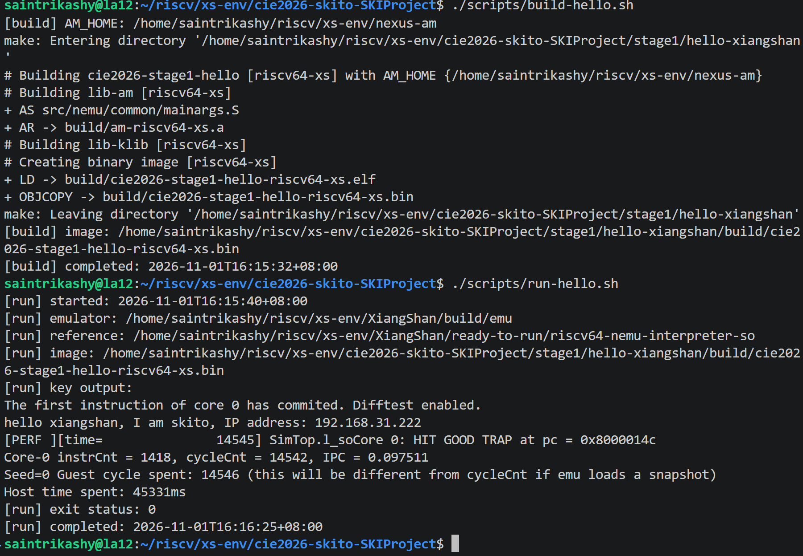
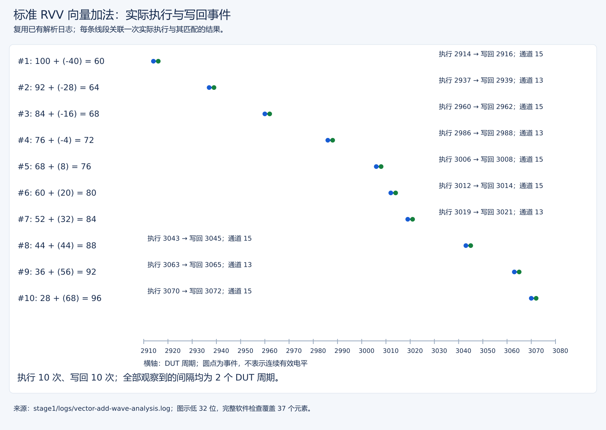

# 环境、依赖与 RVV 基线验收

本报告对应第一阶段的环境部署、Hello 输出和标准向量加法验证。基线环境与保留的 vdot v0.1 核分别完成 Hello 检查，各自的结果和截图独立列明。

## 1. 环境与仓库关系

作品为 `cie2026-skito-SKIProject`，团队/TEAM_ID 为 `skito`，目标为香山昆明湖 V2。作品目录位于 `xs-env` 根目录，和下列依赖同级：

| 目录 | 用途 |
| --- | --- |
| `../XiangShan` | RTL、模块测试及整核仿真 |
| `../NEMU` | 指令参考模型及 Difftest |
| `../nexus-am` | 裸机编译与运行时 |
| `../NutShell` | 初期环境自检 |
| `../XiangShanLab` | 官方提交材料仓库，与作品公有仓库分开 |

工具版本和固定依赖提交号以[工具版本](../../manifest/tool-versions.txt)、[提交号记录](../../manifest/submodule-commits.txt)为准；仓库历史关系见[原关系表](../../manifest/仓库关系.md)。初次记录的开发机 IP `192.168.31.222` 是历史值，当前应通过 `hostname -I` 或 `ip -4 -brief address show scope global`查询。

早期 coreutils 的 `sync -d` 调用兼容性修正见[部署日志](环境部署与操作日志.md)。该修正用于环境适配，不涉及向量指令功能。

## 2. Hello 与差分闭环

历史 MicroBench 十项测试在 NutShell 与 XiangShan/NEMU 链路通过。独立 Hello 程序为 `stage1/hello-xiangshan/main.c`，验收关键输出为团队/IP信息、`HIT GOOD TRAP`和退出 0。

Hello 实测：1418 条指令、8148 DUT 周期、GOOD TRAP PC=`0x8000014c`、退出 0。 环境检查记录 Git、GCC、Clang、Java、Verilator、交叉 GCC、emu/ref 和 AM 构建入口通过。

重新构建并运行 Hello，使用保留的 v0.1 核 `XiangShan/build/emu` 和随附参考库。终端截图显示差分开启、指定团队/IP 输出、GOOD TRAP 和退出码 0：



| 验证配置 | 指令数 | 核周期 | 结束状态 | 文本证据 |
| --- | ---: | ---: | --- | --- |
| 初始基线核 | 1418 | 8148 | GOOD TRAP，退出 0 | [初次运行](../logs/20260922-hello-run.log) |
| 保留的 v0.1 核 | 1418 | 14542 | GOOD TRAP，退出 0 | [构建](../logs/20261101-hello-build.log)、[运行](../logs/20261101-hello-run.log) |
| 独立工作树重建的 e8/e16 核 | 1418 | 14542 | Difftest、GOOD TRAP，退出 0 | [本轮独立运行](../../stage2/logs/clean-reproduction/hello.full.log) |

截图对应第二行，guest 周期为 14546，宿主耗时 45331 ms。两次周期不合并比较；Hello 验证环境和差分链路，不执行 vdot，也不用于衡量点积加速比。图中 IP 为程序输出的地址字段。

从**作品仓库根目录**使用以下入口；它们属于重新构建/运行，会产生新产物，不是只读复查：

```bash
bash scripts/verify-stage1-env.sh
bash scripts/build-hello.sh
bash scripts/run-hello.sh
```

部署过程见[环境部署与操作日志](环境部署与操作日志.md)，工具检查见[环境检查日志](../logs/environment-check.log)。上述分别保存的日志用于区分初次基线和补充运行；通用 `hello-run.log` 会由运行脚本更新。

## 3. 标准 RVV 向量加法基线

输入 37 个 int32：A[i]=3i−40，B[i]=100−2i，期望 C[i]=60+i。显式汇编执行 `vsetvli(e32,m1,ta,ma) → vle32.v → vadd.vv → vse32.v`，关闭编译器自动向量化，使目标指令可以明确定位。历史配置 VLMAX=4，37=9×4+1，覆盖尾块。

构建使用 `ARCH=riscv64-xs`、`MARCH=rv64gcv_zba`。 软件检查 first=60、last=96、checksum=2886，全部 37 项正确，5983 指令/22056 周期，GOOD TRAP PC=`0x8000026c`、退出 0。

后续独立工作树用新编译的 e8/e16 核和参考库再次通过同一 37 元素程序，结果为 5983 指令/27434 核周期，见[新运行日志](../../stage2/logs/clean-reproduction/vadd.full.log)和[完整复现报告](../../stage2/reports/公开包独立目录复现报告.md)。原基线周期、原窗口和十次执行/写回图保持原版本；新运行没有重新采集 vadd 整核波形。

```bash
bash scripts/build-vector-add.sh
bash scripts/run-vector-add.sh
```

成功必须联合具备 `vector-add PASS`、GOOD TRAP、退出 0 且没有 Difftest mismatch；仅看见加法数据不算整核通过。原过程和反汇编见[运行记录](向量加法指令执行过程.md)。

## 4. 波形与信号观察

目标 PC=`0x80000246`，编码=`0x02848557`；历史窗口为 2850–3300 cycle，VCD 大小 149536116 字节。

| 观察点 | 信号/判据 |
| --- | --- |
| 分派身份 | `io_toIssueBlock_vfUops_*_bits_pc/instr` 配对目标 PC/编码 |
| 执行接收 | `io_toExus_vf_*_valid && ready` |
| 配置 | `vsew=10` 即 SEW32，`vlmul=000` 即 LMUL1 |
| 操作数 | 执行通路 `src_0/src_1` 的 128 位输入 |
| 写回 | 当次使用的 `io_fromWB_wbData_13/15_valid` 及对应数据 |

执行周期为 2914、2937、2960、2986、3006、3012、3019、3043、3063、3070；对应写回均相隔 2 周期，共 10 执行/10 写回，与分块数相符。此间隔不是芯片实际频率或 vdot 延迟证明；端口编号属于当时配置。

```bash
bash scripts/dump-vector-add-wave.sh
bash scripts/analyze-vector-wave.sh
```

波形生成会重新仿真；查看/解析已有证据前检查脚本路径和输出保护，不盲目覆盖原 VCD。信号表、原命令与完整解释见[波形记录](向量加法波形分析.md)、[解析日志](../logs/vector-add-wave-analysis.log)。大文件查看见[Surver 远程手册](../../stage2/docs/远程波形查看操作手册.md)。

### 关键图：执行与写回对应



蓝点为执行，绿点为写回。十对事件均相隔 2 个 DUT 周期；图中只画解析日志实际记录的事件，不补画未记录周期的信号电平。图的具体输入和来源见[波形分析](向量加法波形分析.md)。这张图证明标准 vadd 基线，不替代第三阶段的 RVV 点积基线。

## 5. 验收结论与材料清单

| 第一阶段要求 | 验证材料 | 结论 |
| --- | --- | --- |
| 环境部署与指定 Hello 输出 | 本报告截图、分别保存的 Hello 日志 | 输出符合要求，差分开启，正常退出 |
| 部署及操作过程 | [部署日志](环境部署与操作日志.md)、[环境检查](../logs/environment-check.log) | 构建、兼容处理及运行过程有记录 |
| 向量加法执行过程 | [执行文档](向量加法指令执行过程.md)、[波形分析](向量加法波形分析.md) | 37 个元素正确，10 次执行与 10 次写回对应 |

第一阶段证明工具链、标准向量指令和差分环境可用。自定义指令的设计与功能验证属于后续阶段，不由 Hello 或 vadd 的结果推导。
