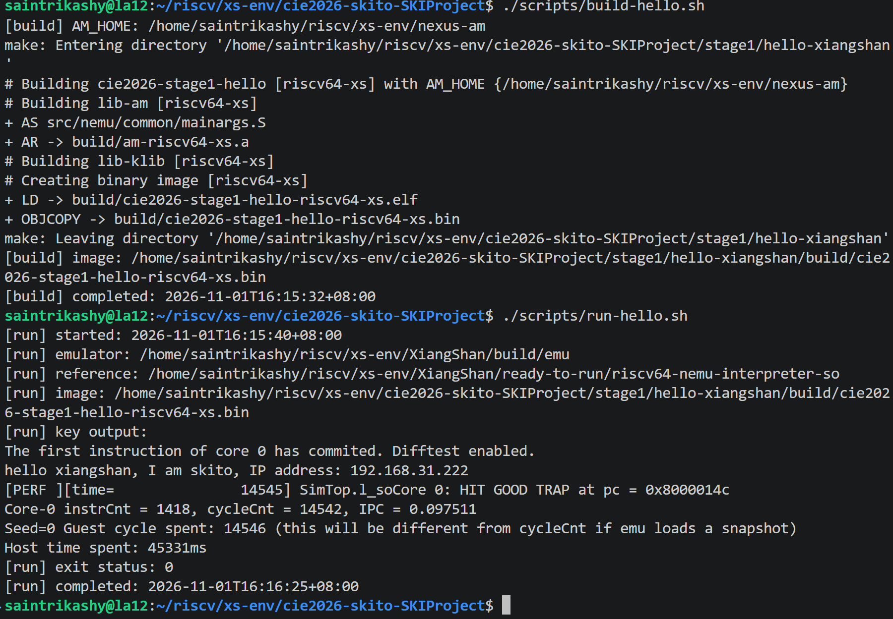

# 第一阶段环境部署与操作日志

## 1. 基本信息

- 团队名 / TEAM_ID：`skito`
- 项目名：`SKIProject`
- GitHub 用户名：`juese12`
- 初次部署记录的开发机 IPv4：`192.168.31.222`
- 工作仓库：`cie2026-skito-SKIProject`

IP 查询命令：

```bash
hostname -I
ip -4 -brief address show scope global
```

查询记录中的局域网地址为 `eth2: 192.168.31.222/24`。后续运行的程序输出保留该地址字段，不以历史输出代替实时网卡查询。

## 2. 建仓过程

作品代码在 `xs-env` 下单独建仓，与香山、NEMU 和裸机运行环境同级管理：

```bash
mkdir -p cie2026-skito-SKIProject
git init -b main cie2026-skito-SKIProject
git -C cie2026-skito-SKIProject config user.name juese12
git -C cie2026-skito-SKIProject config user.email juese12@users.noreply.github.com
```

作品仓库地址为 `https://github.com/juese12/cie2026-skito-SKIProject`。仓库与依赖关系见[工程说明](../../manifest/仓库关系.md)，提交材料入口见[作品总览](../../项目说明.md)。

## 3. 环境基线

### 3.1 工具与依赖

工具版本和依赖提交号分别记录在：

- `manifest/tool-versions.txt`
- `manifest/submodule-commits.txt`

### 3.2 基线程序验证

执行 `bash ./env-test.sh`，完成 NEMU 构建、Scala/Chisel RTL 生成和 NutShell 仿真。由于新版 coreutils 的 `sync` 参数语义变化，将 NutShell 的两处 `sync -d dir -d dir` 兼容性调用调整为 `sync -d dir dir` 后，MicroBench 的 10 个测试全部通过并出现：

```text
MicroBench PASS
HIT GOOD TRAP
```

随后在 `XiangShan/` 目录使用香山仿真器和随附参考模型运行同一 MicroBench：

```bash
./build/emu \
  --diff=./ready-to-run/riscv64-nemu-interpreter-so \
  -i ../nexus-am/apps/microbench/build/microbench-riscv64-xs.bin
```

结果为 10 项全部通过、`HIT GOOD TRAP`，说明 XiangShan + NEMU 差分闭环可用。

### 3.3 环境检查与标准向量指令验证

执行 `scripts/verify-stage1-env.sh`，Git、GCC、Clang、Java、Verilator、RISC-V GCC、香山仿真器、NEMU 参考模型及 nexus-am 构建入口均检查通过，见[环境检查日志](../logs/environment-check.log)。

同时完成标准 RVV `vadd.vv` 验证：37 个 `int32_t` 结果全部匹配，NEMU 差分无错误，程序以 `HIT GOOD TRAP`、退出码 0 结束。执行过程、反汇编和波形另见[向量加法执行过程](向量加法指令执行过程.md)及[波形分析](向量加法波形分析.md)。

## 4. Hello XiangShan 用例

### 4.1 程序与运行方法

源码位于 `stage1/hello-xiangshan/main.c`，独立于 `nexus-am` 原有示例，便于作品仓库管理和复现。

构建：

```bash
./scripts/build-hello.sh
```

运行：

```bash
./scripts/run-hello.sh
```

### 4.2 初次运行结果

[运行日志](../logs/20260922-hello-run.log)记录如下：

```text
hello xiangshan, I am skito, IP address: 192.168.31.222
Core 0: HIT GOOD TRAP at pc = 0x8000014c
Core-0 instrCnt = 1418, cycleCnt = 8148, IPC = 0.174030
[run] exit status: 0
```

程序按要求输出团队与 IP 信息，NEMU 差分未报错，仿真正常结束。

### 4.3 补充验证截图与结果

重新构建并运行 Hello，终端截图如下。截图与本次[构建日志](../logs/20261101-hello-build.log)、[运行日志](../logs/20261101-hello-run.log)对应。



图 1 中可以直接核对构建完成、`Difftest enabled`、团队/IP 输出、`HIT GOOD TRAP` 及 `[run] exit status: 0`。实际结果如下：

| 检查项 | 验证结果 |
| --- | --- |
| 输出内容 | `hello xiangshan, I am skito, IP address: 192.168.31.222` |
| 仿真核 | `XiangShan/build/emu`，即保留的 vdot v0.1 核 |
| 参考模型 | `XiangShan/ready-to-run/riscv64-nemu-interpreter-so` |
| 测试镜像 | `stage1/hello-xiangshan/build/cie2026-stage1-hello-riscv64-xs.bin` |
| 差分及结束 | 差分开启，GOOD TRAP PC=`0x8000014c`，退出码 0 |
| 指令与周期 | 1418 条指令，核周期 14542，guest 周期 14546 |
| 宿主耗时 | 45331 ms，不作为硬件性能指标 |

两次运行均通过 Hello 环境验证，但运行核不同，周期数分别保留，不互相替换。截图证明当前 Hello 构建和仿真链路正常；该程序没有执行 `vdot`，不作为点积计算或性能验证。
