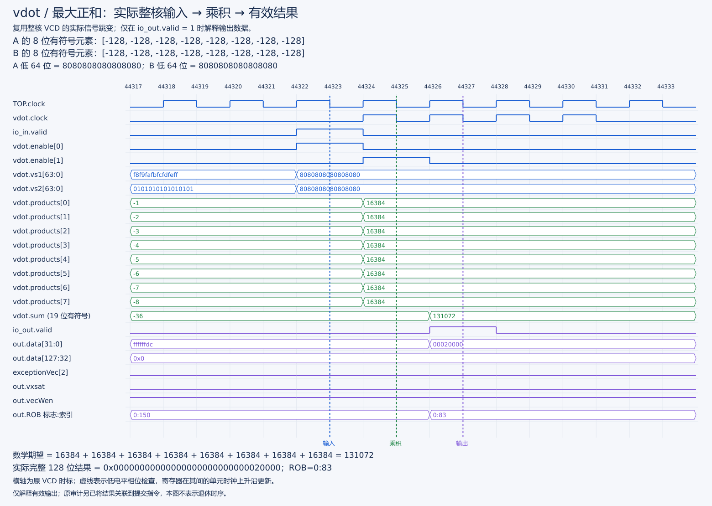
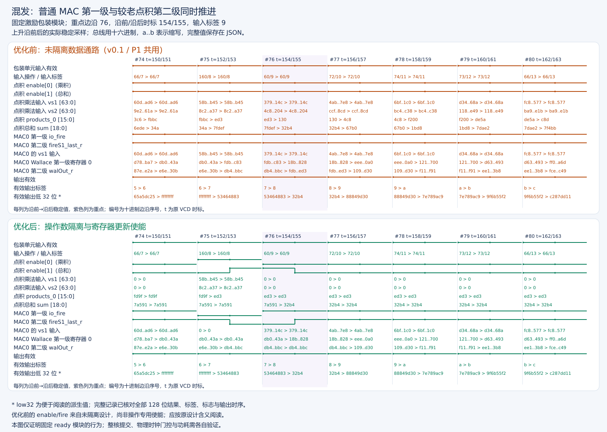

> 版本说明：本文为 v0.1 历史设计附件，正文中的“当前”“本轮”及待完成项均按该历史版本理解。正式参赛设计采用固定八项 e8/e16，见[当前主设计](vdot指令设计说明.md)和[提交阅读指南](../../docs/提交文档阅读指南.md)。下文 e8-only 限制不代表当前实现范围。

# vdot.vv 历史设计说明（v0.1，仅 e8）

版本：D0.1。团队：skito；项目：SKIProject。

状态：本设计已用于 v0.1 实施，RTL / NEMU / 裸机测试已落地，单测及整核完整差分（1,052 合法 + 10 非法）通过；新核等价性和本轮性能测量通过，PPA 未验收。实际操作与证据见[实施报告](../reports/vdot原始版本实施记录.md)，实施方法见[修改与操作手册](vdot历史集成操作手册v0.1.md)。下文提案用语保留原设计过程，当前完成状态以实施报告为准；赛题未明确语义仍为项目约定，不表示官方确认。

数据通路优化：当前源码增加点积/普通乘法分支操作数隔离和按指令类型的寄存器更新使能，不改变指令合同、两级延迟和输出选择。点积 S1 使能使用输入类型，S2 使用 `ctrlVec(1)` 类型；普通乘法保留原固定时间 `fire` 约定并排除点积，复用其内部 `fireS1`。不改 MGU 或物理时钟。详细设计、前后模块验证及尚未完成的整核/PPA 项见[隔离优化记录](../reports/操作数隔离与寄存器更新门控报告.md)；历史整核验收不自动覆盖本次优化源码。

## 1. 目标、依据与必须先确认的事项

目标是在香山昆明湖 V2 的既有向量后端内加入 `vdot.vv`，而不是在 CPU 外外挂一个绕过乱序调度和提交的加速器。复用译码、寄存器重命名、向量发射、执行接口、写回和精确异常机制；新增指令识别及整数点积逻辑。

### 1.1 赛题事实与工程提案分开记录

[赛题页面](https://rv.cie.org.cn/direction?id=8)及其[语义示意图](https://api.rv.cie.org.cn/storage/ueditor/20260615/bc72c5ea-d0b4-.png)给出 SEW=8、VLEN=128，示例计算两个源寄存器中 8 个有符号字节的点积，并将结果写到目标低位、其他通道清零。第二阶段要求设计说明、RTL 和正数/负数/边界测试；第三阶段要求 NEMU 协同验证及基线性能分析。

页面可以通过公开接口 `https://api.rv.cie.org.cn/api/subject/index?race_id=8`（请求头 `server: 1`，题目 id=36）核对。

以下内容在示例中没有被严格定义，不可直接称为官方规范：

| 待确认问题 | 本稿首版提案 | 改变后主要影响 |
| --- | --- | --- |
| VLEN=128 可装 16 个 int8，为何示例只计算 8 个？ | 严格按示例取低 8 项，高 8 字节不参与 | 乘法器数、加法树、测试、性能基线 |
| SEW=8 时“第一个元素”究竟多宽？ | 结果为低 32 位，高 96 位全零；不是截断到 8 位 | 输出打包、参考模型、结果读取 |
| VL 是固定 8、上限 8，还是任意长度？ | 只接受 VL=8 | 配置检查、零长度行为、拆分策略 |
| mask、LMUL、vstart 如何处理？ | vm=1、LMUL=1、vstart=0，其他情况报非法指令 | 依赖、掩码、归约与异常 |
| 编码由参赛者自选还是统一指定？ | 建议 custom-0 编码，见第 3 节 | RTL、NEMU、汇编必须同步 |

首版约束是为了形成可验证的实现合同，不构成“任意删减要求即可通过比赛”的承诺。实现前应确认上述问题；若评审要求更广语义，应先升级规范，再改代码。未明确处不能用“RVV 默认如此”代替决定。

### 1.2 源码基线

提交号是源码定位基准，不是仿真二进制来源证明；还要保存配置、未提交补丁和产物文件。当前目录存在既有修改，实施不能直接 reset、覆盖配置或升级所有子模块。目标名称为昆明湖 V2，并不意味着任意最新 NEMU 配置都能与此版本的 difftest 匹配。

## 2. 指令语义：首版实现合同

### 2.1 数学定义与寄存器布局

汇编记法采用 `vdot.vv vd, vs2, vs1`，次序与常见 RVV 算术记法一致；乘法在数学上可交换，但译码槽位仍必须固定。

```text
a[i] = signed_int8(vs1[8*i+7 : 8*i])
b[i] = signed_int8(vs2[8*i+7 : 8*i]) i = 0..7
S = Σ(a[i] * b[i]) 无 old_vd 加数
vd_new[31:0] = S 的 32 位二进制补码
vd_new[127:32] = 0
```

源寄存器 `[127:64]` 不参与计算；即使其值为全 1 或尾部不确定值，也不影响结果。目标是完整覆盖一个 128 位寄存器，不是只更新一个 SEW=8 元素。不要将其接成 `vmacc`：本指令没有 `old_vd + sum`。

| 对象 | 首版定义 |
| --- | --- |
| 源寄存器 | 两个完整的架构向量寄存器，实际使用各自低 64 位 |
| 目的寄存器 | 单个向量寄存器；不写整数寄存器、不访存 |
| 同名源/目的 | 允许 `vd=vs1`、`vd=vs2`、`vs1=vs2` 及三者相同；使用写入前的源值 |
| v0 | 是可读写向量寄存器，不是 x0；vm=1 不等于禁止源/目的为 v0 |
| 累加与舍入 | 精确有符号求和，无舍入、无饱和 |
| CSR | 不改变 vl、vtype、vxrm、vxsat；成功时 vstart 为 0，按现有机制更新向量状态 Dirty |

### 2.2 配置合法性与异常

合法执行条件为：向量状态已启用，`vill=0`、`vsew=0`（e8）、`vlmul=000`（m1）、`vl=8`、`vm=1`、`vstart=0`，构建目标 VLEN=128。

| 条件 | 首版行为 | 检查位置 |
| --- | --- | --- |
| VS=Off，或适用的虚拟化向量状态被关闭 | 非法指令，继承既有权限检查 | DecodeUnit / NEMU require_vector |
| vill=1、非 e8、非 m1、vm=0、vstart≠0 | 非法指令 | VecExceptionGen；执行端防御性复核 |
| VL=0、1..7、9..VLMAX | 非法指令，不是零结果或 no-op | 执行端读取本指令所依赖的真实 VL |
| vta/vma 任意组合 | 均接受，输出仍为低 32 位结果、高 96 位零 | 专用输出打包绕过普通合并 |
| 不匹配本指令族的编码 | 保持原有译码规则；未分配编码非法 | 精确匹配，不捕获整个 custom-0 |
| VLEN 非 128 的构建 | 首版 elaboration/assert 拒绝，或显式禁用此扩展 | 硬件构建及 NEMU 配置 |

这里的 VL=0 报错、全寄存器清零是自定义合同，不是一般 RVV 算术规则。`vta=1` 也不意味着硬件必须清零尾部；本设计不能依赖 agnostic 策略得到确定性零值。

异常时不提交目的寄存器结果，不改变源或向量配置；陷入入口按既有机制更新异常 CSR。乱序执行允许错误路径产生被丢弃的物理结果，但不能更新已提交的架构状态。不得自行把 vstart 清零后再报错，也不能将不支持的配置静默夹到 8。

### 2.3 位宽推导

单项输入范围 `[-128,127]`，乘积范围 `[-16256,16384]`。8 项和的实际范围：

```text
最小值 = 8 * (-128 * 127) = -130048
最大值 = 8 * (-128 * -128) = 131072
```

18 位有符号上界为 131071，恰好容不下最大值，必须至少使用 19 位有符号总和。输出符号扩展到 32 位，再在 32 位之外补零；负数不得符号扩展到整个 128 位。

建议位宽：8×`SInt(16.W)` 乘积 → 4×`SInt(17.W)` 两项和 → 2×`SInt(18.W)` 四项和 → 1×`SInt(19.W)` 八项和。Chisel 使用显式 `.asSInt`、扩位加法 `+&` 和明确的寄存器宽度，不能让普通 `+` 的结果宽度悄悄截掉进位。

### 2.4 信号字典

| 名称 | 含义及本设计用法 |
| --- | --- |
| VLEN / SEW / vsew | VLEN 是寄存器位数；SEW 是元素位数；vsew 是其编码，e8 对应 0，不是数值 8 |
| LMUL / vlmul | LMUL 为寄存器分组倍率；架构编码 m1=000。VecExceptionGen 内部 `LMUL` 是变换后的编码，m1 对应 100，不可混用 |
| VL / AVL / VLMAX | VL 为实际生效元素数；AVL 为软件请求；本配置 VLMAX=128/8=16，但本指令只接受 VL=8 |
| vm / vmask | vm=1 为无掩码；vm=0 表示使用 v0.t。首版不支持后者；源 v0 的数据依赖仍可能存在 |
| vstart | 本条指令的起始元素状态；本版只接受 0，不实现断点后缀求和 |
| vta / vma / vill | 尾部策略、掩码策略、非法 vtype 标志；前两者不改变本指令确定性输出 |
| vxrm / vxsat | 定点舍入模式 / 饱和黏滞状态；均不参与计算，结果事件 vxsat=false 不能解释为清除 CSR |
| fuType / fuOpType | 调度到哪类功能单元 / 该单元执行哪种操作；本版复用 vimac，新增唯一操作标识 |
| lsrc / ldest | 架构源/目的寄存器号，来自指令字段 |
| psrc / pdest | 重命名后的物理寄存器号；结果写 pdest，最终由提交确定架构映射 |
| oldVd | 旧目的值，用于普通向量合并或乘加；vdot 数学上不依赖它 |
| numUops / numWB | 单条指令产生的微操作数 / ROB 所需写回数；本指令均为 1 |
| uopIdx / vuopIdx / lastUop | 拆分索引 / 向量微操作索引 / 最后一条标记；本指令为 0 / 0 / true |
| vecWen / v0Wen | 普通向量寄存器 / 专用 v0 通路写使能，由 DecodeStage 按目的号分流 |
| robIdx / redirect | 微操作对应 ROB 项 / 冲刷重定向；必须和数据同拍到达，取消错误路径结果 |
| valid / ready / fire | 请求有效 / 接收能力 / 握手成功（valid && ready）；点积寄存器推进还必须服从既有固定延迟流水级使能 |
| srcVConfig / outVConfig | 经重命名依赖取得的向量配置数据 / 延迟对齐后的配置；运行时 VL 检查使用此处，不读一个可能过期的全局值 |
| isDependOldVd / isWritePartVd | 算术是否依赖旧目的 / 是否只写部分目的；vdot 都应为 false，因为整寄存器覆盖 |

## 3. 编码与内部操作标识

### 3.1 建议机器码：custom-0 中的一个精确子空间

RISC-V 将 custom-0..3 留给自定义扩展；保留编码与自定义编码不是一回事。因此首版建议使用 custom-0，不把 OP-V 中暂时未见使用的 funct6 宣称为永久安全空间。依据见[官方 opcode map](https://docs.riscv.org/reference/isa/v20260120/unpriv/rv-32-64g.html)。如果赛题另行指定 OP-V 编码，必须重新执行冲突检查并同步三端定义。

```text
31 26 25 24 20 19 15 14 12 11 7 6 0
+-----------+--+-----------+-----------+-------+-----------+------------+
| 000000 | vm | vs2 | vs1 | 010 | vd | 0001011 |
+-----------+--+-----------+-----------+-------+-----------+------------+
```

| 项目 | 值 |
| --- | --- |
| 指令族匹配（包含随后报错的 vm=0） | `MATCH=0x0000200b`，`MASK=0xfc00707f` |
| 合法 vm=1 匹配 | `MATCH=0x0200200b`，`MASK=0xfe00707f` |
| 族 BitPat | `b000000???????????010?????0001011` |
| 编码公式 | `0x0200200b | (vs2 << 20) | (vs1 << 15) | (vd << 7)` |
| 示例 | `vdot.vv v10,v9,v8` → `0x0294250b` |

这些是本项目候选常量，不是已注册的标准编码。实施前需对当前所有活动译码表进行掩码交集检查：两模式有交集当且仅当 `((matchA ^ matchB) & maskA & maskB) == 0`；也要查本平台其他 custom 扩展。当前源码人工检索没有证明全部可选配置都无冲突。

### 3.2 内部编码与软件机器码不可混淆

建议在 XiangShan 自有 `package.scala` 中新增 `VdotOpType.vdot`，候选 9 位 `0x160`。当前 `VimacType` 常规操作高两位填 0，候选使用高位区分，同时低位不会被解释为 widening。此值仍需唯一性断言，不扩展共享字段宽度。

执行端先完整比较 `fuOpType` 判断 vdot，再选择专用数据通路。不能仅用 `VimacType.getOpcode` 的低 3 位识别，否则会与普通 vmul 等混淆。首版不必修改 yunsuan 的标准操作枚举或乘法器内核。

建议新增 `UopSplitType.VEC_VDOT`，候选 `100110`（当前枚举未占用，仍须实施时检查），固定一条微操作。虽然合法 m1 可以复用 VEC_VVV，但专门的固定拆分可避免非法 m2/m4 输入先按 LMUL 扩展出多条操作，并清楚表达本指令并非逐元素乘法或标准归约。

## 4. 完整微架构通路

```text
裸机 C 测试 + 汇编机器码
        │ 编译、链接、生成 .bin
        ▼
前端取指 → 精确指令识别 → 向量复杂译码（固定 1 uop）
                              │ vs1/vs2/vd、vtype、异常信息
                              ▼
              DecodeStage 的 v0 分流 → 重命名（向量 / v0 / VL）
                              ▼
                  分派 → 向量发射队列 → 操作数读取
                              │ vs1、vs2、实际 VL、控制/ROB 标签
                              ▼
                   VFEX0 / FuType.vimac / VIMacU
                        ┌─────┴──────────────┐
                        │ 普通 vmul 等      │ vdot
                        │ 原 VIMac64b + MGU  │ 8 乘法 + 加法树
                        │                   │ 32 位结果 + 高位零
                        └─────┬──────────────┘
                           对齐后的输出选择
                              ▼
                既有写回、旁路、唤醒 → ROB 顺序提交
                              │
                              └── 与 NEMU 架构状态比较
```

### 4.1 取指与译码

32 位自定义编码沿正常取指通路进入，无需改变指令长度、I-cache、分支预测器。新增本地指令常量与 VecDecoder 表项，配置 `FuType.vimac`、自定义 fuOpType、两个向量源、向量目的、无标量写回、无饱和事件。

关键修改：`backend/decode/isa/bitfield/RiscvInst.scala` 的 `isVecArith` 当前只识别 OP-V。采用 custom-0 后必须加入“精确命中的 vdot 指令族”，不能把所有 custom-0 都认成向量指令。否则 VecDecoder 虽识别成功，UopInfoGen/DecodeStage 仍可能选错处理路径。

`VTypeGen` 中针对 OP-V 的判断用于识别 vset 指令，不应机械地扩展到 vdot；vdot 读取现有配置，不产生新 vtype。`isOPMVV` 等传统分类也不必把所有 custom 指令纳入，只对实际需要的调用点做处理。

### 4.2 单微操作与早期合法性

`UopInfoGen` 为 VEC_VDOT 显式产生 `numOfUop=1`、`numOfWB=1`；`DecodeUnitComp` 增加固定单寄存器源/目的映射，保证 `uopIdx=0`、`vuopIdx=0`、first/last 标志完整。不能直接套 `VEC_VRED`：其意义是既有归约的拆分和部分写语义，不是这条自定义指令的完整覆盖语义。

`VecExceptionGen` 合并自定义静态配置检查，保留原来的 VS/vill/vstart/寄存器合法性检查。此模块接口没有真实 VL，不能在此凭一个不明确来源的 VL 作最终判断。VL=8 检查放在执行端，通过 vconfig 数据依赖取得正确值。

### 4.3 重命名、v0 与旧目的依赖

使用既有向量 RAT 分配目的物理寄存器；源操作数必须指向写之前的映射，因此同名源/目的无需在硬件内提前清零。

本版本 `DecodeStage` 将 `ldest=0` 的向量写改为 `v0Wen`，并针对任意向量源为 v0 的情况设置专用源类型。vdot 必须经过这一通路。即使 vm=1，`vs1=v0` 仍然是有效的数据依赖，不能一刀切地屏蔽整个 v0 读取通路。

首版允许保留 VIMacU 的第三源 oldVd 结构接口，VecDecoder 可保守地沿用 oldVd 读取，但计算必须完全不使用它；这可能引入无必要等待，不影响值的正确性。将 `isDependOldVd=false`、`isWritePartVd=false`，允许既有分派/发射逻辑按其条件消除依赖。

后续可对 vdot 独立取消第三源依赖，前提是验证 SrcType 编码、v0 重定向和控制 bundle 的所有使用者；不能从全体 VimacCfg 删除第三源，否则 vmacc、保留尾部等普通指令会损坏。

### 4.4 调度与执行资源

当前 `Parameters.scala` 的 VFEX0 包含 VimacCfg。沿用 `FuType.vimac`，通常无需新增发射队列、物理寄存器端口、唤醒网络或写回仲裁端口；vdot 与普通整数向量乘法共享此执行资源。

`FuConfig.scala` 中 VimacCfg 已提供：128 位目的数据、向量/v0 写端口、VL 与 mask 唤醒、非法指令异常输出，且为 `CertainLatency(2)`。首版保持其接口延迟为 2，并把新运算流水线对齐到该合同。**两周期是现有接口和设计目标，不是新模块已经达到的综合时序结论，也不是整个 CPU 仅花两周期。**

活动实现是 `backend/fu/wrapper/VIMacU.scala`；同名 `backend/fu/vector/VIMacU.scala` 是注释掉的旧实现，不是接入目标。

### 4.5 结果合并与完整写回

现有 VIMacU 把普通乘法结果送入 `Mgu`，根据 SEW、VL、vstart、mask、ta/ma 合并 oldVd。vdot 的 32 位标量式结果与 SEW=8 配置不匹配，且要求高 96 位确定为零，因此专用结果必须在 MGU 之后独立选择：

```text
isVdotOut ? packedDotResult : mguResult
```

选择信号使用延迟对齐后的 `outCtrl.fuOpType`，不能使用当拍新指令的输入 `fuOpType`。同样，非法标志、ROB 标签、目的号、写使能均要对应同一条操作。普通指令继续走原通路。

vdot 的饱和事件输出必须为 false，已经为 1 的 vxsat CSR 保持为 1。当前有效通路由 VimacCfg 的 `writeVxsat` 提供结果字段，ROB 汇总事件后送到 CSR 的黏滞 OR 更新；不能只在旧式译码参数里填写一个 `vxsatWen=false` 就以为控制已接通，也不能关闭整个 VimacCfg 的饱和接口。异常输出选择 vdot 专用检查或普通 MGU 检查，并保留适用的公共异常，尤其不能因 Chisel 后赋值优先而覆盖基类 vstart 检查。避免自引用 exceptionVec，先组成独立布尔量再赋值。

### 4.6 旁路、提交、异常与冲刷

向量/v0 写回、数据旁路和唤醒沿用原协议。ROB 等待一次写回后可正常提交；非法指令交由既有异常路径处理，不能出现一条指令完成计数两次或无人完成。

点积单元不维护跨指令累加状态，不新增全局 CSR。冲刷由既有有效位、robIdx 与 redirect 机制处理，专用数据寄存器中的旧数值没有有效标签时不得写回。须测试 vdot 在途时的分支误预测、异常和连续混合操作，不能仅验证孤立算术。

当前 `Rename.scala` 根据非标量、非 AMOCAS 的拆分类型等条件生成 dirtyVs；ROB 提交时更新向量状态。因此 VEC_VDOT 要保留在向量类别中，不可为了“只有一条 uop”改成 SCA_SIM。`IssueQueue.scala` 在发射时把 payload.uopIdx/lastUop 填入 vpu.vuopIdx/lastUop，单 uop 的索引和末尾标志必须一路正确传到这里。

## 5. 点积数据通路与流水时序

### 5.1 首版：新增局部算术，复用后端接口

建议新增 `backend/fu/vector/VDot8.scala`，实现 8 路 signed 8×8 乘法和三级平衡加法树。此方案复用向量实现的控制、存储、调度和写回，但首版不承诺复用 yunsuan 内部乘法阵列；新增面积需要后续测量。

```text
vs1[63:0] ── 切成 8 个有符号字节 ─┐
                                   ├─ 8 × 16-bit 乘积 ── 第一级寄存
vs2[63:0] ── 切成 8 个有符号字节 ─┘
                                        │
                            4 × 17-bit 两项和
                                        │
                            2 × 18-bit 四项和
                                        │
                            1 × 19-bit 总和 ── 第二级寄存
                                        │
                       符号扩展为 32 位 / 前拼 96 个零
                                        │
                              128-bit 完整结果
```

初始流水切分为“乘法一级、加法树一级”。若综合发现第二级不能满足目标时钟，可以调整切分；不能私自增加一级却仍向调度器声明延迟 2。改变共享 VimacCfg 延迟还会影响普通乘法、唤醒和旁路，必须整体重新设计并回归。

### 5.2 对齐规则

| 相对阶段 | 数据 | 同步控制 |
| --- | --- | --- |
| 接收 | 两个源低 64 位、配置 | isVdot、robIdx、pdest、写使能、合法性 |
| 第 1 级 | 8 个 16 位乘积 | 同一条操作的有效位和控制 |
| 第 2 级 | 19 位点积和及 128 位打包结果 | outCtrl、outVConfig、异常与写回有效 |

设计目标为启动间隔 II=1，前提是共享执行接口允许连续发射且无冲刷/阻塞。外部操作数读取、排队、写回仲裁、ROB 提交都会增加程序观察到的延迟。

必须对照 `VecPipedFuncUnit` 与 `FuncUnit.HasPipelineReg` 的 `regEnable(i)`、`validPipe`、`ctrlPipe` 连接推进数据。现有 VIMac64b 使用自己的 fire 流水，不能照抄一个两拍 ShiftRegister 就认定与整个后端控制一致。要覆盖气泡、连续 vdot、vdot/vmul 交替、下游约束及冲刷；若设计依赖 ready 恒真，应先从接入点证明并加断言，而不是默认。

### 5.3 不选的首版方案

- 不取普通 vmul 的 SEW=8 输出再相加：每项可能已截为低 8 位，信息已丢失。
- 不取两个 64 位 VIMac64b 的完整输出直接当点积：当前输出面向逐元素乘法/乘加，不是 8 个完整 16 位乘积的规约接口。
- 不新增独立 FuType 作为第一步：会扩大端口、调度和唤醒配置修改面；只有明确需要并行吞吐时再评估。
- 不在软件外部偷偷算结果、跳过 difftest 或劫持写回：这不能验证指令实现。

## 6. 软件、参考模型与整体运行流程

### 6.1 首版软件入口

优先用独立 `.S` 文件封装固定寄存器版本，以 `.4byte` 或已验证支持的 `.insn` 发出机器码。无需先维护整套 GCC/LLVM fork。`.4byte` 只是让编译器发出比特，不会自动给 RTL 或 NEMU 增加语义；反汇编显示 `.word`/unknown 不一定表示编码失败。

调用顺序：裸机初始化并开启向量状态 → 设置 e8/m1/VL=8 → 装载两个 8 字节向量 → 执行候选机器码 → 将完整目的寄存器存到 16 字节缓冲区 → C 标量模型验证。

测试应使用 `vs1r.v` 保存整寄存器，或切换 e32/m1/VL=4 后存储四个 32 位字。不能在 e8/VL=8 下只保存 8 字节就声称已检查高 96 位；也不能在 e8 下用 vmv.x.s 读取结果并认为取到了完整 32 位。汇编函数需声明/记录 clobber 和 vtype/vl 改变，遵守调用约定。

### 6.2 NEMU 全通路

NEMU 至少需要同时接通：

1. `instr/decode.c` 的主 opcode 分派：custom-0 不会自动走 OP_V。
2. `instr/rvv/decode.h` 的向量操作数解析或专用解析器：正确提取 vs1/vs2/vd/vm 和 SRC_VV，不能仅按标量 R 型读取 GPR 值。
3. `include/isa-all-instr.h` 的执行 ID 注册。
4. `instr/rvv/vcompute.h` 的执行 helper，必要时提取到独立头文件并加入 exec.h。
5. 合法性、寄存器、向量状态更新以及参考共享库构建配置。

实现顺序：先检查 VS/vtype/vl/vm/vstart，再把全部源数据读入临时值并求和，最后清零目标并写入低 32 位；这样 `vd=vs1/vs2` 不会因先清零而破坏源。C 模型使用 int32_t 累加；从 uint8_t 明确转换为 -128..127，避免依赖 char 默认有符号性。使用本地 get/set_vreg 或明确的寄存器访问接口，不能把 `vsew=0` 传给结果写函数而只写了 8 位。

非法输入通过 `longjmp_exception(EX_II)` 等既有异常机制处理；不能 assert 崩溃宿主或直接返回。成功时按既有 helper 更新 vstart 和向量 Dirty 状态，保留 vxsat/vxrm/vl/vtype。使用 `CONFIG_RVV` 保护相关注册/实现，禁用 RVV 的构建仍须能编译。

### 6.3 差分闭环的版本条件

当前第一阶段脚本加载的是 `XiangShan/ready-to-run/riscv64-nemu-interpreter-so`。该预编译模型并未因此获得 vdot 支持；第二阶段新脚本必须明确接受新的参考库路径，并说明其版本。

初次设计核查时，本地 NEMU `.config` 未启用 RVV，因此当时不能宣称参考模型已准备好。后续已启用RVV（当前 `CONFIG_RVV=y`），匹配参考模型与新RTL的hello/vadd/vdot整核差分及正式测量已经通过，实际配置、ABI与版本见 [实施报告](../reports/vdot原始版本实施记录.md)。换版本时仍需从 `riscv64-xs-ref_defconfig` 和寄存器/CSR ABI、扩展集重新核查，先通过hello/vadd再调vdot；不能靠跳过新指令掩盖不一致。

整体闭环：同一 ELF/.bin 在 RTL 上执行 → 按架构提交驱动 NEMU → 比对完整向量寄存器及相关 CSR/异常 → C 测试再与独立标量 oracle 对比。两边同错仍可能差分通过，故独立 oracle 不可省。

## 7. 验证计划与验收标准

### 7.1 基础测试向量

所有行都要断言目标高 96 位为零。

| 编号 | A[0..7] | B[0..7] | 十进制结果 | 低 32 位 |
| --- | --- | --- | ---: | --- |
| P1 正数 | 1,2,3,4,5,6,7,8 | 1,1,1,1,1,1,1,1 | 36 | 0x00000024 |
| P2 非对称 | 1,2,3,4,5,6,7,8 | 8,7,6,5,4,3,2,1 | 120 | 0x00000078 |
| N1 负数 | -1,-2,-3,-4,-5,-6,-7,-8 | 全 1 | -36 | 0xffffffdc |
| B1 最大和 | 全 -128 | 全 -128 | 131072 | 0x00020000 |
| B2 最小和 | 全 -128 | 全 127 | -130048 | 0xfffe0400 |
| B3 正端点 | 全 127 | 全 127 | 129032 | 0x0001f808 |
| B4 零 | 全 0 | 任意 int8 | 0 | 0x00000000 |
| B5 抵消 | 127,-127,127,-127,127,-127,127,-127 | 全 1 | 0 | 0x00000000 |

### 7.2 必须补充的控制/集成测试

| 类别 | 覆盖内容 | 可发现的问题 |
| --- | --- | --- |
| 高位毒化 | 改变源高 64 位；目标预填非零；四种 ta/ma | 算错 16 项、未清零、误过 MGU |
| 寄存器重叠 | vd=vs1、vd=vs2、全部相同、最高号 v31 | 先写后读、错误寄存器组假设 |
| v0 通路 | vs1/vs2/vd 分别为 v0，vdot 写 v0 后作为 mask 使用 | v0 当 x0、专用寄存器通路漏接 |
| 配置依赖 | 紧邻 vset 改变 VL，8→0→8、8→16→8 | 读取过期 VL、缺少配置唤醒 |
| 非法配置 | SEW/LMUL/vill/vm/vstart/VS 各项及组合 | 静默误算、错误异常优先级 |
| 依赖链 | vdot→vector store、vdot→向量运算、源刚被写回 | 旁路和固定延迟声明错误 |
| 混合发射 | vdot/vmul/vmacc/vsmul 交替及连续发射 | 输入选择与输出控制错拍、饱和污染 |
| 冲刷与异常 | 在途分支重定向、年轻指令被取消、非法 vdot | 错误路径提交、ROB 等待不结束 |
| CSR | 初始 vxsat=0/1、vxrm 四值；检查 vl/vtype 不变 | 误清饱和 CSR、隐藏配置副作用 |
| 随机 | 固定种子至少 1000 对合法输入，完整输出比较 | 算术边角、符号或位序错误 |

负向测试需要捕获并检查非法指令 cause（通常为 2）、故障 PC、未修改的架构目的值，并安全跳过 4 字节故障指令；基础裸机 panic/GOOD TRAP 机制不能替代异常验收程序。VS=Off 测试应先恢复允许的状态再读取向量寄存器，不能在关闭状态下直接执行验证用向量存储。

实施补充：本固定版本的 DUT 在译码非法时保存指令位，在 vdot 的 VL-only 执行异常时没有 trapInstInfo，因此 mtval=0。后者属于特权规范允许的平台选择；参考模型精确建模该情形，其他非法指令保留原有 tval 行为，未屏蔽 CSR 差分。裸机与参考 API 对两类值分别作精确检查，见实施报告。

### 7.3 分层通过条件

1. 编码/译码：无冲突，字段正确，合法与非法配置均不会产生错误的多 uop 写回。
2. 算术单元：全部定向/随机值匹配独立模型，位宽和完整清零正确。
3. 流水与 wrapper：2 周期接口、气泡/混发/冲刷、数据与控制一致，异常不会被覆盖。
4. 整核：基础测试与既有 RVV 回归通过；正常测试同时有专用 PASS、GOOD TRAP、无差分错误。
5. 参考模型：匹配版本基线通过，再完成 vdot 差分，保留机器码、配置、文件、完整日志和关键波形。

本稿的原始计划不构成通过证据；当前实际测试结果、失败修正及覆盖范围以实施报告为准。第一阶段 vadd 证据只证明基线，不证明新增指令。

### 7.4 已有关键波形与设计对应



图只读已有 v0.1 整核 VCD：输入各八项 −128，八路乘积各为 16384，在第二级求和为 131072；输出有效时低 32 位 `00020000`、高 96 位零。这同时对应第 2 节的精确求和、19 位位宽和输出打包要求，不再用结果事件点代替计算过程。完整八组算术用例与判读见[基础功能测试报告](../reports/vdot基础功能测试与验收报告v0.1.md)。图中的物理输出不表示已提交时刻。



这张图直接复用隔离版真实 wrapper 测试图片：关注 #76，普通 MAC 输入有效、dot enable1 有效、dot enable0 无效，较老 dot 结果和 tag 仍正确输出。它对应第 5 节的控制/数据对齐规则，不证明整核提交或物理时序。oldVd 优化及隔离保持的其他图见[当前设计补充](vdot指令设计说明.md)；真实推测取消见[整核控制报告](../reports/隔离版本整核构建与控制验证报告.md)。

## 8. 等价基线、优化方向与取舍

### 8.1 等价 RVV 基线

基线必须得到精确 32 位和、高 96 位零，并使对外配置状态一致。普通 `vmul.vv(e8) + vredsum` 会先丢弃每项乘积高位，不等价。

已实现的基线：先以 e32/m1 将目标和 32 位 seed 寄存器清零；e8/m1、VL=8 执行 `vwmul.vv` 得到 e16 的双寄存器乘积组；切到 e16/m2、VL=8，以 `vwredsum.vs` 加零 seed 得到 e32 和，使用 tu 保留此前为零的目标其余位；最后恢复 e8/m1、VL=8。寄存器组必须对齐且不与输入/seed 非法重叠。实际实现见 `stage3/vdot-bench/bench.S`；双方独立 oracle、完整输出及最终 CSR 检查和四进程正式测量已通过，见 [v2 报告](../../stage3/reports/vdot正式性能实测报告v2.md)。

### 8.2 性能指标不能混为一谈

- 单元延迟：执行接口接收到结果有效，按波形测量；既有两级接口已通过 wrapper 测试和整核执行路径检查，但程序微基准周期比不能直接作为孤立单元延迟。
- 依赖链延迟：下一条真正使用结果的指令何时可执行。
- 吞吐：多条相互独立点积的稳态 cycles/dot，包括共享发射资源限制。
- 端到端：相同输入装载、配置、结果保存条件下的完整时间。

分别报告计算内核与端到端加速比 `baseline_cycles / vdot_cycles`；固定预热、循环次数、数据布局、仿真配置及计数方法。不能用仿真器宿主运行秒数当芯片执行延迟，不能拿“基线含配置与访存”对比“vdot 只算两拍”而不注明口径。

### 8.3 后续优化优先级

1. 正确性稳定后，去掉 vdot 独有的 oldVd 假依赖，并门控未使用的普通乘法通路，降低等待和切换。
2. 测量加法树关键路径；考虑乘法与部分加法重新分级、压缩树、时钟使能，保证声明延迟同步修改。
3. 面积较大时研究复用 yunsuan 的部分积/乘法阵列；需导出完整乘积或专用压缩结果，不能复用已截断输出。
4. 有吞吐证据后再评估专用 FuType、更多执行端口，权衡寄存器带宽、写回竞争和面积。
5. VL 可变、mask、16 项、更多 SEW/LMUL、累加型 vdot 均属于 ISA 扩展，必须重新定义位宽、结果布局、重启与基线；不能作为悄悄改变首版语义的优化。

尤其是非零 vstart：归约不能简单从 vstart 开始重算后缀，因为缺少前缀和。RVV 标准也对归约重启有专门限制；扩展前需完整定义状态，而非仅加一个循环起点。参见[官方向量规范](https://docs.riscv.org/reference/isa/v20260120/unpriv/v-st-ext.html)。

## 9. 源码参考与交付边界

以下链接固定到已核查版本，方便在仓库外阅读；具体修改位置以操作手册的路径和符号为准。

- [活动 VIMacU wrapper](https://github.com/OpenXiangShan/XiangShan/blob//src/main/scala/xiangshan/backend/fu/wrapper/VIMacU.scala)
- [FuConfig：端口、异常与延迟](https://github.com/OpenXiangShan/XiangShan/blob//src/main/scala/xiangshan/backend/fu/FuConfig.scala)
- [向量译码表](https://github.com/OpenXiangShan/XiangShan/blob//src/main/scala/xiangshan/backend/decode/VecDecoder.scala)
- [微操作数量生成](https://github.com/OpenXiangShan/XiangShan/blob//src/main/scala/xiangshan/backend/decode/UopInfoGen.scala)
- [NEMU 主译码入口](https://github.com/OpenXiangShan/NEMU/blob//src/isa/riscv64/instr/decode.c)

初稿阶段仅新增文档与导航。后续已实施 RTL、NEMU 与软件测试，实际修改和通过记录见实施报告；既有用户实验日志未被覆盖。
