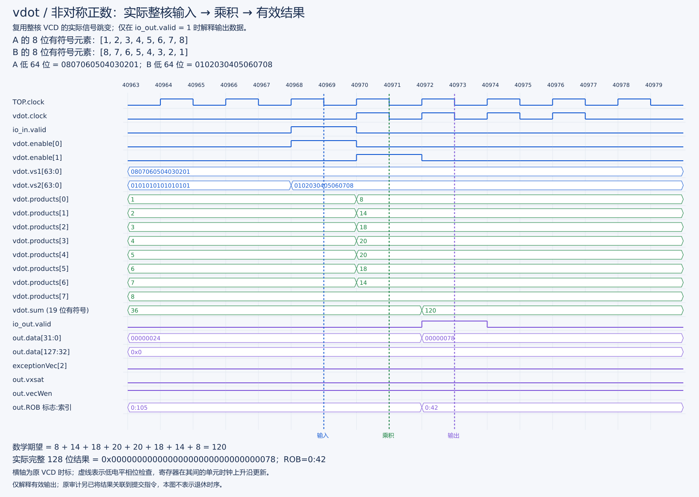

> 版本说明：本文为 v0.1 集成过程的历史附件，正文旧命令和阶段状态不作为当前操作依据。当前 e8/e16 功能入口为 `bash scripts/run-vdot-sew16.sh`，完整构建和运行见[当前操作手册](../sew16/固定八项e8e16扩展操作手册.md)，提交材料见[阅读指南](../../docs/提交文档阅读指南.md)。

# vdot.vv 历史集成操作手册（v0.1）

旧构建中间文件保存方式更新：用户已明确授权精简 `XiangShan/build/rtl/SimTop.fir` 和 `build/p1-oldvd/rtl/SimTop.fir`，执行情况见[存储清理台账](../../manifest/存储清理台账.md)。现有旧核与生成的 SystemVerilog 保留；下文若涉及直接复用旧 FIR，需要先恢复或用匹配版本重新生成。当前源码已升级为 e8/e16，不能直接将其重新生成结果当作 v0.1/P1。

版本：D0.1。配套历史规范：[v0.1 设计说明](vdot历史设计说明v0.1.md)；当前完整设计见[vdot.vv 设计说明](vdot指令设计说明.md)。

本手册回答“在哪里改、为什么改、按什么顺序做、怎样证明接通”。 起已按本手册实施 v0.1：RTL、三类单测、NEMU helper 和裸机测试均已创建；单测及新核完整差分（1,052 合法 + 10 非法）通过，整核波形 29 次执行/提交关联通过；新核等价性和本轮性能测量通过。下文“拟新增”为原设计计划用语，实际完成项、命令和失败记录以 [实施报告](../reports/vdot原始版本实施记录.md) 为准。示例预期值不等于实测结果。

### 操作数隔离与更新门控

此次仅改 `wrapper/VIMacU.scala`、`vector/VDot8.scala` 和相关测试。实施顺序为：相同 seed 扩展测试在旧 RTL 上通过并保存 before VCD → 在包装层拆分分支使能/隔离普通输入，在点积内部隔离低 64 位 → 重跑算术/混合/译码测试 → 对照输入、有效输出及内部禁用寄存器保持 → 导出独立命名补丁。

详细命令、操作日志和验收边界见[隔离优化记录](../reports/操作数隔离与寄存器更新门控报告.md)。本轮不修改共享流水、MGU、NEMU 或 yunsuan；不把 `RegEnable` 宣称为物理时钟门控。补丁导出使用 `bash scripts/export-vdot-patches.sh --xiangshan-only operand-isolation`，保留原 v0.1 和 P1 补丁。整核必须另建产物，不能拿既有 `build/emu` 或 `build/p1-oldvd/emu` 验收修改后的 Scala 源码。

### 本次执行入口与差异

`scripts/vdot-step.sh` 将执行记录追加到 `stage2/logs/operations.tsv`，不覆盖旧日志。`build-vdot.sh` / `run-vdot.sh` 已实现，`build-vdot-smoke.sh` 额外提供 52 合法 + 10 非法的快速集成检查；默认全量仍为 1,052 合法 + 10 非法。

参考库使用新增 `NEMU/configs/vdot-v0.1_defconfig`：基于 xs-ref，开启 RVV/VCSR 检查并将 NMIE 初值设为 1，以匹配旧 DUT ROM；新增 flash-v2 API 传入 DUT 实际 ROM，解决新旧 ROM 指令不同的问题。不要继续直接使用不认识 vdot 的 ready-to-run 库。

`export-vdot-patches.sh` 导出包含新增文件的两个补丁，不提交文件、不修改 Git 索引、不包含用户原有 difftest 改动。`dump-vdot-wave.sh` / `analyze-vdot-wave.sh` 已创建，按指定实际周期窗口采集真实 CPU 的完整相位与提交 trace；实际通过记录以报告为准，不将旧 vadd 波形当作 vdot 证据。

针对低内存环境提供 `build-vdot-rtl-separated.sh`：先由 Java 输出 CHIRRTL 并退出，再独立 firtool，最后运行 `finish-vdot-rtl.sh` 完成 SRAM/断言/C++ 构建。`--target chirrtl` 已通过生成器 help 核对，但**整条新脚本尚未端到端运行验证**。本次已通过的是复用首次生成 FIR 的独立 firtool、SRAM/断言后处理、单线程 Verilator/C++ 与链接。完整命令与结果见实施报告，不应把未来构建入口当作已通过的证据。

DRAMsim3 必须用 `-DCOSIM=ON` 编译静态库，默认库不包含香山需要的 `ComplexCoDRAMsim3`，会在最后链接失败。`prepare-vdot-dramsim.sh` 已实测通过并加入构建入口的预检。需要 cmake 可执行程序；也可设置 `VDOT_CMAKE` 为本地解包路径，并由调用环境设置其所需 `LD_LIBRARY_PATH`。本次使用本地 CMake 4.2.3，并以 `-DCMAKE_POLICY_VERSION_MINIMUM=3.5` 兼容原工程，无系统安装。

整核非法指令 tval 的平台细节：VDot8/VIMacU 的 VL-only 异常写 mtval=0，译码阶段的非法配置写指令编码。NEMU 精确建模两种情况，裸机负例分别精确检查，未关闭 CSR 差分。首次 mtval 差分失败和修正证据见实施报告。

`validate-vdot-core.sh` 顺序执行新核 vadd、vdot 烟雾、全量及基准，并用 flock 防重复。对话可能中断时可用 `setsid nohup` 启动独立后台会话并保留日志；每一步失败立即停止，不能把队列已启动当作已完成。

## 1. 开始前的约束与交付路线

先确认设计说明第 1 节的语义问题，再按下列关卡推进。每个关卡保留源码版本、实际命令、完整输出及结论；失败时停在对应层排查，不应一开始就反复重建整核。

```text
G0 语义/版本固定
  → G1 编码与译码单测
  → G2 点积算术与流水单测
  → G3 wrapper/异常/写回集成
  → G4 整核基础测试与旧指令回归
  → G5 NEMU 匹配基线 + vdot 差分
  → G6 等价基线与性能分析
```

G5 是第三阶段交付，但可提前做以减少 G4 调试成本。若要先交第二阶段，可使用显式关闭差分的独立仿真配置执行 C 自检；必须标为“RTL 自检、无 NEMU 差分”，保留真正的 RTL 执行/写回证据。不得加载不认识 vdot 的旧参考库后跳过该指令，或称自检为协同验证。

### 1.1 工作区保护

当前作品仓库已有 `stage1/logs/hello-build.log`、`hello-run.log` 的未提交修改；其他子仓库也有本地改动。首先查看状态，不覆盖它们。不要为了套教程而执行全量 `git reset --hard`、`git checkout --`、递归更新子模块或清空 build。

本次文档不运行构建，不修改上述日志、RTL 或 NEMU。未来构建可能覆盖 `XiangShan/build/emu`、`NEMU/.config`、参考模型和日志，必须先保存基线，使用新的运行目录。

### 1.2 路径约定

以下路径以 `xs-env` 为工作区根目录：

| 简称 | 根目录 |
| --- | --- |
| XS | `XiangShan/src/main/scala/xiangshan/` |
| NM | `NEMU/src/isa/riscv64/` |
| PROJECT | `cie2026-skito-SKIProject/` |

本手册用符号名定位，不依赖会漂移的行号。首选 `rg` 查找，确认命中的是当前活动实现。

## 2. RTL 逐文件修改清单

“必须改”基于本稿 custom-0 + 独立固定拆分 + 复用 vimac 的方案；若编码或语义改变，应重新审查整个表。

| 文件 / 定位符号 | 动作 | 修改原因与验收重点 |
| --- | --- | --- |
| XS `backend/decode/Instructions.scala` | 必须改：新增独立对象，如 `XVDot`，放置族/合法 BitPat | 统一指令识别，避免多处手写位模式漂移；不必改 rocket-chip 标准表 |
| XS `backend/decode/isa/bitfield/RiscvInst.scala` / `isVecArith` | 必须改：加入精确 vdot 识别 | custom-0 默认不在 OP-V 通路；不能将整个 custom-0 判成向量 |
| XS `package.scala` | 必须改：`VdotOpType` 和 `UopSplitType.VEC_VDOT` | 分离外部机器码、内部操作码和拆分码；候选 0x160/100110 均要唯一性检查 |
| XS `backend/decode/VecDecoder.scala` / OPMVV 表 | 必须改：新增表项 | 向量源、向量目的、vimac、无标量写/饱和写、固定拆分；布尔项建议使用命名参数 |
| XS `backend/decode/DecodeUnit.scala` | 必须审查，必要时增加 vdot 专用控制 | 核查表导入、srcType/lsrc、isDependOldVd/isWritePartVd、needFrm；不要误置为普通归约、乘加或浮点 |
| XS `backend/decode/UopInfoGen.scala` / `numOfUop` | 必须改：VEC_VDOT → 1 | numOfWB 同为 1；非法 m2/m4 也不应按 LMUL 生成多条 dot |
| XS `backend/decode/DecodeUnitComp.scala` | 必须改：固定单 uop 分支 | 源和目的不加组偏移；复核 first/last、uopIdx/vuopIdx 生成链 |
| XS `backend/decode/VecExceptionGen.scala` | 必须改：并入自定义合法性检查 | e8/m1、vm、vstart、vill；保留公共检查，不使用本模块没有提供的 VL |
| XS `backend/fu/vector/VDot8.scala` | 拟新增 | 8 个 signed 乘积、19 位和、显式流水使能；128 位打包可在此或 wrapper 做，但只定义一次 |
| XS `backend/fu/wrapper/VIMacU.scala` | 必须改 | 实例化 VDot8，完整 fuOpType 选择、真实 VL 检查、输出绕过 MGU、控制对齐、异常与 vxsat 输出 |
| `XiangShan/src/test/scala/xiangshan/backend/fu/vector/VDot8Test.scala` | 拟新增 | 独立数学 oracle、定向/随机输入、气泡与两级对齐 |
| `XiangShan/src/test/scala/xiangshan/VDotDecodeTest.scala` | 拟新增 | 编码、isVecArith、源类型、拆分数量、v0、非法配置；可拆成多个类 |
| `XiangShan/src/test/scala/xiangshan/backend/fu/vector/VDotIntegrationTest.scala` | 拟新增 | wrapper 混发、异常、完整写回与冲刷；整核测试补足单测无法覆盖的协议 |

### 2.1 需要核查和回归、首版通常不改的通路

| 文件/模块 | 为什么仍在“完整通路”范围内 | 保持不改的前提 |
| --- | --- | --- |
| XS `backend/decode/DecodeStage.scala` | 目的 v0 分流、源 v0 特判、RAT 读地址 | 新指令走标准向量入口，v0 定向测试通过 |
| XS `backend/rename/` | 处理源/目的重叠、配置依赖和物理分配 | 使用现有向量/v0/VL 寄存器类别 |
| XS `backend/dispatch/NewDispatch.scala` | 有条件忽略 oldVd 依赖 | vdot 标志准确；不修改其他指令条件 |
| XS `backend/issue/EntryBundles.scala` | 同样存在 oldVd 唤醒与忽略逻辑 | 保留真实 vs1/vs2/VL 依赖 |
| XS `backend/issue/IssueQueue.scala` | 将 payload.uopIdx/lastUop 传入向量执行控制 | VEC_VDOT 单 uop 的索引为 0、末尾标志为 true |
| XS `backend/datapath/` 与执行单元连接 | 操作数读出、旁路、端口有效 | 不新增源数量，不改变数据宽度或延迟合同 |
| XS `backend/fu/FuConfig.scala` / VimacCfg | 两周期、128 位写回、v0/VL/异常接口 | 新模块确实满足当前配置，不只改数据却改延迟 |
| XS `Parameters.scala` / VFEX0 | 决定有哪些执行资源 | 继续使用 FuType.vimac，不新增独立 FuType |
| XS `backend/fu/vector/VecPipedFuncUnit.scala` | 提供源、outCtrl/outVConfig 等延迟别名 | 数据流水服从它所使用的控制管线 |
| XS `backend/fu/FuncUnit.scala` / HasPipelineReg | valid、ready、ctrlPipe、regEnable、公共异常 | 新结果不绕过有效位和 ROB 标签；不覆盖适用公共异常 |
| XS `backend/fu/vector/Mgu.scala` | 普通向量指令尾部/mask 合并 | vdot 在其后选择专用输出；不修改通用 MGU 语义 |
| XS `backend/rob/`、CSR 和 difftest 接口 | 精确提交、异常、Dirty 状态、差分 | 新指令不新增架构状态，沿用既有事件 |
| XS `backend/fu/NewCSR/Unprivileged.scala` / vcsr | 提交的 vxsat 事件与原状态作 OR | vdot 事件为 false，保留整个 VimacCfg 饱和接口供旧指令使用 |
| XS `backend/decode/VTypeGen.scala` | 生成/预测 vset 的配置 | vdot 不生成 vtype，不能把 custom-0 当成 vset |
| `XiangShan/yunsuan/.../VIMac64b.scala` 和 `package.scala` | 当前普通整数向量乘法实现 | 首版新增局部算术，不修改原有 yunsuan 接口 |

若任何前提不成立，应扩展修改范围并更新设计文档，而不是继续声称这些路径“肯定不用改”。特别注意：`XS backend/fu/vector/VIMacU.scala` 是注释掉的旧实现，不能当作实际执行路径。

## 3. 软件、NEMU、验证与交付文件清单

| 文件 | 动作与原因 |
| --- | --- |
| NM `instr/decode.c` | 在 CONFIG_RVV 下增加精确 custom-0 族入口；只改 rvv 子表不能接通主译码 |
| NM `instr/rvv/decode.h` | 复用 OP_V 的操作数解析或新增专用解析；定义 SRC_VV、vm、寄存器号，再分派 vdot |
| NM `include/isa-all-instr.h` | 在 RVV 执行 ID 宏中注册 vdot，避免只有 helper 没有执行入口 |
| NM `instr/rvv/vcompute.h` | 新增 vdot helper；所有检查在写状态前，先读完源再清目的 |
| NM `instr/rvv/exec.h` | 仅在 helper 放进独立新文件时增加 include；放在 vcompute.h 中则不必改 |
| NM `instr/rvv/vreg.h`、`vreg_impl.c`、`vcompute_impl.h/.c` | 复用寄存器访问、require_vector、异常、Dirty 机制；不新造一套向量状态 |
| NM `local-include/encoding.h` | 如项目采用 MATCH/MASK 统一定义或反汇编接入则同步；单独改此文件不构成译码实现 |
| `NEMU/configs/` | 在已证明兼容的参考配置基础上保存项目配置；不能覆盖现有用户配置后忘记来源 |
| `NEMU/src/isa/riscv64/difftest/ref.c`、两侧 difftest 状态定义 | 首版不应因 vdot 新增寄存器 ABI；若版本不匹配，作为独立兼容性问题处理 |
| PROJECT `stage2/vdot-tests/{Makefile,main.c,vdot.S}` | 拟新增；裸机入口、独立 C oracle、机器码封装、完整结果保存 |
| PROJECT `stage2/vdot-tests/trap.S` 等 | 拟新增或使用经过验证的异常框架；捕获负向用例 cause/PC，恢复执行 |
| PROJECT `scripts/build-vdot.sh`、`run-vdot.sh` | 参数化 RTL/参考库路径，检查构建产物并保存运行日志 |
| PROJECT `scripts/dump-vdot-wave.sh`、`analyze-vdot-wave.sh` | 拟新增；按实际 PC/周期定位并验证结果/控制，不能复用 vadd 固定窗口 |
| PROJECT `stage2/tests/` | 拟新增；编码冲突检查、定向向量表、随机种子及机器可读预期值 |
| PROJECT `stage2/patches/` | 后续导出 XiangShan/NEMU 补丁及基线说明，包括新增文件 |
| PROJECT `stage2/logs/`、`stage2/reports/` | 后续保存实测日志、测试统计、关键波形解析、已知限制 |
| PROJECT `stage3/` | 后续放 NEMU 差分报告、等价基线、性能原始数据和分析 |

GCC/binutils 首版不要求修改。若后续要支持真正的 `vdot.vv` 助记符或 intrinsic，才扩展汇编器/反汇编器/编译器描述；不能用机器码封装已经能工作的事实，宣称工具链完整支持新指令。

## 4. G0：保存环境与基线

以下是实施时可用的命令示例。本机根目录为 `/home/saintrikashy/riscv/xs-env`；在其他机器上替换为实际位置。不要使用 HOME 作为项目变量。

```bash
cd /home/saintrikashy/riscv/xs-env
source ./env.sh
export VDOT_PROJECT="$PWD/cie2026-skito-SKIProject"
export VDOT_RUN_DIR="$(mktemp -d "$VDOT_PROJECT/stage2/vdot-run.XXXXXX")"

git status --short
git -C XiangShan status --short
git -C NEMU status --short
git -C "$VDOT_PROJECT" status --short
git -C XiangShan rev-parse HEAD
git -C NEMU rev-parse HEAD
git -C XiangShan submodule status
```

保存版本输出、`git diff`、所有未跟踪源文件清单；diff 不包含未跟踪文件，不能只保存 diff 就认为所有工作都已备份。建议复制现有 NEMU `.config`、既有 emu 与参考库到新运行目录，并记录 ；不要覆盖预编译参考库。运行目录包含二进制，后续脚本应把它排除出 Git。

```bash
cp NEMU/.config "$VDOT_RUN_DIR/nemu.config.before"
cp XiangShan/build/emu "$VDOT_RUN_DIR/emu.before"
cp XiangShan/ready-to-run/riscv64-nemu-interpreter-so "$VDOT_RUN_DIR/ref.before.so"
```

这些命令假设第一阶段产物仍存在；不存在时先定位实际产物，不要随意从其他版本拿同名文件凑齐。

旧基线复跑优先直接调用备份产物并保存到新目录，避免覆盖 stage1 日志。测试镜像采用已有 vector-add 二进制，若不存在先按第一阶段构建说明构建并记录日志。

```bash
set -o pipefail
"$VDOT_RUN_DIR/emu.before" \
  --diff="$VDOT_RUN_DIR/ref.before.so" \
  -i "$VDOT_PROJECT/stage1/vector-add/build/cie2026-stage1-vector-add-riscv64-xs.bin" \
  2>&1 | tee "$VDOT_RUN_DIR/vadd-before.log"
```

验收：实际日志出现 `vector-add PASS`、`HIT GOOD TRAP`，且无差分错误。仅有进程退出码 0 不够。本关卡只保存旧基线；后续还必须测试新构建组合。

## 5. G1：先把机器码和译码做对

### 5.1 建立唯一编码定义

从设计说明第 3 节复制并交叉核对 MATCH/MASK/BitPat，而非分别凭记忆填写。使用位掩码交集算法扫描活动译码；对于生成或非字面量定义的表，补充 Scala 展开后的比较测试，不能只用文本 grep 证明无冲突。

候选机器码可在不构建 RTL 的情况下检查：

```bash
python3 -c 'w=0x0200200b | (9<<20) | (8<<15) | (10<<7); print(hex(w)); assert w==0x0294250b; assert (w & 0xfc00707f)==0x0000200b'
```

加入负例：改 opcode、funct6、funct3 后不误认；vm=0 仍识别为该指令族但按合同非法。检查寄存器字段四种边界 0/1/30/31。

### 5.2 译码控制验收

建议 OPMVV 表项保守保留旧目的源结构，使用命名参数表达 `fu=vimac`、自定义 `fuOp`、`xWen=false`、`vWen=true`、`mWen=false`、`uopSplitType=VEC_VDOT`；这里 mWen 是原表的控制项，不可凭名称将其理解为 vm。

追踪以下链，而不是只测表项命中：

```text
BitPat 命中 → isVecArith=true → isComplex 路由
→ numUops/numWB=1 → DecodeUnitComp 固定源/目的
→ DecodeStage 正确分流普通向量/v0 → 进入预期执行资源
```

检查 `src(0)=vs1`、`src(1)=vs2`，`isReverse/isNarrow/isExt/isMove/isDstMask=false`，`isDependOldVd/isWritePartVd=false`，不误使能浮点舍入；在 wrapper 的有效结果通路明确输出 vxsat=false，不依赖旧式译码参数名来保证饱和行。非法 SEW/LMUL/vstart 等的异常位必须存在，不生成多条实际点积。

## 6. G2/G3：实现算术与 wrapper，保住流水协议

### 6.1 实现顺序

1. 编写独立 VDot8 算术和单测，明确输入为 UInt 位串、每字节转 SInt 后相乘。
2. 验证 16→17→18→19 位逐级扩展，先过最大和 131072，再加随机数据。
3. 按两周期接口加入寄存器及级使能，控制和数据使用同一推进条件。
4. 在活动 VIMacU 实例化专用模块；普通操作继续使用原 vimacs。
5. 用输出端 isVdot 选择 `packedDotResult` 或 MGU 输出；同时选择对应异常/vxsat，确认公共异常不被覆盖。
6. 从 srcVConfig/outVConfig 取得匹配本指令的 VL，做 `VL==8` 检查。不能用当前正在译码的另一条指令的配置。
7. 加入混发、气泡、冲刷、v0、重命名重叠和旁路回归，再构建整核。

新单元不必直接知道 ROB 架构细节，但 wrapper 必须通过现有控制流水把结果绑定到正确 ROB/pdest。不能通过 `dontTouch` 波形信号代替真正的有效位控制。

### 6.2 关键断言

- 合法 vdot 的 uopIdx/vuopIdx 为 0、numWB=1，输出目的类型与输入一致。
- vdot 输出有效且无异常时，高 96 位为零。
- 输入最大值不会触发算术溢出或截断。
- 普通 vmul/vmacc/vsmul 的结果与改动前相同。
- 每条被接受且未冲刷的合法 vdot，只有一条匹配标签的有效结果；非法指令有异常完成通知，不能卡死 ROB。
- 不得对被冲刷操作产生架构提交；结果值可以留在无效物理流水寄存器中。
- 检查两周期对齐与可能的背压协议，不将“仿真中通常 ready=1”当作不需验证的前提。

### 6.3 单元测试命令

当前工程使用 Mill/ScalaTest，可参考现有 `ByteMaskTailGenTest.scala`。先在 XiangShan 目录用 `mill resolve 'xiangshan.test._'` 查看实际测试目标。下列命令在对应测试类创建后使用；若构建定义不同，以 resolve 输出修正，不假装测试类已经存在。

```bash
cd "$NOOP_HOME"
mill xiangshan.compile
mill xiangshan.test.testOnly xiangshan.backend.fu.vector.VDot8Test
mill xiangshan.test.testOnly xiangshan.VDotDecodeTest
mill xiangshan.test.testOnly xiangshan.backend.fu.vector.VDotIntegrationTest
```

输出中应有实际运行的测试数与通过数；只有 elaboration 或 emitVerilog 完成不等于测试通过。首版若未建立 wrapper 单测框架，必须记录缺口，并用整核控制定向测试补足，不能省略验证项目。

## 7. G4：软件用例、整核构建与执行

### 7.1 新建裸机测试工程

沿用 `stage1/vector-add/Makefile` 的 AM 接入方式和 `ARCH=riscv64-xs`；新 NAME 建议 `cie2026-stage2-vdot`。保持 scalar oracle 不自动向量化，编译选项可沿用 `-fno-tree-vectorize -fno-tree-slp-vectorize`。测试中使用 `<stdint.h>` 的明确类型，不使用可能改变符号性的普通 char。

在语义和编码正式确定后，首个汇编函数可以按下面顺序编写。这里只演示核心片段，不是包含向量初始化、函数 ABI 和异常处理的完整程序：

```asm
# a0 = 至少 16 字节的输出缓冲区，a1/a2 = 各至少 8 字节输入
# 前提：裸机已启用向量状态；函数允许改动 v8/v9/v10、vl/vtype
vsetivli zero, 8, e8, m1, ta, ma
vle8.v v8, (a1)
vle8.v v9, (a2)
.4byte 0x0294250b # 候选 vdot.vv v10,v9,v8
vs1r.v v10, (a0) # 保存整个 128 位寄存器
```

C 端至少比较四个 uint32_t：`out[0] == (uint32_t)expected` 且 `out[1..3] == 0`。对负数也比较二进制补码。目标预填非零、高源位毒化等测试需专门汇编构造，不能指望上面的最小片段自然覆盖。

未来构建命令（工程创建后）：

```bash
make -C "$VDOT_PROJECT/stage2/vdot-tests" ARCH=riscv64-xs
riscv64-unknown-elf-objdump -d \
  "$VDOT_PROJECT/stage2/vdot-tests/build/cie2026-stage2-vdot-riscv64-xs.elf"
```

如果实际工具链前缀或 ELF 文件名不同，按 Makefile 产物调整。用 `objdump -s` 核对目标 PC 的小端字节 `0b 25 94 02`；助记符未知本身不是失败。

### 7.2 整核构建

先记录原 emu 对应的 CONFIG、核心数、内存模型、TRACE 与 Verilator 参数；无法确认时不得把新默认构建和旧产物直接用于性能比较。当前 Makefile 默认 CONFIG=DefaultConfig，`make emu` 会先生成仿真 RTL，再调用 difftest 构建。

以下是显式单核 DefaultConfig 的候选构建命令，不是已证明与当前预编译 emu 同配置的命令。实施前核对资源容量和第一阶段配置，可按已记录的基线调整；不要为节省资源盲目选可能关闭向量单元的最小配置。

```bash
make -C "$NOOP_HOME" emu CONFIG=DefaultConfig NUM_CORES=1 \
  WITH_DRAMSIM3=1 WITH_CONSTANTIN=0 EMU_THREADS=2 -j2
```

`WITH_DRAMSIM3=1` 要求现有 DRAMsim3 依赖完整；`WITH_CONSTANTIN=0` 是此示例的明确选择，不是 vdot 的语义要求。构建失败先按日志处理资源/依赖/编译问题，不用清空整个工作区来“修复”。当前 difftest 的 Verilator 构建文件存在本地修改，应保留并记录。

构建后记录 emu 和 RTL 文件时间、文件及源码补丁；在生成 RTL 中查到 VDot8/相关逻辑仅说明生成了代码，尚不证明实际指令运行经过它。

## 8. G5：NEMU 扩展、参考库和差分执行

### 8.1 编写参考语义

本节对应实现已经完成，不是尚未落地的计划。参考语义与真实 RTL 输入/乘积/有效结果的图文对应见[NEMU 与协同仿真图解](../../stage3/reports/基线与vdot延迟加速图文分析.md)。NEMU 是指令级模型，不将 RTL 波形称为 NEMU 的逐拍波形。



示例八项乘积求和为 120，完整输出高 96 位零；该图只证明所选 v0.1 RTL 计算过程，NEMU 的执行结果以 API 测试和差分日志为准。

在 CONFIG_RVV 下实现完整入口链。建议用独立循环描述数学语义，不照搬硬件加法树，避免双方共有同一个索引错误。

```text
require_vector(true)
检查 e8 / m1 / VL=8 / vm=1 / vstart=0
读取源 0..7，明确按 int8 解释
用 int32 累加所有乘积
清空目标 128 位
写目标低 32 位
vstart 保持为 0；标记向量状态 Dirty
```

所有非法检查必须在写目标前完成。若使用 get/set_vreg，要注意其参数是 SEW 编码，不是位数；32 位结果应明确写 32 位视图。保留源快照或完成全部求和后才写目的，覆盖同名寄存器测试。

不要在通用 RVV 运算宏里替换所有尾部行为；只为 vdot 实现确定性的完整清零。NEMU 非法输入应进入客体异常，不应成为宿主 assert。

### 8.2 配置与 ABI 关卡

早期配置未启用 RVV，实施时已完成 RVV 参考库及 ABI 适配并通过 API/整核差分，当前结果见[统一功能验收](../reports/vdot功能与整核控制验收报告.md)。以下保留配置构建入口，供新环境复现；不是要求对现有参考库重新构建。修改配置前先完成第 4 节备份，并选择和此 XiangShan/difftest 版本匹配的配置：

```bash
make -C "$NEMU_HOME" riscv64-xs-ref_defconfig
make -C "$NEMU_HOME" -j2
```

检查实际生成配置中的 RVV、RVH、向量寄存器布局、CSR 扩展、共享库选项及 VLEN。新 NEMU 提交可能引入旧 difftest 没有的状态布局；`make` 成功不等于 ABI 兼容。如果 hello/vadd 在 vdot 之前就失败，优先定位版本/ABI/配置，不要改 vdot 算术去迎合错误参考状态。

如果必须换参考源码版本，先记录现有修改并在独立工作树或经确认的环境中操作；不得静默切换或覆盖用户仓库。重新跑标准基线证明兼容后，再将 vdot helper 移植到该版本，并更新版本表。

### 8.3 显式选择新参考库

假设实际产物是下列常用路径；运行前必须 `test -f` 确认并核对构建日志。不要继续调用写死 ready-to-run 参考库的第一阶段运行脚本来验证 vdot。

```bash
export VDOT_EMU="$NOOP_HOME/build/emu"
export VDOT_REF_SO="$NEMU_HOME/build/riscv64-nemu-interpreter-so"
export VDOT_IMAGE="$VDOT_PROJECT/stage2/vdot-tests/build/cie2026-stage2-vdot-riscv64-xs.bin"
test -f "$VDOT_EMU"
test -f "$VDOT_REF_SO"
test -f "$VDOT_IMAGE"
```

先用这对新 emu/ref 跑第一阶段 vadd（输出到新目录）；通过后执行：

```bash
set -o pipefail
"$VDOT_EMU" --diff="$VDOT_REF_SO" -i "$VDOT_IMAGE" \
  2>&1 | tee "$VDOT_RUN_DIR/vdot-diff.log"
```

拟新增 `run-vdot.sh` 应检查退出码、差分启用信息、约定的 `vdot PASS` 与 `HIT GOOD TRAP`，并拒绝 BAD TRAP/差分失配等错误。负向测试只有在捕获到预期异常并继续完成自检后才打印 PASS，不能把意外 trap 当作成功。

如果第二阶段先做无差分测试，单独构建经 Makefile 核实支持的无差分配置并保存其参数；不要想当然地认为省略 `--diff` 就关闭差分。此类日志必须明确标记 no-diff，不能用于 G5 验收。

## 9. 波形观察与故障定位

### 9.1 应观察的逻辑信号

先通过目标 PC/机器码定位执行窗口，再从生成的 VCD/FST 头中查真实层级名称。以下是逻辑关注点，不保证综合后的层级拼写一字不变：

| 层次 | 观察内容 | 预期 |
| --- | --- | --- |
| 译码 | instr、fuType、fuOpType、split、异常位 | 命中候选 vdot；1 uop |
| 读操作数 | vs1/vs2、psrc、VL 配置、vstart、vm | 低 8 字节与 C 输入一致；VL=8 |
| 执行输入 | valid/ready、robIdx、pdest、isVdot | 正确接收，无伪握手 |
| 算术 | 8 个乘积、两级寄存器、19 位总和 | 有符号值与独立 oracle 相符 |
| 执行输出 | outCtrl、outVl、out.valid、result、exception | 同一操作对齐；高 96 位零 |
| 写回/提交 | vecWen/v0Wen、目标号、ROB 完成/提交 | 一次完成；非法/冲刷不提交结果 |

第一阶段的 2850–3300 周期窗口属于 vadd，不能直接用于新程序。新波形脚本应参数化开始/结束周期，并按实际机器码对应 PC 定位；可参考已有 `dump-vector-add-wave.sh` 的参数形式，但新 emu 还要确认构建时启用了所需 trace 支持。

### 9.2 常见问题的排查顺序

| 现象 | 优先检查 |
| --- | --- |
| 立即非法指令 | 机器码、custom-0 主入口、扩展启用、VS/vill/VL/SEW/LMUL/vm/vstart；区分是 RTL 还是 NEMU 报错 |
| 译码命中但不执行 | isVecArith、复杂译码路由、numUops/numWB、发射资源与源就绪 |
| 结果像低 8 位截断 | 使用普通 vmul 输出、NEMU 结果写入 SEW、软件取数 SEW |
| 正数对、负数错 | 每字节符号解释、SInt 转换、扩位加法、输出符号扩展边界 |
| 只有最大和错 | 总和误用 18 位，131072 溢出 |
| 低 32 位对，高位错 | 仍通过 MGU、未完整覆盖目标、测试只存了部分字节 |
| 单条对、混发错 | 输出用输入 isVdot 选择、数据/控制/异常错拍、流水使能不一致 |
| vd=vs1/vs2 失败 | NEMU 先清目的、RTL 重命名/源选择错误 |
| 仅 v0 用例失败 | DecodeStage 分流被绕过、误删除 v0 数据依赖、错误写端口 |
| 修改 VL 后偶发异常 | VL 配置依赖没接、读取过期全局值 |
| ROB 卡死 | numWB 不一致、异常未通知完成、错误 gated valid |
| 新参考库连 vadd 都失败 | 首先检查 NEMU/difftest ABI、扩展配置和产物来源 |
| difftest 通过但 C 自检失败 | 两端同错、输出保存/调用约定错误、oracle 有误；三者独立排查 |
| 运行退出码为 0 但日志失败 | 验收脚本仅看退出码；必须联合 PASS/GOOD TRAP/错误扫描 |

## 10. G6：性能与交付包

按设计说明实现精确的 `vwmul + vwredsum` 基线，先逐用例证明与 vdot 一致，再计时。固定输入、寄存器预置、配置恢复、加载存储口径；保留原始 cycles、循环次数、空循环开销、波形窗口和随机种子。

性能报告应分开写单元延迟、依赖链、稳态吞吐和端到端耗时。原始日志没有测到的指标标为“未测”，不能把目标 II=1 或两周期 FU 配置直接写成加速比。

建议最终交付：

```text
stage2/
  README.md
  docs/                         本次已创建的两份文档
  vdot-tests/                   后续：C / 汇编 / Makefile / 异常测试
  tests/                        后续：编码检查、向量数据、种子
  patches/                      后续：RTL 补丁、基线提交和应用说明
  logs/                         后续：基础/边界/回归的文本证据
  reports/                      后续：覆盖表、波形摘要、已知限制
stage3/
  ...                           后续：NEMU 补丁、差分及性能报告
```

XiangShan/NEMU 是独立仓库或子模块，作品仓库不会自动保存它们的修改。交付必须包含可应用的补丁或明确可取得的提交，并包含所有新增文件。仅导出 `git diff` 会漏掉未跟踪的 VDot8.scala/测试文件；最终应在干净的匹配基线上做一次补丁应用检查和构建复现。不要为导出补丁自动提交或推送用户工作。

### 10.1 提交前核对表

- [ ] 官方未明确的语义已有确认记录，或在报告中明确披露实现范围与限制。
- [ ] 机器码、RTL、NEMU、软件与测试预期完全一致。
- [ ] 所有源码/依赖版本、配置、本地补丁和工具版本可追溯。
- [ ] 编码无冲突；所有关键控制路径和 v0/异常/冲刷已有证据。
- [ ] 正数、负数、端点、随机和旧 RVV 回归均有实际日志。
- [ ] 若声称差分通过，使用的是支持 vdot 且 ABI 匹配的新参考模型，未跳过目标指令。
- [ ] 波形包含目标机器码对应执行及写回，非只展示测试程序打印。
- [ ] 性能两侧功能等价、测试口径一致，原始数据可复算。
- [ ] 文档中“已完成/待完成”与实际文件、日志一致。
- [ ] 不提交大型 emu/VCD/临时运行目录、隐私资料或无关用户改动。

当前状态：本清单是正式提交核对门槛，不因文档编写自动完成。 已取得单测、完整整核差分、执行/提交波形和补丁检查证据，见 [功能验收摘要](../reports/vdot基础功能测试与验收报告v0.1.md)； 性能测量可信度 v2 与四进程正式验收已完成，见 [v2历史报告](../../stage3/reports/vdot正式性能实测报告v2.md)。PPA 与干净快照完整构建复现未取得，官方语义未确认。保留未勾选项，避免将提交门槛与本轮功能验收混淆。

## 11. 本次文档校验记录

已检查两份文档及导航中的本地 Markdown 链接、代码块闭合，以及机器码/BitPat/MATCH/MASK、小端字节和基础测试表的数学预期值。已重新核对 XiangShan、NEMU、nexus-am 的提交号及关键源码路径。

上述记录仅描述初次文档校验，不包含当时尚未执行的 Scala 编译、RTL 仿真、NEMU 构建或性能测量；后续实际执行结果见实施报告。既有 stage1 日志的本地修改保持不动。
