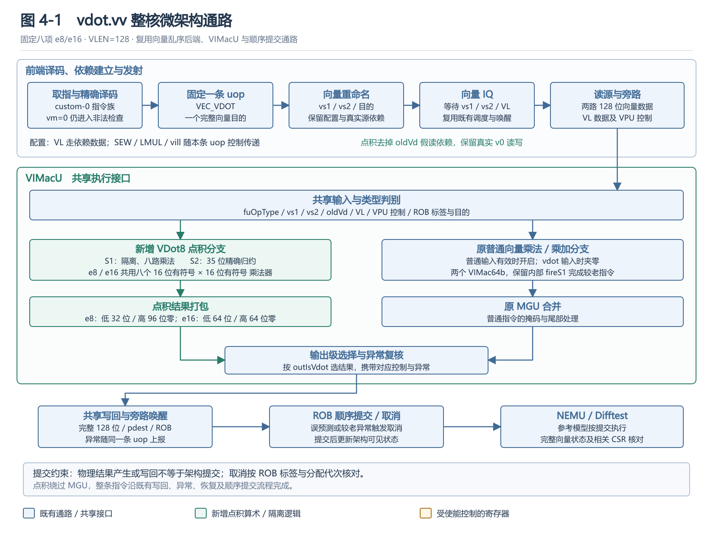
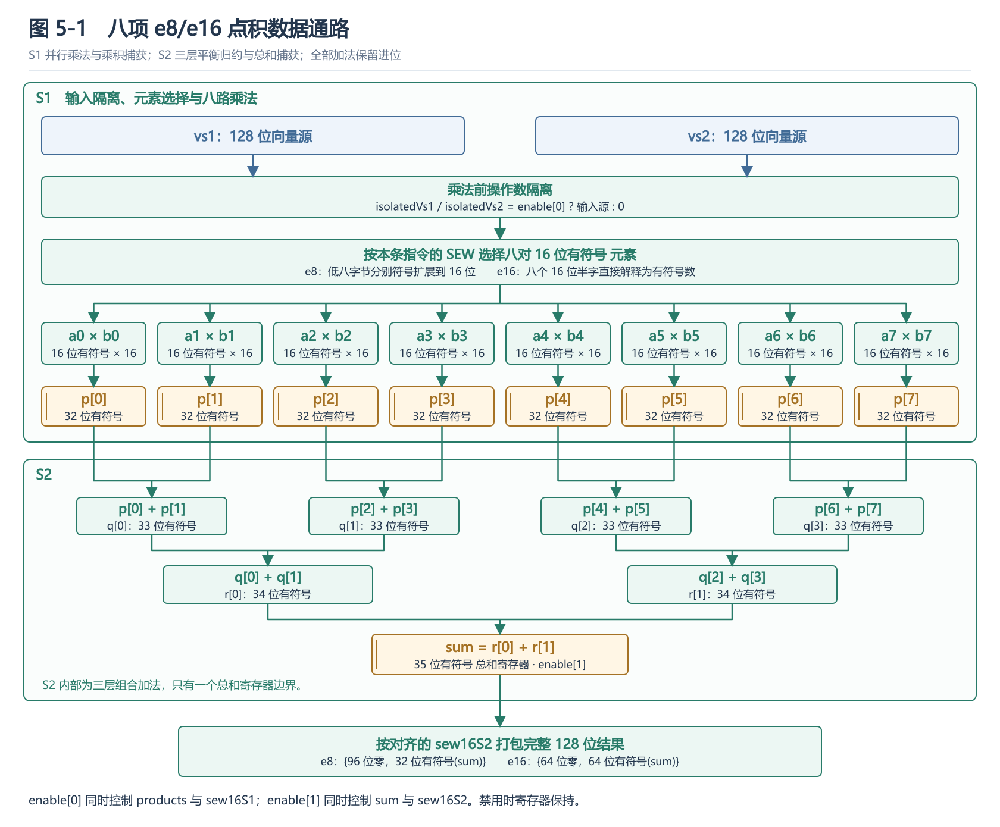
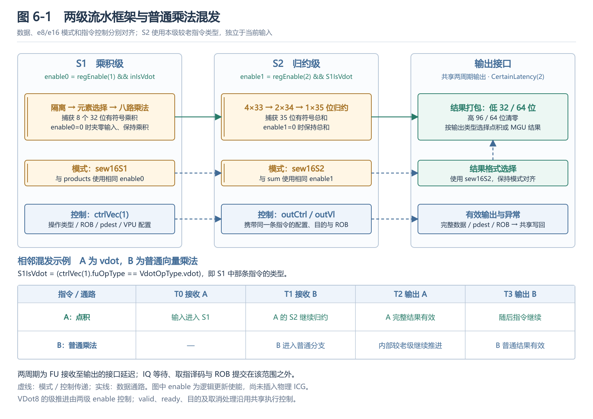
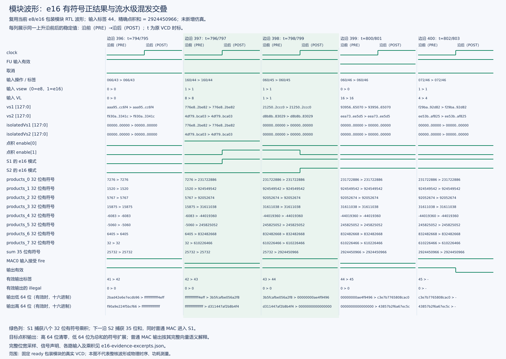
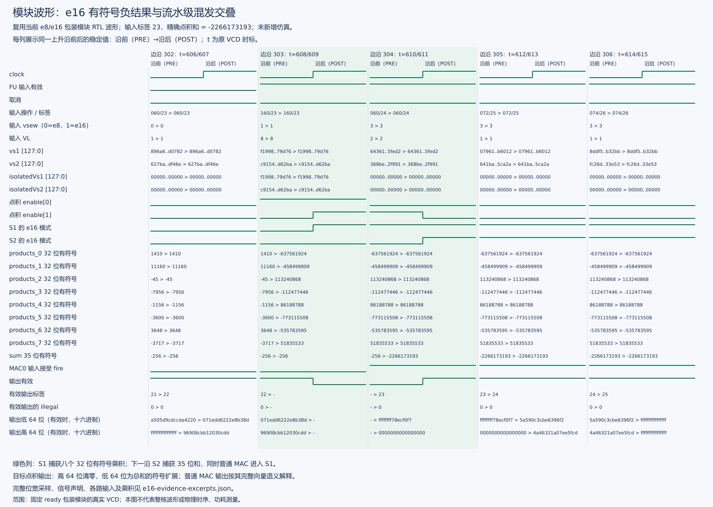
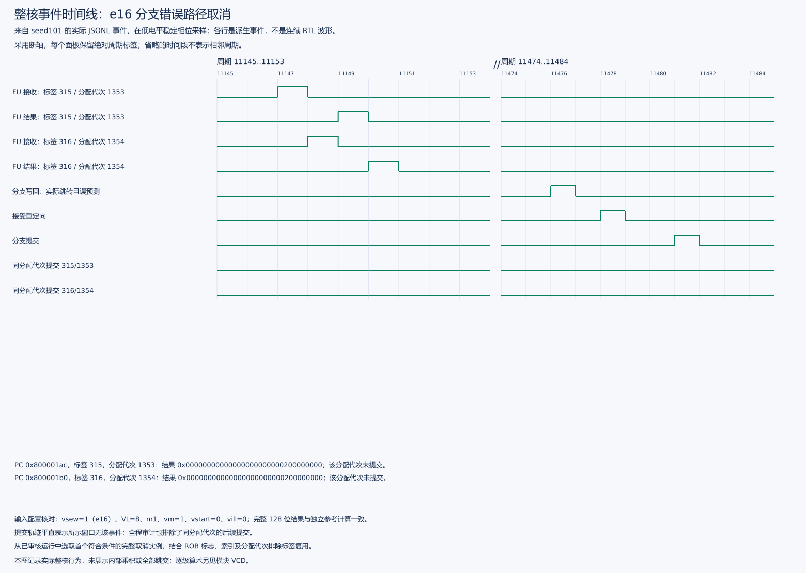
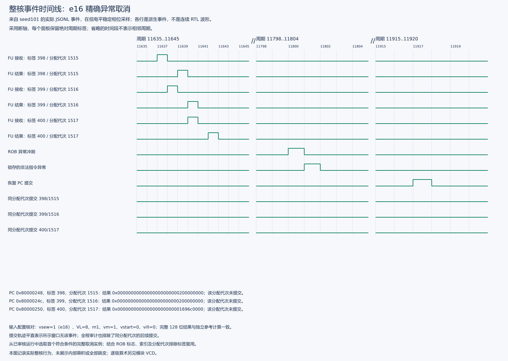
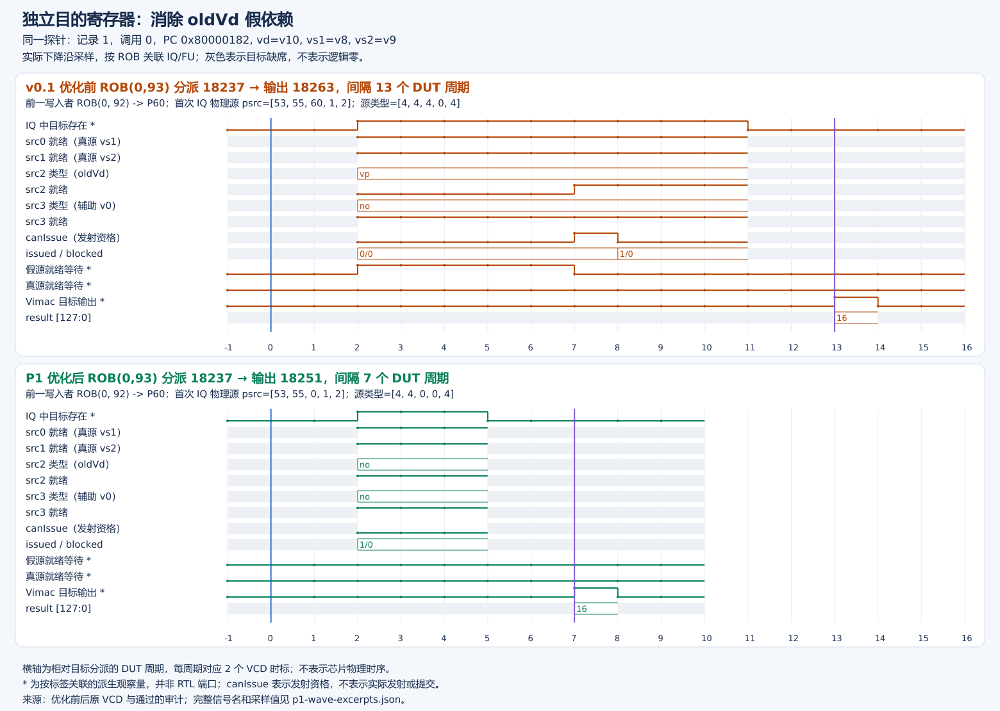
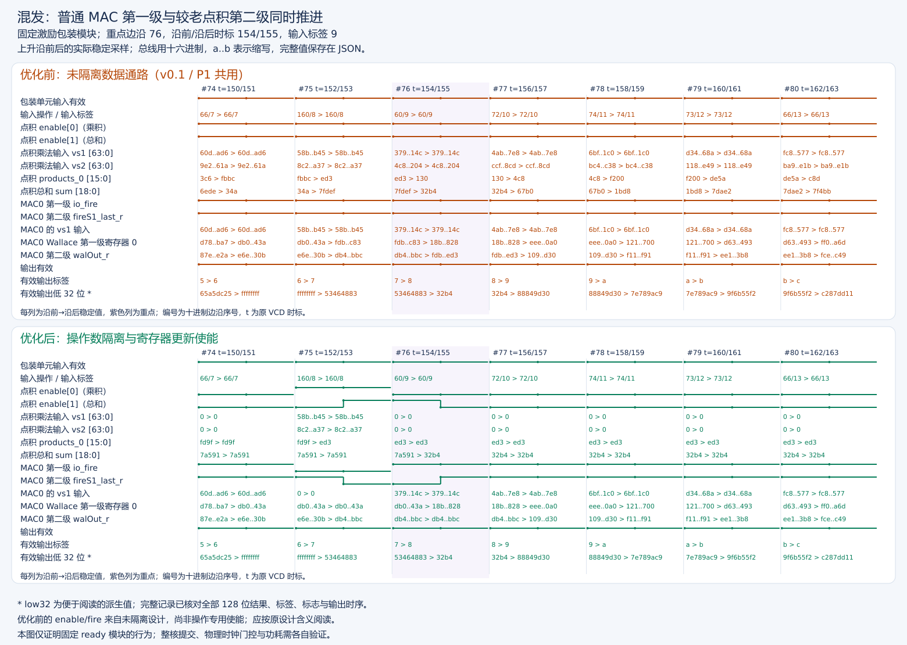

# vdot.vv 指令与微架构设计说明

团队：skito　项目：SKIProject　设计版本：固定八项 e8/e16（`sew16-fixed8`）　本文对应赛题第二阶段“vdot.vv 设计文档”，完整描述已实现的指令语义、编码、配置约束、微架构、算术数据通路、流水控制、异常处理及软硬件验证。实现平台为香山昆明湖 V2 的本项目单核配置，向量寄存器长度 VLEN=128 位。当前设计继承 v0.1 的指令编码，包含 oldVd 无效依赖消除、操作数隔离和寄存器更新使能，并支持八项有符号 e8/e16 点积。

## 1. 设计目标与总体方案

点积需要逐项相乘并将所有乘积归约为一个结果。使用已有向量指令时，需要宽乘法、宽归约及相应配置切换。本设计将固定八项运算组合成一条指令，减少中间结果写回和指令间依赖，适用于八项整数点积这一基本计算单元。

| 设计项目 | 本实现的选择 | 选择原因 |
| --- | --- | --- |
| 运算规模 | 每条指令处理八对元素 | 在 VLEN=128 下同时覆盖 e8 与 e16，便于确定归约宽度和验证范围 |
| 输入与输出 | 两个向量源，一个完整向量目的 | 沿用向量重命名、发射、旁路和写回接口 |
| 精度 | 有符号精确乘积与求和 | 避免中间截断；正负与极值有唯一可核对结果 |
| 执行位置 | 在既有 `VIMacU` 中加入专用点积分支 | 复用向量乘法执行入口及两周期接口 |
| 算术结构 | e8/e16 共用八个 16×16 乘法器及平衡加法树 | 共用硬件资源，保持统一流水边界 |
| 依赖处理 | 保留 vs1、vs2、VL 配置依赖，去掉 oldVd 读源 | 目的寄存器全覆盖，不需要旧值参与计算或尾部合并 |
| 活动控制 | 未使用分支的输入隔离和分级更新使能 | 减少无效输入翻转及寄存器更新，同时允许较老指令继续完成 |

固定八项、结果打包和 custom-0 编码属于本项目的扩展约定；现有赛题材料未给出更细的正式语义，本文不将该约定表述为官方 ISA 定义。可变 VL、掩码点积、其他 SEW 或更大 VLEN 不属于本实现范围。

## 2. 指令格式与精确语义

### 2.1 汇编形式与编码

```text
vdot.vv vd, vs2, vs1
```

| 位段 | 字段 | 取值或含义 |
| --- | --- | --- |
| [31:26] | funct6 | `000000` |
| [25] | vm | 合法执行取 1，表示不使用掩码 |
| [24:20] | vs2 | 第二个向量源寄存器编号 |
| [19:15] | vs1 | 第一个向量源寄存器编号 |
| [14:12] | funct3 | `010` |
| [11:7] | vd | 向量目的寄存器编号 |
| [6:0] | opcode | `0001011`，custom-0 |

指令族的精确匹配为 `(inst & 0xfc00707f) == 0x0000200b`，vm 不参与族匹配，vm=0 在合法性检查中报错。其余 custom-0 编码继续遵循原有译码规则，不能将整个 custom-0 作为向量指令接收。

合法编码可按下式生成；SEW 由向量配置提供，不增加指令编码位：

```text
inst = 0x0200200b | (vs2 << 20) | (vs1 << 15) | (vd << 7)
vdot.vv v10, v9, v8 = 0x0294250b
```

当前汇编程序使用 `.4byte` 发出该编码，无需修改工具链即可运行测试；工具链尚未新增 `vdot.vv` 助记符识别。内部操作码 `VdotOpType.vdot=0x160`、拆分类型 `VEC_VDOT=0x26` 是处理器控制编码，与上述机器指令编码不同。执行分支使用完整 `fuOpType` 判别。

### 2.2 元素读取与数学定义

记 `W=SEW`，`signed_W(x)` 表示将 W 位补码解释为有符号整数。元素编号从寄存器低位开始，操作数均取本条指令写回前的值：

```text
for i = 0..7:
    a[i] = signed_W(vs1[W*i + W-1 : W*i])
    b[i] = signed_W(vs2[W*i + W-1 : W*i])
S = Σ(i=0..7) a[i] × b[i]
```

e8 读取各源低 64 位的八个字节，源高 64 位不参与运算；e16 读取完整 128 位的八个半字。点积不累加旧目的寄存器，不使用舍入，不饱和，也不对输入做无符号解释。

### 2.3 目的寄存器格式

| 配置 | 有效结果 | 完整 128 位写回 |
| --- | --- | --- |
| e8 | S 符号扩展为 32 位补码 | `vd = {96'b0, signed32(S)}` |
| e16 | S 符号扩展为 64 位补码 | `vd = {64'b0, signed64(S)}` |

每次成功执行覆盖整个 vd。负结果只在低 32 位或低 64 位内部符号扩展，高位区域按表清零。它不是普通逐元素算术指令的尾部合并，也不依赖 ta/ma 的 agnostic 策略得到零值。

例如 e8 的 `a=[1,2,3,4,5,6,7,8]`、`b=[8,7,6,5,4,3,2,1]`，八项乘积为 `8,14,18,20,20,18,14,8`，S=120。将 a 全部取负后 S=−120，低 32 位为 `0xffffff88`，高 96 位仍为零。

### 2.4 精度与边界推导

| 参数 | e8 | e16 |
| --- | --- | --- |
| 元素范围 | −128～127 | −32768～32767 |
| 单项乘积最小值 | −16256 | −1073709056 |
| 单项乘积最大值 | 16384 | 1073741824 |
| 八项和最小值 | −130048 | −8589672448 |
| 八项和最大值 | 131072 | 8589934592 |
| 精确总和所需最少有符号位数 | 19 | 35 |

最大正乘积由两个最小负数相乘产生。e8 的上界 131072 超出 signed18；e16 的上界 8589934592 超出 signed34。使用 19/35 位才能包含闭区间内的全部结果。

| 定向输入 | 结果与应检查内容 |
| --- | --- |
| 两源 e8 全 −128 | S=131072；检查最大正值及高 96 位清零 |
| 两源 e8 分别全 −128 / 全 127 | S=−130048；检查符号解释与低 32 位负数打包 |
| 两源 e16 全 −32768 | S=8589934592，即 对应原始实验附件；检查超过 32 位的正结果 |
| 两源 e16 分别全 −32768 / 全 32767 | S=−8589672448；检查负极值及 64 位符号扩展 |
| 零向量、正负抵消 | S=0；完整目的 128 位均为零 |
| e8 低八字节不变，高八字节任意变化 | 结果不变；检查元素选取边界 |
| `vd=vs1`、`vd=vs2` 或三者相同 | 使用写回前的源值；不得边累加边破坏后续源元素 |

## 3. 向量配置、CSR 与异常语义

### 3.1 参数含义与合法取值

| 参数 | 含义 | 本指令要求 |
| --- | --- | --- |
| VLEN | 一个向量寄存器的物理位数 | 128 位 |
| SEW / `vtype.vsew` | 元素宽度；`SEW=8×2^vsew` | SEW=8 或 16，vsew=0 或 1 |
| LMUL / `vtype.vlmul` | 向量寄存器组倍率 | LMUL=1，vlmul 编码为 000 |
| VL / `vl` | 当前实际有效元素数 | 精确等于 8 |
| AVL | 软件向 `vset*` 请求的元素数 | 请求值不代替实际 VL，执行时检查已生效的 VL |
| VLMAX | 当前配置所能容纳的最大元素数 | e8/m1 为 16；e16/m1 为 8 |
| vm | 指令中的掩码使能选择位 | vm=1；不将 v0 用作本指令掩码 |
| `vstart` | 向量指令重新开始执行的元素编号 | 为 0；不支持部分重启 |
| `vill` | vtype 非法标志 | 为 0 |
| `vta` / `vma` | 尾部/掩码策略 | 四种组合均接受，输出仍按完整寄存器格式写回 |
| VS | 特权状态中的向量状态使能 | 通过既有向量使能检查，不能为 Off |
| `vxrm` / `vxsat` | 定点舍入模式/粘性饱和状态 | 本指令不用舍入，不产生饱和事件，保留原 CSR 值 |

VL=8 表示固定八项，不是“最多八项”。VL=0 也产生非法指令异常，不解释为 no-op。软件请求 AVL=8 时，e32/m1 和 e64/m1 的实际 VL 可能分别只有 4 和 2，负例必须检查真实 VL，不能假定请求值就是生效值。

### 3.2 成功执行与非法执行的状态变化

成功执行只更新完整目的向量及既有向量脏状态；vl、vtype、vxrm、vxsat 保持，vstart 为 0。写 v0 使用处理器既有的 v0 写回路径。v0、v31 和所有源目的别名组合均可作为合法数据寄存器使用。

不支持的 SEW、LMUL、vm、VL、vstart 或非法 vtype 产生非法指令异常，cause=2，异常 PC 指向本指令。该指令不提交目的寄存器结果；异常 CSR 则由处理器既有陷入流程更新。不能先清零 vstart、部分覆盖目的或将不合法 VL 静默改为 8 后继续执行。

合法性分两处检查：译码阶段检查可由指令和 vtype 判断的条件；执行输出阶段以随本条 uop 对齐的 SEW、LMUL、vill、vm、vstart 和实际 VL 做防御性复核。VS 等特权限制复用公共向量检查。执行端检查逻辑为：

```text
vdotIllegal = vill || (vsew > 1) || (vlmul != 0)
              || (VL != 8) || (vm == 0) || (vstart != 0)
```

当前平台对仅 VL 不合法、其余条件合法的 vdot，在执行端报告异常时 xtval=0；译码阶段识别的非法配置保留指令位。NEMU 对该指令族单独匹配这一行为，保留精确比较，不全局屏蔽 xtval，也不改变标准指令异常规则。

## 4. 整核微架构与集成通路

### 4.1 通路总览



图 4-1　整核微架构通路。蓝色表示既有接口，绿色表示新增点积分支；点积与普通乘法共同使用 VIMacU 的执行入口和输出控制。

[查看高清 PNG](figures/vdot-design/microarchitecture.png) · [SVG 矢量源图](figures/vdot-design/microarchitecture.svg)

图中点积分支与普通乘法分支共同属于 VIMacU；点积绕过 MGU，按自身全寄存器格式写回。分支错误路径、异常和恢复沿处理器原通路处理，无独立提交接口。

### 4.2 译码与单 uop 拆分

`Instructions.scala` 定义精确指令族；`RiscvInst.scala` 将该族加入向量算术识别，`VecDecoder.scala` 将其映射到 `FuType.vimac` 和 `VdotOpType.vdot`。目的写使能为向量写，不写标量整数或浮点寄存器。

`UopInfoGen.scala` 将 `VEC_VDOT` 固定为一条 uop，写回数为一。即使输入 LMUL 非法，也不会按 LMUL 先拆出多条点积。`DecodeUnitComp.scala` 指定 `lsrc(0)=vs1`、`lsrc(1)=vs2`、`ldest=vd`、`uopIdx=0`，并清除无用途的第三源类型。

### 4.3 重命名、真实依赖与 v0

点积结果与旧目的值无关，因此专用拆分路径设置 `srcType(2)=SrcType.no`。这一设置在 `DecodeStage` 辅助 v0 源识别之前生效，避免仅因目的为 v0 而误读旧 v0。

vs1/vs2 的读依赖继续保留，包括它们真实读取 v0 的情况。`vd=vs1` 等别名由已有重命名机制分别取得旧源物理寄存器和新目的物理寄存器。`DecodeStage` 根据目的编号选择普通向量写或 v0 写，后续依赖者沿既有唤醒与旁路路径读取新结果。

这项优化限定于 vdot，不能从整个 `VimacCfg` 删除第三源；普通 `vmacc` 等运算仍需 oldVd。它消除的是假读依赖，真实源未就绪时仍需等待。

### 4.4 配置依赖与连续 vset 操作

实际 VL 作为既有配置源参与重命名、等待和旁路，保证 vdot 使用程序顺序上应当生效的 VL。SEW、LMUL、vill 等则由本条 uop 的 VPU 控制携带，不能在执行时读取另一条较新配置的全局值。

本实现的 `VlData` 端口实际宽度为 8 位，仅承载 VL。`VDot8.io.sew16` 必须来自输入 `vpu.vsew`；输出合法性检查使用 `outVecCtrl`，实际 VL 使用随流水对齐的 `outVConfig.vl`。从 `srcVConfig.vtype` 读取 SEW 会读到未承载的高位，是不能采用的接线方式。

因此连续 `vsetivli → vdot → vsetivli → vdot` 时，输入和输出分别依据各自指令的配置。输出阶段同时到来的新输入 SEW 不参与较老点积的结果打包。

## 5. 专用算术数据通路

### 5.1 元素选择与输入隔离

`VDot8` 接收两路完整 128 位数据、一个 e16 模式位和两级 enable。名称中的 8 指八项运算，模块同时支持 e8/e16。

首先在乘法之前使用第一级使能夹零两源：`isolatedVs*=enable[0] ? vs* : 0`。e8 从各源低八个字节取值，符号扩展为 signed16；e16 直接把相应半字解释为 signed16。隔离发生在元素提取和算术之前，未使用点积分支时输入变化不会继续驱动乘法操作数变化。

### 5.2 八路乘法与平衡归约



图 5-1　八路乘法与平衡归约数据通路。黄色框为受使能控制的寄存器，绿色框为点积算术与隔离逻辑；S2 的三层加法位于同一个流水阶段。

[查看高清 PNG](figures/vdot-design/datapath.png) · [SVG 矢量源图](figures/vdot-design/datapath.svg)

点积分支内的八个乘法器由 e8/e16 共用，原普通乘法使用单独的 `VIMac64b` 数据通路。S1 并行计算 `p[i]=a[i]×b[i]`，保存八个 signed32 乘积。S2 按以下结构完成归约：

```text
q[j] = p[2j] + p[2j+1] j=0..3，signed33
r[k] = q[2k] + q[2k+1] k=0..1，signed34
S = r[0] + r[1] signed35
```

实现使用 Chisel `+&` 保留进位，并检查总和寄存器宽度为 35。三层加法逻辑均位于第二个流水阶段；图中的三层归约不是三拍流水。相较八项串行累加，平衡树将组合加法深度降为三层，但最终频率仍需物理实现验证。

### 5.3 结果模式对齐

`sew16S1` 与 products 使用相同第一级使能，`sew16S2` 与 sum 使用相同第二级使能。打包时只看 `sew16S2`：e8 将 S 扩展到低 32 位，e16 将 S 扩展到低 64 位，然后拼接高位零。

e8 复用 35 位归约后再转换为 32 位输出；因为其真实总和已证明落在 signed19 范围内，该转换不损失精度。e16 直接使用 signed35 到 signed64 的扩展，避免超过 32 位的正负结果出错。

## 6. 两级流水、混发与活动控制

### 6.1 接口与逐级使能

Vimac 保持既有 `CertainLatency(2)`，输出数据宽度 128 位。包装层检查 `dataWidth=128`、`latency=2` 和 `latdiff=0`。控制和数据依托处理器既有流水接口推进；VDot8 内部不另设独立的 valid、ready、ROB 或 redirect 端口。



图 6-1　S1 乘积级、S2 归约级及输出接口。数据、模式与控制分别对齐；下方时序表展示点积 A 与普通乘法 B 的相邻混发。输出接口为组合打包与结果选择，不增加第三个流水阶段。

[查看高清 PNG](figures/vdot-design/pipeline.png) · [SVG 矢量源图](figures/vdot-design/pipeline.svg)

| 信号 | 实现表达式 | 含义 |
| --- | --- | --- |
| `inIsVdot` | `fuOpType == VdotOpType.vdot` | 当前输入属于点积 |
| `regEnable(i)` | `validVec(i-1) && rdyVec(i-1)` | 既有流水允许本级有效数据前进 |
| `enable(0)` | `regEnable(1) && inIsVdot` | 捕获本次点积的八个乘积及模式 |
| `enable(1)` | `regEnable(2) && ctrlVec(1).fuOpType == vdot` | 捕获处于 S1 的较老点积总和及模式 |
| `outIsVdot` | `outCtrl.fuOpType == vdot` | 选择与输出控制对齐的点积结果 |
| `macInputActive` | `io.in.valid && !inIsVdot` | 普通乘法输入分支的原固定时间 fire 条件 |

第二级依据自己的级内操作类型，不能用当前输入的 `inIsVdot`。否则普通乘法紧跟点积时会阻止较老点积求和，而点积紧跟普通乘法时又可能错误推进点积的旧乘积。

以接口时刻 T0 接收点积 A、T1 接收普通乘法 B 为例：

| 时间 | 点积分支 | 普通乘法分支 | 对齐要求 |
| --- | --- | --- | --- |
| T0→T1 | A 完成元素选择与乘法，在 S1 捕获 | 无本次普通乘法输入 | A 的 e8/e16 模式进入 sew16S1 |
| T1→T2 | A 在 S2 归约；新的点积 S1 可禁用 | B 进入普通乘法通路 | A 的 S2 不被 B 的输入类型关闭 |
| T2 | A 的两周期输出有效 | B 在自身后续阶段继续推进 | A 的结果、目的、异常与 ROB 标签一致 |
| T3 | 依随后输入决定 | B 按原两周期接口输出 | 输出选择按 B 的类型切回普通结果 |

两周期指功能单元接口接收至对应输出，不包括取指、译码、IQ 等待和 ROB 提交。本项目未据此宣称整核点积只需两周期，也未单独证明极限吞吐率。

### 6.2 普通乘法分支的兼容处理

vdot 或无效输入到来时，普通分支的 vs1、vs2、oldVd 在 `VecDataSplitModule` 之前夹零，类型控制选择安全的普通 vmul/e8，其他无效控制夹为零或 false。普通分支仍由两个 `VIMac64b` 组成，原 MGU 负责普通结果的尾部与掩码合并。

普通乘法的输入 `fire` 使用 `macInputActive`，保留其原固定时间约定。内部 `fireS1` 继续完成较老普通乘法，不能因为新输入是 vdot 就关闭整条普通流水。普通乘法 S1 和较老点积 S2、点积 S1 和较老普通乘法后级均可交叠。

### 6.3 操作数隔离与寄存器更新使能

操作数隔离降低无效分支的组合输入活动；更新使能使点积 products、sum 和模式寄存器在该级没有点积时保持。普通乘法内部寄存器沿用其有效级使能。两者作用不同，只有寄存器保持不能阻止前级组合乘法器因输入变化而翻转。

本设计未插入物理集成时钟门控单元 ICG。enable 为 Chisel 逻辑更新条件，不能直接换算为功耗下降比例。共享资源、隔离选择器和使能逻辑也有面积及组合路径成本，实际收益需综合及功耗分析确认。

## 7. 写回、异常与精确提交

VIMacU 在输出级按 `outIsVdot` 选择专用结果或 MGU 结果，将完整数据、异常和既有目的信息送回共享写回通路。点积不产生饱和事件，输出 vxsat 事件为 false；这表示不新增饱和事件，不是清除已有的粘性 `vxsat` CSR。

执行完成、物理寄存器写回和架构提交是不同事件。错误路径上的 vdot 可能已经产生正确算术结果，甚至写入其新分配的物理目的；只有 ROB 顺序提交后，该结果才成为架构状态。处理器的 redirect、异常及重命名恢复必须保证取消的分配代次不能提交。

控制正确性按三类场景检查：

1. 分支误预测：已执行的错误路径点积随 redirect 取消，恢复后读取目的值仍符合正确程序路径。
2. 精确异常：较老非法指令触发异常，年轻点积即使完成计算也不能提交，普通目的、v0 和别名目的均需保持正确架构状态。
3. ROB 标签复用：审计同时关联标签和分配代次，不能仅凭某段时间没有相同标签提交就判为安全。

VDot8 的内部数据寄存器无需在每次气泡或取消时清零。内部保留值只有在共享输出有效、类型及目的匹配时才有意义；是否提交由既有控制链路决定，不能将内部 sum 的变化直接解释为架构状态改变。

## 8. NEMU 参考模型与软件运行流程

### 8.1 参考模型

NEMU 的主译码和 RVV 子译码对同一 custom-0 指令族精确匹配，helper 在全部合法性检查通过后执行八项求和。每个元素显式从补码转换到有符号整数，使用 `int64_t` 累加，所有源读取完成后才写目的。e8 写低 32 位补码并清其余位，e16 写低 64 位补码并清高 64 位。

NEMU 使用顺序整数循环，RTL 使用并行乘法和平衡树；另有独立 C/Python oracle 检查数学结果，降低参考模型与硬件复用同一计算错误的风险。Difftest 按提交推进参考模型，比较向量状态和相关 CSR，异常用例还检查 cause、PC、xtval 与目的保持。

### 8.2 软件到硬件的完整执行流程

软件首先启用向量状态并配置 `VL=8`、e8/m1 或 e16/m1，将两个输入装入向量寄存器，再发出自定义机器码。处理器完成精确译码、重命名和依赖等待；VIMacU 按该指令配置进行两级运算，写回后由 ROB 提交，NEMU 执行同一指令并对照。软件最后读取完整目的寄存器，与独立 oracle 检查，正常结束输出 GOOD TRAP。

以下为输入已放入 v8/v9 后的最小 e16 运算片段，向量状态启用和程序启动由裸机运行环境负责：

```asm
vsetivli zero, 8, e16, m1, tu, mu
.4byte 0x0294250b # 执行 vdot.vv v10, v9, v8
vs1r.v v10, (a0) # a0 指向至少 16 字节的结果区域
```

e8 使用同一机器码，配置改为 e8/m1。`vs1r.v` 存储完整寄存器，使高位清零也成为可检查结果，不能只读取最低一个字节或半字。

### 8.3 标准 RVV 等价基线

基线必须得到相同数学精度及完整目的格式。e8 采用 signed8 宽乘为 signed16，再宽归约到 signed32；e16 采用 signed16 宽乘为 signed32，再宽归约到 signed64。若只用同宽 `vmul` 再归约，会先截断乘积，不能作为等价基线。

以 e16 为例，v8/v9 已载入、v12 为零归约种子、v14 已完整清零时，基线核心为：

```asm
vsetivli zero, 8, e16, m1, tu, mu
vwmul.vv v16, v8, v9
vsetivli zero, 8, e32, m2, tu, mu
vwredsum.vs v14, v16, v12
vsetivli zero, 8, e16, m1, tu, mu
```

配置为 e32/m2，使宽乘积组的八个元素均参与归约。输出预清零并使用 tu，确保低 64 位结果之外保持零；计时程序对初始化、配置、存储和计时标记的归属统一定义，不能仅按指令条数推算端到端加速比。完整实现见 `stage3/sew16-perf/bench.S`。

## 9. 源码组成与修改边界

下表中的 XS 路径相对 `XiangShan/src/main/scala/xiangshan/`，NEMU 路径相对 `NEMU/src/isa/riscv64/`。

| 文件或模块 | 新增/修改内容及作用 |
| --- | --- |
| XS `backend/decode/Instructions.scala` | 定义 XVDot 精确机器码匹配 |
| XS `backend/decode/isa/bitfield/RiscvInst.scala` | 允许该自定义指令进入向量算术处理流程 |
| XS `package.scala` | 定义点积内部操作类型和专用拆分类型 |
| XS `backend/decode/VecDecoder.scala` | 生成 Vimac 类型、向量写使能和专用拆分控制 |
| XS `backend/decode/UopInfoGen.scala` | 固定一 uop 和一个写回计数 |
| XS `backend/decode/DecodeUnitComp.scala` | 设置源目的映射，局部清除 oldVd 读源类型 |
| XS `backend/decode/VecExceptionGen.scala` | 加入支持 SEW、LMUL 和 vm 的合法性限制 |
| XS `backend/fu/vector/VDot8.scala` | 新增八项共享算术、两级寄存器、隔离与模式对齐 |
| XS `backend/fu/wrapper/VIMacU.scala` | 接入点积；逐级使能、普通分支隔离、结果选择与执行异常 |
| NEMU `instr/decode.c`、`instr/rvv/decode.h` | 主译码及 RVV helper 分派 |
| NEMU `include/isa-all-instr.h` | 注册 vdot 指令 helper |
| NEMU `instr/rvv/vcompute.h` | 实现合法性检查、精确求和、完整目的写回 |
| NEMU `system/intr.c` | 对齐该指令族仅 VL 非法时的 xtval 行为 |

`FuConfig.scala` 的 Vimac 两周期、128 位目的及共享源端口继续使用原配置；`DecodeStage` 的 v0 分流、重命名、IQ、ROB 和 Difftest 均复用既有机制。无需为 vdot 新建独立发射队列、寄存器文件或提交端口。

模块测试位于 XS 的 `src/test/scala/xiangshan/VDotDecodeTest.scala`、`backend/fu/vector/VDot8Test.scala` 和 `backend/fu/vector/VDotIntegrationTest.scala`。当前功能软件、参考库直接检查及波形审计在 `stage2/sew16/`；短控制实验在 `stage2/e16-events/`；性能程序及分析在 `stage3/sew16-perf/`。

交付补丁为 [XS 完整整合补丁](../patches/xiangshan-vdot-sew16-fixed8.patch)与 [NEMU 完整整合补丁](../patches/nemu-vdot-sew16-fixed8.patch)，适用基线及应用方法见[补丁说明](../patches/vdot补丁选择与应用说明.md)。当前补丁包含早期实现与优化，不能再次叠加 v0.1/P1 的旧整合补丁。

## 10. 验证方法与关键证据

### 10.1 分层验证结果

| 层次 | 方法 | 已完成结果 |
| --- | --- | --- |
| 译码与算术模块 | 定向边界、完整结果、非法配置、使能和混发 | 4 个 suite、8 项测试通过；随机混发 issued=1027、checked=1003、cancelled=24 |
| NEMU 直接验证 | 四组数据种子、独立整数 oracle、向量寄存器与配置 CSR 对比 | 合法 2304、非法 96，通过 |
| 模块活动检查 | 复用现有模块 VCD 检查隔离、保持和交叠 | 1158 个边沿；113 个 e8、80 个 e16 请求；13221 次禁用保持、142 次交叠，通过 |
| 完整整核差分 | 当前 emu＋当前 NEMU＋e8/e16 裸机镜像 | e8 检查 1564、e16 检查 836，完整差分、GOOD TRAP、进程退出 0 |
| 执行后取消 | 四独立初始化进程，关联实际输入、结果、redirect/异常与同代次提交 | 共 8 次分支取消 16 条、32 次异常取消 96 条已执行 e16，通过 |
| 性能计时边界 | 四个内核的动态起止事件与结果对应关系 | 每内核 42 次完整边界、400 次 dot 输出两周期对齐，通过 |

完整整核主回归的四个数据种子运行于同一初始化 seed=101 的 CPU 进程，不能计为四个独立启动；短控制实验则分别使用初始化 seed=101/202/303/404。后者四份有效事件轨迹相同，证明多次初始化下该轨迹一致，不等于四种不同控制历史。检查项数量也不等于动态指令数。

当前测试覆盖正数、负数、最大/最小/零、抵消、高位无关性、ta/ma、v0/v31、源目的别名、e8/e16 交替配置、普通乘法混发、v0 写后掩码读取、非恒定依赖链和非法恢复。完整结果见[扩展验收](../reports/固定八项e8e16实施与验收报告.md)及[整核图文总结](../reports/e16整核仿真与关键信号图解.md)。

极值和配置边界的专项读图见[当前功能与边界验收报告](../reports/固定八项e8e16实施与验收报告.md)，包括 e8 最大和/零、最小负乘积与保持、e16 最大正和提交、负数宽位打包及 VL=0 异常。

### 10.2 当前模块波形：精确算术与模式打包



图 10-1 来自当前 e8/e16 wrapper 已归档的模块 VCD。tag=44 的输入在 `t=796 PRE` 有效，`vsew=1`、VL=8；`t=797 POST` 捕获八个乘积，`t=799 POST` 输出 S=2924450966，完整结果为 `0x000000000000000000000000ae4f9496`。该结果超过 signed32 上界，说明 e16 总和必须保留更高精度。图中较新普通乘法与较老点积 S2 同时前进，说明逐级类型判别的必要性。



图 10-2 的 tag=23 在 `t=609 POST` 捕获乘积、`t=611 POST` 得到 S=−2266173193，完整输出为 `0x0000000000000000ffffffff78ecf0f7`。低 64 位正确符号扩展，高 64 位保持零；相邻禁用阶段的隔离输入为零，products 或 sum 保持。两图的 t 为 VCD 时间戳，不是整核周期，逐项输入与乘积表见[图文总结第 2、3 节](../reports/e16整核仿真与关键信号图解.md)。

### 10.3 整核事件：已执行结果的取消与未提交



图 10-3 来自 seed=101 的整核实测事件记录。两条错误路径 e16 分别在周期 11147/11148 接收、11149/11150 产生正确结果，11478 接受取消；审计继续检查其相同分配代次未提交。输出两周期和随后取消是两个独立事实，不能将“算术结果正确”当作“指令应提交”。



图 10-4 的三条年轻 e16 使用普通目的、v0 和别名目的，在周期 11637～11642 完成接收和输出，11800 随较老非法指令的异常被取消，恢复后架构检查正确。图 10-3/10-4 是稀疏事件时序图，包含审计派生的同代次提交判断，并非连续整核 VCD。事件、代次关联和完整取消统计见[控制报告](../reports/e16整核取消与独立初始化实验报告.md)。

### 10.4 优化机制的前后对照



图 10-5 对照原 v0.1 与 P1 的相同场景。真实源已就绪时，原版本仍等待无用途的 oldVd；P1 清除该读源后，所选记录的分派至 FU 输出从 13 降到 7 周期。它证明假依赖消除，不是 FU 延迟从 13 降至 7。真实源必须等待的安全对照和 v0 场景见[P1 报告](../../stage3/reports/原始核至P1优化对比报告.md)。



图 10-6 来自 e8 隔离优化的原 wrapper 模块测试，说明输入分支关闭后较老级仍可前进，结果及标签保持对齐。该实验累计 301 个有效结果一致、4140 次禁用保持，所定义采样口径的位翻转为 178205→135389，减少 24.03%；该比例不是功耗数据。详见[隔离报告](../../stage3/reports/P1至隔离核优化对比报告.md)。图 10-5/10-6 保留历史版本身份，当前 e8/e16 的功能验收使用本节前述独立证据。

## 11. 延迟与加速效果

加速比定义为相同任务下 `RVV 周期 / vdot 周期`。当前 v4 正式实验包含新 e8/e16 核四进程和旧 e8 隔离核四进程，共 1920 行预热及正式样本。当前核的主要结果如下：

| SEW | 场景 | 点积数 | vdot 周期 | RVV 周期 | 加速比 |
| --- | --- | --- | --- | --- | --- |
| 8 | batch4 | 256 | 350 | 1648 | 4.708571 |
| 16 | batch4 | 256 | 350 | 1648 | 4.708571 |
| 8 | e2e | 256 | 1244 | 2750.25 | 2.212181 |
| 16 | e2e | 256 | 1181.5 | 2750.5 | 2.329411 |
| 8 | chain256 | 256 | 1824 | 7456.5 | 4.087856 |
| 16 | chain256 | 256 | 1824 | 7456.5 | 4.087993 |

周期为四进程各自中位数的中位数，加速比为各进程比值的中位数，因此不要求表中两个汇总周期相除与比值逐位相等。batch4 是预加载、每批四个独立目的共用一对源的内核；e2e 含加载、初始化和存储；chain256 使用非零、非固定点的受控反馈序列。

按 16/64/256 链长拟合的有效反馈链斜率，vdot 约 7 周期/步，RVV 约 29 周期/步，包含循环和配置成本，与单元两周期接口不是同一指标。新旧核 e8 配对场景的周期比中位数均为 1.0，仅说明本次测量下兼容路径周期相同，不代表面积、频率或功耗不变。

## 12. 设计评价与适用边界

本设计的主要价值是把精确宽乘归约组合成单 uop，复用现有乱序向量后端，去除无用途的 oldVd 等待，并在共享接口中实现 e8/e16 运算与逐级活动控制。正确性证明同时覆盖算术、配置依赖、普通乘法兼容、取消与架构提交，性能结论有等价基线及计时边界支持。

面向评审的[延迟与创新贡献图文说明](../../stage3/reports/基线与vdot延迟加速图文分析.md)分别给出三项工作的“问题—修改—收益—安全验证”，关联已有前后波形、当前宽位结果和正式数据。该说明将端口延迟、有效依赖链、独立流内核及含加载保存区间分开呈现，可与本设计的接口、算术及流水章节对照阅读。

主要成本是八个 16×16 乘法器、35 位归约树及模式/隔离选择逻辑。相对原 e8 的八个 8×8 乘法器，共享 e16 能力可能增加面积、组合延迟和活动；现有周期仿真不能回答物理最高频率、面积或功耗收益，项目尚无这些结果。

当前适用范围为 VLEN=128、LMUL=1、VL=8、无掩码的有符号 e8/e16 点积。可变长度、掩码、无符号/混合符号、跨寄存器组、其他 VLEN 及完整应用性能需要新的语义、控制和验收。e2e 调用上下文差异已有内部事件诊断，但其上游唯一因果尚未闭合，不能将单次最快样本推广为应用收益。

## 附录 A. 主要信号字典

| 信号或变量 | 所在位置 | 作用 |
| --- | --- | --- |
| `lsrc` / `ldest` | 译码与重命名前 | 逻辑源/目的寄存器编号 |
| `srcType` | 译码控制 | 决定读源类型；vdot 第三源为 no |
| `pdest` | 执行控制 | 本条指令的新物理目的 |
| `robIdx` | 共享控制流水 | 标识 ROB 中的指令位置；审计另关联分配代次 |
| `fuType` / `fuOpType` | 译码、IQ、执行 | 选择执行资源及具体运算；vdot 内部操作码为 0x160 |
| `uopIdx` / `vuopIdx` | 拆分及向量控制 | 微操作序号；固定八项点积只有一条，序号为 0 |
| `vs1` / `vs2` | VecPipedFuncUnit 输入 | 已完成读取或旁路的两个 128 位数据源 |
| `oldVd` | 共享 VIMac 输入 | 普通乘加及合并需要的旧目的；vdot 不读取其逻辑依赖 |
| `vecCtrl` / `outVecCtrl` | 输入/输出 VPU 控制 | 本条指令对齐的 SEW、LMUL、vill、vm 等 |
| `srcVConfig.vl` / `outVl` | 输入/输出配置数据 | 经过依赖处理并随流水对齐的实际 VL |
| `validVec` / `rdyVec` | 既有执行流水 | 该级数据有效及可前进条件 |
| `ctrlVec(1)` | 中间控制级 | 决定较老指令的 S2 操作类型 |
| `isolatedVs1/2` | VDot8 输入 | enable0 为零时夹零的完整数据源 |
| `activeSew16` | VDot8 元素选择 | 第一级使能有效且为 e16 时选择半字 |
| `products` | VDot8 S1 | 八个 signed32 乘积寄存器 |
| `pairs` / `quads` | VDot8 S2 组合逻辑 | 四个 signed33 / 两个 signed34 部分和 |
| `sum` | VDot8 S2 | signed35 精确总和寄存器 |
| `sew16S1` / `sew16S2` | VDot8 两级模式寄存器 | 与本条点积数据同步的结果模式 |
| `io.result` | VDot8 输出 | 按当前输出模式打包的 128 位结果，本身没有独立 valid |
| `mgu` | 普通乘法输出分支 | 普通向量结果的掩码/尾部合并，vdot 输出绕过 |
| `exceptionVec.illegalInstr` | VIMacU 输出控制 | 随目的与 ROB 标签上报非法指令 |
| `io.out.valid` | 共享输出接口 | 当前输出结果及控制的有效标志，不等于提交 |

## 附录 B. 操作与材料入口

| 阅读目的 | 对应材料 |
| --- | --- |
| 核、参考库和程序的配套选择 | [版本选择](../../docs/核与参考库版本选择.md) |
| 当前构建、运行和已有结果复核 | [e8/e16 操作手册](../sew16/固定八项e8e16扩展操作手册.md)；作品根目录执行 `bash scripts/run-vdot-sew16.sh` |
| 正负与边界的当前完整验收 | [扩展验收](../reports/固定八项e8e16实施与验收报告.md)、[整核图文总结](../reports/e16整核仿真与关键信号图解.md) |
| 原 e8 基础功能与算术波形 | [v0.1 基础测试报告](../reports/vdot基础功能测试与验收报告v0.1.md)，按其历史版本阅读 |
| 执行后取消的操作与原始事件 | [短控制实验手册](../e16-events/e16短控制实验操作手册.md)、[控制报告](../reports/e16整核取消与独立初始化实验报告.md) |
| 延迟和加速比的完整分析 | [v4 测量手册](../../stage3/sew16-perf/性能测量与复核手册v4.md)、[正式性能报告](../../stage3/reports/e8e16正式性能分析报告v4.md) |
| 设计框图与可编辑源图 | [图件目录](figures/vdot-design/)、[绘图脚本](../tests/render-vdot-design-diagrams.py)；每图同时提供 PNG 与 SVG |
| 历史方案及逐文件集成过程 | [v0.1 历史设计](vdot历史设计说明v0.1.md)、[历史集成手册](vdot历史集成操作手册v0.1.md) |

图 4-1、5-1 和 6-1 是依据当前 RTL 绘制的设计框图；第 10 章证据图取自既有波形或实测事件。历史图件用于解释优化机制，当前功能与性能结论分别引用对应版本的验收和实验。
