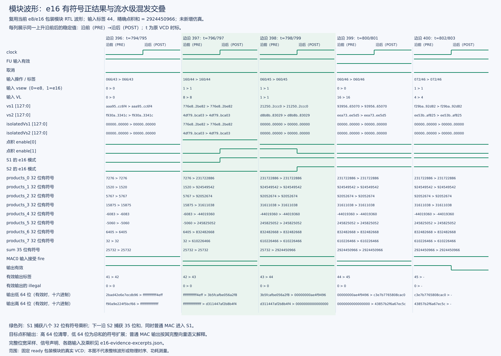
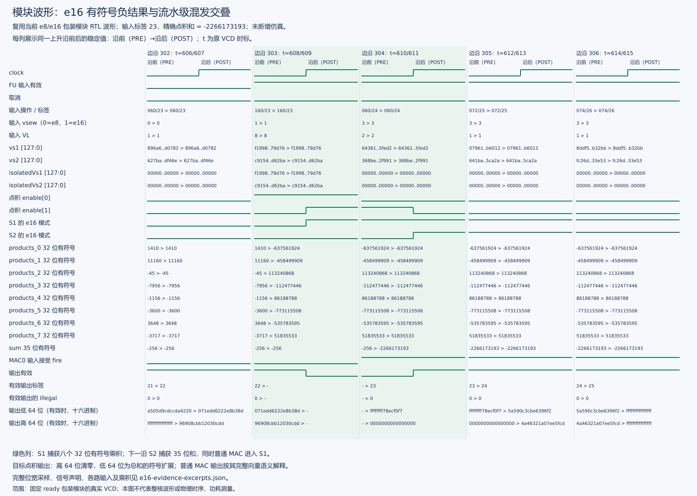
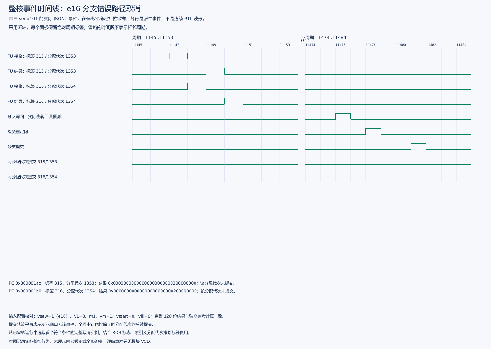
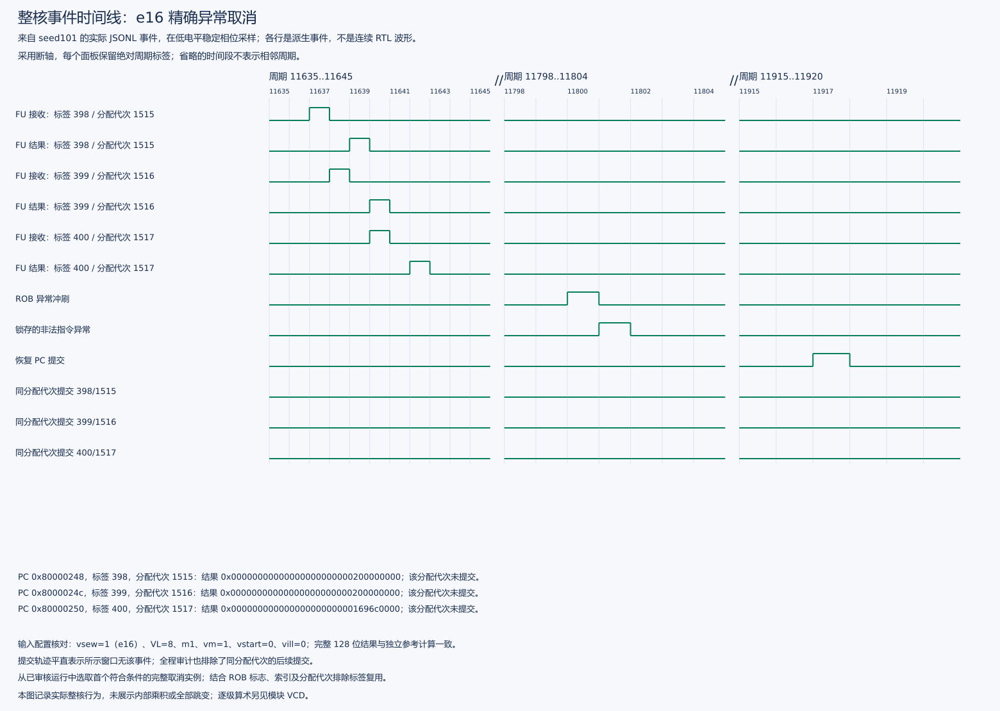

# e16 完整整核仿真总结与关键信号图解

结论：**支持 e16 的新核已完整跑完 e8/e16 整核差分回归，836 项 e16 检查通过，GOOD TRAP、实际进程退出 0。** 后续又完成四个独立初始化种子的 e16 短控制实验，直接观察到执行、正确结果、取消及同代次未提交。

本文汇总已有[扩展实施记录](固定八项e8e16实施与验收报告.md)与[内部取消实验](e16整核取消与独立初始化实验报告.md)，硬件合同见[当前主设计](../docs/vdot指令设计说明.md)。图件来自两套独立证据：图 1/2 为当前 e8/e16 wrapper 的真实 VCD 稳定边沿采样；图 3/4 为整核 JSONL 实测事件时序图。**全量整核回归未开启 VCD，图 1/2 不是该整核运行的内部波形，图 3/4 也不属于连续整核 VCD。**

## 1. 完整整核运行结果

| 项目 | 已保存的实际结果 |
| --- | --- |
| 核 | `XiangShan/build/sew16-fixed8/emu`，VLEN=128，固定八项 e8/e16 |
| 参考库 | `NEMU/build/sew16/riscv64-nemu-interpreter-so` |
| 镜像 | `stage2/sew16/build/cie2026-stage2-vdot-sew16-riscv64-xs.bin` |
| 差分与结束 | NEMU 差分开启，HIT GOOD TRAP，真实进程退出 0，协调器/审核退出 0 |
| 指令数 | 935006 |
| 核周期 / guest 周期 | 766319 / 766323，分别使用日志中的各自计数口径 |
| 宿主运行时间 | 2281234 ms，约 38 分钟 |
| e16 检查 | 836 项 |
| e8 兼容检查 | 1564 项，含原 1052 项合法检查与交替回归 |
| 数据随机种子 | `56444f54 / 1 / 9e3779b9 / deadbeef`，同一个初始化 seed=101 的进程 |

“完整”指这套包含 e8/e16 的功能程序从启动到正常结束全部执行完成，不表示任意配置穷举，也不是纯 e16 性能测试。检查项可能执行多条指令，836 不等于动态 e16 指令条数；回归总周期不能直接解释成 vdot 延迟或加速比。

实际覆盖如下：

| 覆盖项 | 完成情况 |
| --- | --- |
| e16 算术 | 边界、正负、零、全 ta/ma 组合、源目的别名、v0/v31、完整 128 位结果 |
| 随机与模式变化 | 四数据种子，每种 128 次 e16 和 128 次 e8，交替配置 |
| 普通向量指令混发 | 普通 e16 乘法、点积、v0 写后掩码消费及配置切换 |
| 依赖链 | 32 级非固定点 e16 自依赖，独立 C oracle 终值 324 |
| 非法配置与恢复 | VL=0、VL=7、vm=0、vstart=1，精确异常及完整目的保持 |
| 架构控制 | 64 次分支训练、4 次跳过探测、4 次非法之后年轻 e16 探测；目的/v0/别名保持 |

原始证据：[完整整核日志](../logs/20261026T205315-sew16-core.full.log)、[协调器日志](../logs/20261026T205315-sew16-core-regression.full.log)、[原验收 JSON](../logs/20261026-sew16-core-audit.json)。已核对日志、实际退出状态及配套的核、参考库和测试镜像，[复核结果为 PASS](../logs/20261027-e16-summary-full-core-review.json)。

## 2. 图 1：e16 正结果、乘积寄存器与两级流水

来源为已归档的 `stage2/sew16/mixed-module.vcd.gz`，不是示意信号。每列显示一个上升沿前后稳定值 `PRE > POST`，顶部 `t` 是 VCD 原始时间戳，不是整核周期。绿色两列分别对应目标的乘积捕获与总和捕获；长输入只在图片中缩写，完整值保存在图件 JSON 中。

按以下顺序读图：

1. `t=796` 的 PRE：输入 `op=0x160/tag=44`，`vsew=1` 表示 e16，VL=8，`dot enable[0]=1`。两个完整 128 位源通过隔离后送往八个 16×16 有符号乘法器。
2. `t=797` 的 POST：`products_0..7` 保存八个真实 signed32 乘积，`sew16S1=1`；此时尚不能把输出当成这条目标的有效结果。
3. `t=799` 的 POST：35 位 `sum=2924450966`，`sew16S2=1`；`output valid=1`、tag=44、illegal=0。完整结果是 `0x000000000000000000000000ae4f9496`，高 64 位为零。
4. 第二个绿色列的 PRE 同时出现 `dot enable[1]=1` 与 `MAC0 input fire=1`：较老 e16 在 S2 求和，较新的普通乘法进入 S1。两级按各自所属指令推进。

这个正结果超过 signed32 上限 `2147483647`，体现 e16 不能按有符号 32 位总和处理。e8/e16 共用八个 signed16×16 乘法器，e8 先将字节符号扩展为 16 位；35 位总和再按当前结果模式打包。

## 3. 图 2：e16 负结果、符号扩展和禁用保持

这是同一份真实 VCD 中另一个独立窗口，输入 tag=23：

- `t=608 PRE`：合法 e16 点积输入，两个隔离后的源与真实源相同。
- `t=609 POST`：八个乘积写入 S1，乘积之和为 `-2266173193`。
- `t=611 POST`：S2 的 signed35 总和更新，tag=23 的有效完整结果为 `0x0000000000000000ffffffff78ecf0f7`。低 64 位按负数符号扩展，高 64 位清零；没有把负数符号扩展到整个 128 位目的。
- 后续 `dot enable[0]=0` 时，`isolatedVs1/2` 为零，八个乘积保持；`dot enable[1]=0` 时，总和保持。普通乘法仍可继续产生自己的全向量结果。

图中新的普通输入可能显示 `vsew=3`，它属于普通 e64 乘法。应通过延迟后的操作类型和目标 tag 解释较老点积的输出，不能拿当前输入 SEW 解释输出。只有目标 dot 输出要求高 64 位零，旁边普通乘法输出遵循其自身语义。

两张图中八个乘法项的精确值如下，均由 VCD 的乘积寄存器核对：

| 项 | 图 1 vs1 | 图 1 vs2 | 图 1 乘积 | 图 2 vs1 | 图 2 vs2 | 图 2 乘积 |
| --- | --- | --- | --- | --- | --- | --- |
| 0 | -16766 | -13821 | 231722886 | -25226 | 25274 | -637561924 |
| 1 | 30482 | 30331 | 924549542 | 14199 | -32291 | -458499909 |
| 2 | 4382 | 21007 | 92052674 | 10212 | 11089 | 113240868 |
| 3 | 3559 | 8882 | 31611038 | -10006 | 11241 | -112477446 |
| 4 | -16674 | 2640 | -44019360 | 6894 | 12502 | 86188788 |
| 5 | -30782 | -7986 | 245825052 | -29194 | 26482 | -773115508 |
| 6 | -29252 | -28459 | 832482668 | -28891 | 18545 | -535783595 |
| 7 | 30574 | 19959 | 610226466 | -3687 | -14059 | 51835533 |
| 总和 | — | — | 2924450966 | — | — | -2266173193 |

模块波形全段的原审计为 1158 个上升沿、113 个 e8 请求、80 个 e16 请求、13221 次禁用保持检查及 142 次混合级交叠，[原审计记录](../logs/20261026-sew16-isolation.json)为 PASS。图 1/2 的五列只是其中选定窗口，不替代全段验收，也不单独证明整核提交。

## 4. 图 3：整核错误路径上的 e16 先执行，再取消

这张图由 seed=101 的真实 JSONL 记录绘制。纵向各行是实测事件的判定结果；其中 `commit same allocation` 是审计器按 ROB 标签和分配代次关联的派生条件，并非新增 RTL 信号。横轴保留绝对整核采样周期，`//` 表示中间时间被省略，各面板单独读数。

| 指令 | ROB tag / 分配 seq | FU 实际接收 | 有效结果 | 接受 redirect | 同代次提交 |
| --- | --- | --- | --- | --- | --- |
| `0x800001ac`，目标 v20 | 315 / 1353 | 11147 | 11149 | 11478 | 无 |
| `0x800001b0`，目标 v0 | 316 / 1354 | 11148 | 11150 | 11478 | 无 |

分支实际 taken+mispredict 决策在 11476，控制块接受 redirect 在 11478，分支自身于 11481 提交。两条 e16 已经产生完整正确结果 对应原始实验附件，随后被取消；该数也超过无符号 32 位范围。图中接收至输出相差两周期，取消则晚得多。

这里只展示首组满足严格判据的取消。完整日志审计会继续检查相同分配代次没有后续提交，并正确区分 ROB tag 重用，不能只凭图中短窗口内的提交行保持低电平作结论。

## 5. 图 4：整核精确非法异常取消年轻 e16

非法指令在 `0x80000244`，后续三条 e16 使用普通目的、v0 和源目的别名：

| 年轻 e16 PC | ROB tag / 分配 seq | FU 接收 | 有效结果 | ROB flush | 同代次提交 |
| --- | --- | --- | --- | --- | --- |
| `0x80000248` | 398 / 1515 | 11637 | 11639 | 11800 | 无 |
| `0x8000024c` | 399 / 1516 | 11638 | 11640 | 11800 | 无 |
| `0x80000250` | 400 / 1517 | 11640 | 11642 | 11800 | 无 |

11801 的注册异常载荷确认为 `instr=0xffffffff/illegal=1`，恢复 PC `0x80000254` 在 11917 提交。三条目标都已执行并产生 oracle 核对的合法 e16 结果，但均未提交；软件检查同时确认完整目的/v0/别名寄存器保持、精确 trap 和 CSR 正确。该证据同时包含计算发生、取消发生和恢复完成。

四独立初始化进程 `101/202/303/404` 均通过，每个进程有 2 组分支取消 4 条、8 组异常取消 24 条，并有 256 条合法训练点积提交。四进程合计取消 112 条已执行 e16。它们使用各自的四组数据种子，但有效事件轨迹完全相同，不能把它解释为四种不同控制历史。开关记录的对照还确认提交文本、指令数和周期一致。全部范围与限制见[内部取消报告](e16整核取消与独立初始化实验报告.md)。

## 6. 信号含义及证据位置

模块图的层次前缀为 `TOP.VDotIntegrationHarness.fu.vdot.`；外层输入/输出为 `TOP.io_*`。

| 图中信号 | 对应含义 |
| --- | --- |
| `input vsew` / VL | 当前输入配置；vsew=1 为 e16，合法 dot 的 VL=8 |
| `dot enable[0]` / `isolatedVs1/2` | 点积乘积级使能及乘法前隔离的完整 128 位源 |
| `products_0..7` | 八个 signed32 乘积寄存器，S1 在使能时更新 |
| `dot enable[1]` / `sum` | 点积求和级使能及 signed35 总和寄存器 |
| `sew16S1/S2` | 与点积数据按相同使能推进的模式位 |
| output valid / tag / illegal | 当前输出的有效性、目标标签与非法异常标志 |
| low64 / high64 | 实际完整结果的两个 64 位片段 |
| FU accept / result | 整核实际 dot 接收和有效输出事件，包含配置、128 位源与结果 |
| redirect / flush / exception | 控制块接受重定向、ROB 冲刷及精确异常载荷 |
| commit same allocation | 全运行审计后关联到同一分配代次的提交事件 |

图片均另有可缩放 SVG：[正结果](figures/review-edition-20261101/e16-summary/module-e16-positive.svg)、[负结果](figures/review-edition-20261101/e16-summary/module-e16-negative.svg)、[分支取消](figures/e16-summary/core-e16-branch.svg)、[异常取消](figures/e16-summary/core-e16-exception.svg)。精确原始值、层次名、声明位宽、选择窗口和逐条事件见[摘录 JSON](figures/e16-summary/e16-evidence-excerpts.json)，来源及生成过程见[图件清单](figures/e16-summary/e16-evidence-manifest.json)。

## 7. 边界验收

极值、零、结果位宽及 VL=0 的逐图解释见[当前功能与边界验收报告](固定八项e8e16实施与验收报告.md)。其中补充当前算术模块的正极值、负极值乘积与禁用保持、零结果，以及已提交 e16 最大正和和非法配置的真实记录。

当前核正式性能见[v4 性能分析报告](../../stage3/reports/e8e16正式性能分析报告v4.md)。功能回归总周期、模块延迟及性能内核周期分别使用对应口径。
