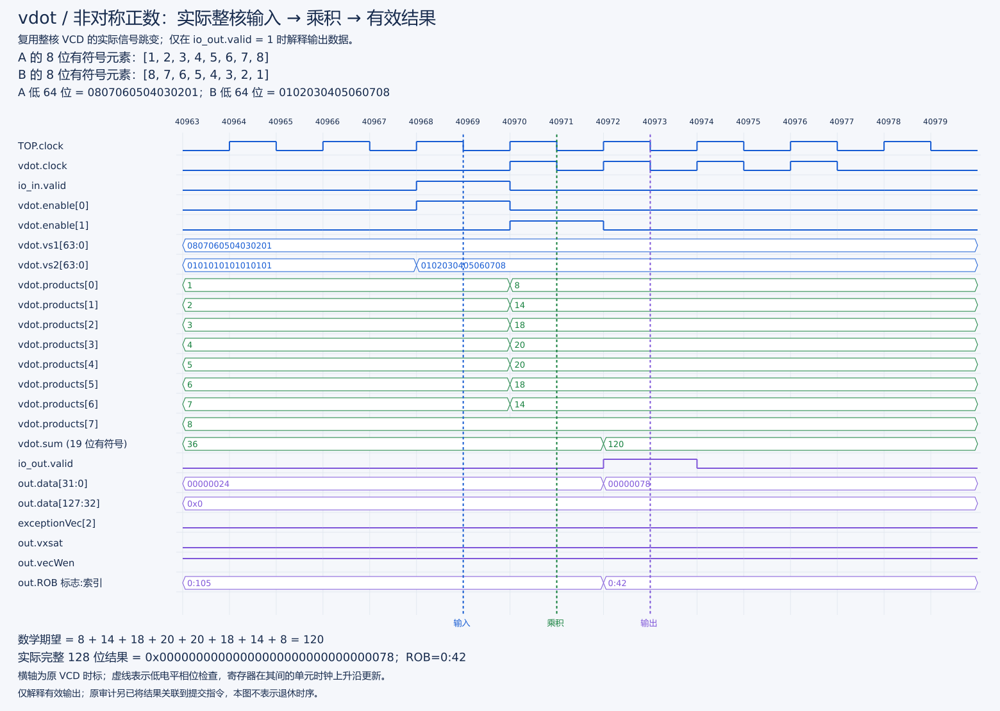
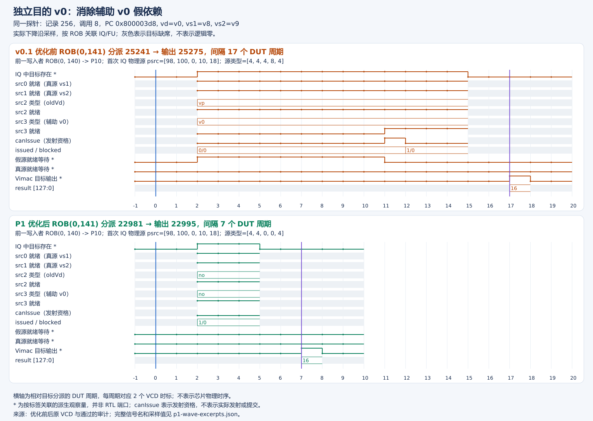
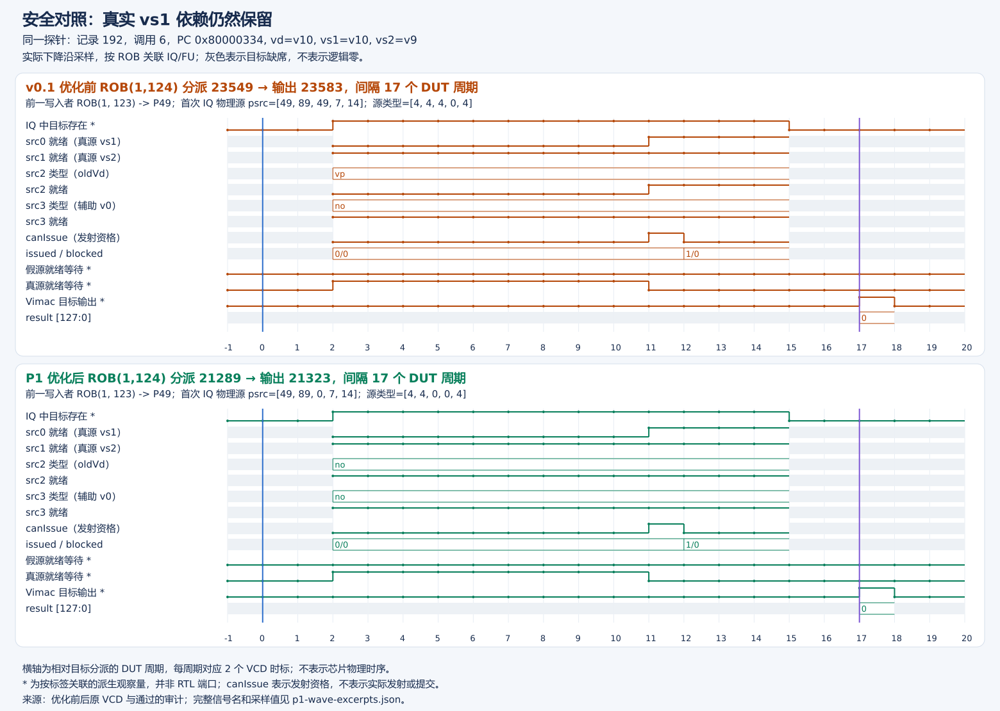
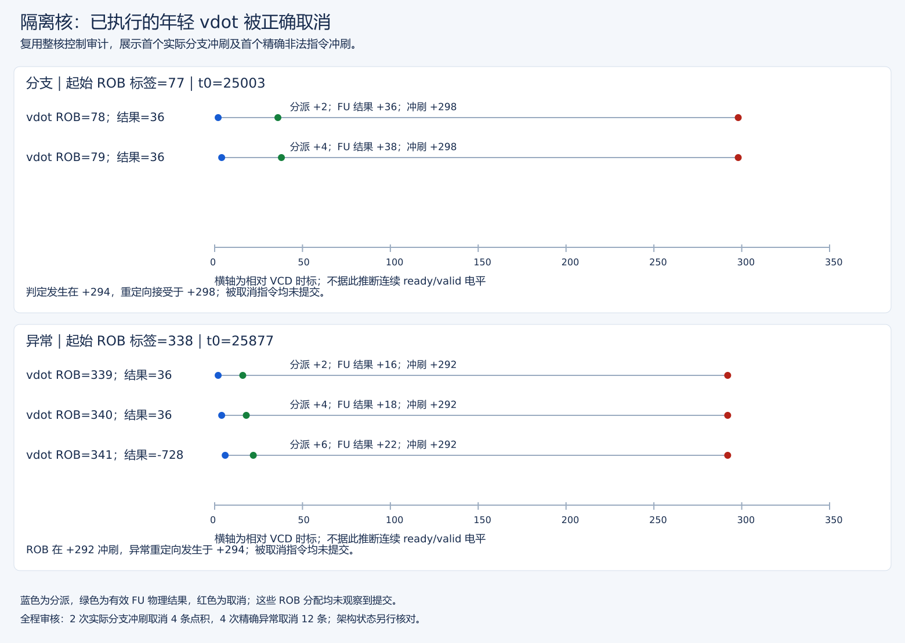

# vdot 功能、集成与整核控制验收

版本入口：当前默认推荐为[固定八项 e8/e16 新核验收](固定八项e8e16实施与验收报告.md)，运行组合见[版本选择](../../docs/核与参考库版本选择.md)。以下共同语义、四 seed 控制和内部取消波形均对应 v0.1/P1/旧 e8 隔离核；新核的 e16 合法配置和覆盖边界以扩展报告为准。

本报告汇总 v0.1、P1 和旧 e8 隔离核的功能、执行/提交及控制验证。各版本使用对应的核、参考库和程序；实施日志作为附件保留。当前 e8/e16 的验收另见上方版本入口。

## 1. 共同语义与版本身份

项目合同为 custom-0、低八项 signed int8 精确点积，低32位补码、高96位清零。仅 e8/m1/VL=8/vm=1/vstart=0/vill=0 且向量状态开启合法；ta/ma四种组合合法，不累加 oldVd，不做尾部/掩码合并。非法配置产生非法指令异常、不改目的；合法运算保留 vxrm/vxsat/vl/vtype，允许源/目的重叠、v0/v31。

| 版本 | emu（相对作品仓库） |
| --- | --- |
| v0.1 | `../XiangShan/build/emu` |
| P1 | `../XiangShan/build/p1-oldvd/emu` |
| 隔离核 | `../XiangShan/build/operand-isolation/emu` |

三版参考模型一致。P1仅去除无用途的oldVd依赖；隔离版再做数据分支隔离与逻辑更新使能，不改变 ISA。不能用旧核波形自动验收新 RTL。赛题官方语义/编码确认、物理 PPA 仍未闭合。

## 2. v0.1 实现与功能证据

| 层次 | 当时实际通过 | 证据 |
| --- | --- | --- |
| RTL | 三个 suite、四项测试，含1000随机、使能、真实wrapper、普通乘法混发及取消 | [历史摘要](vdot基础功能测试与验收报告v0.1.md) |
| NEMU API | 1035合法/10非法，另检查非vdot custom-0 tval不受修正影响 | 对应原始实验附件 |
| 整核差分 | 1052合法/10非法；32定向+1000随机、别名/v0/v31/链/mask、完整128位、CSR/异常恢复、普通vadd/vmul/vmacc/vsmul及饱和 | [原运行摘要](../logs/20261002T113045-vdot-run.log) |
| 整核波形 | 29次完整执行与29次实际提交关联 | [原波形报告](vdot原始核执行与提交波形.md) |
| 补丁 | 固定基线正向/当前树反向 apply检查通过，不改索引 | [补丁手册](../patches/vdot补丁选择与应用说明.md) |

完整差分当时为507883指令/429067 DUT周期，不是点积性能测量。构建为DefaultConfig/单核/EMU_THREADS=0/DRAMsim3 COSIM，保留差分、断言与trace；v0.1历史分离构建复用了首次FIR，不据此声称当时完成干净补丁一键全构建。

## 3. v0.1 执行/提交波形

历史 CPU 窗口20000–30000 cycle、目标PC=`0x800003a2`、机器码=`0x0294250b`、vd=v10。真实层级为 `TOP.SimTop.l_soc.core_with_l2.core.backend.inner_vfExuBlock.exus.Vimac.vdot`。解析器以顶层稳定低相位观察使能/128位输入，独立计算signed点积，核对完整结果和写使能/非法/vxsat，再按ROB与顺序关联提交。

观察到正数36/120、负数−36、最大131072、最小−130048、全127乘积129032、零/相消；高96位均零，无vxsat事件。完整执行29条与提交29条吻合，**该窗口未证明全部v0/非法/冲刷**。完整观察与复审命令保留在[原报告](vdot原始核执行与提交波形.md)。

图只读上述 v0.1 原 VCD，展示真实信号而非结果事件点。输入八项逐项相乘为 8、14、18、20、20、18、14、8，求和与有效输出均为 120；高 96 位为零。八组正数、负数及边界图的完整判读见[基础功能测试报告](vdot基础功能测试与验收报告v0.1.md)。这些是 v0.1 核的计算证据，不冒充隔离核新仿真，也不把 FU 输出当提交。

## 4. P1 与隔离核的新增验收

| 验收项 | P1 | 隔离核 |
| --- | --- | --- |
| 独立同配置整核构建 | 完成 | 完成，独立目录、不覆盖P1 |
| 原烟雾 | 52合法/10非法 PASS | 52合法/10非法 PASS |
| 原完整功能 | 1052合法/10非法 PASS | 1052合法/10非法 PASS |
| oldVd定向等待 | 误等待632→0，真依赖保留 | 沿用P1语义；不借P1波形替代隔离验收 |
| 门控模块前后 | 未隔离数据通路作为基线 | 301有效输出一致、4140禁用保持检查、37混合级重叠 |
| 四种子控制 | 曾单独用于调试测试方法，非隔离核证据 | 四seed均架构PASS，另有新核实际取消联合审计 |

P1证据入口为[v0.1→P1图文报告](../../stage3/reports/原始核至P1优化对比报告.md)。隔离模块与整核证据入口为[P1→隔离核图文报告](../../stage3/reports/P1至隔离核优化对比报告.md)。各版本测试项数属于各自历史记录；当时工具套件为56项，扩展至107项，均不能当作新增硬件测试。

### P1 的 v0 与真实依赖安全对照

此图直接复用 P1 已有整核前后图片，实际两个输入并不是 v0；它证明目的为 v0 时无用途辅助源不再阻塞，不能解读成“忽略所有 v0 读依赖”。

此图的 vd=vs1，删除 oldVd 后真实 src0 仍等待前一生产者，两侧分派到 FU 输出均为 17 周期。它是防止过度去依赖的安全对照，不是加速样例。灰色区域表示目标不在观察项中，不表示信号为零。详细 ROB、物理源及采样定义见[P1 原报告](../../stage3/reports/原始核至P1优化对比报告.md)。

## 5. 隔离核控制覆盖

| 项目 | 覆盖与判定 |
| --- | --- |
| 多seed | 56444f54/00000001/9e3779b9/deadbeef，各256随机；仿真初始化101/202/303/404 |
| 连续配置 | 每seed24合法切换组、16最终非法组，不通过插入CSR读人为排空配置依赖 |
| 混发/v0 | 每seed16×32混发，普通乘法/dot/读写v0/别名由独立C oracle检查 |
| 非零反馈长链 | 每seed16×128级，反馈低四字节，区别于性能基准零固定点链 |
| 实际误预测 | 2次，4条已执行dot产生36后取消、同一ROB分配无提交；不把4个探测轮算作4次误预测 |
| 精确非法异常 | 4次，12条已执行年轻dot取消、无提交；完整目的/v0毒值及CSR保持，cause/mepc/mtval与恢复检查 |
| 正向对照 | 128条合法训练dot正常提交 |

全体四seed共有1024随机、96合法配置组、64最终非法组、64混发组、64长链组。正式联合波形为[成功恢复的控制审计JSON](../waveform/20261006T033620-isolation-control-resumed.vcd.control.json)。它结合实际分派、物理输出、接受重定向/精确冲刷、ROB分配及提交；内部结果出现不等于架构写回。完整证据、失败修正和实际日志见[控制附件](隔离版本整核构建与控制验证报告.md)。

### 关键图：错误路径和异常后的年轻指令被取消

上图为首个实际误预测，下图为首个精确非法异常。蓝点是年轻 vdot 分派，绿点是已产生的物理结果，红点是取消。分支窗口中两条结果均为 36；异常窗口中三条结果为 36、36、−728，但同一 ROB 分配均没有提交。横轴为相对 VCD 时标，不当作 FU 延迟。

图来自既有隔离核联合审计，不用 P1 或模块夹具代替整核证明。图只选各类首个事件；完整的 2 次误预测、4 次异常和全部受影响指令仍以[控制报告](隔离版本整核构建与控制验证报告.md)及原 JSON 为准。图不能单独显示全程“无提交”，该结论来自审计对同一 ROB 分配的跟踪和架构检查。

## 6. 操作入口与限制

第三阶段 NEMU 语义、协同仿真提交边界、RVV 基线真实波形和正式加速比的集中讲解见[NEMU/协同仿真/Baseline 图文对照](../../stage3/reports/基线与vdot延迟加速图文分析.md)。该报告将软件参考语义、RTL 信号、推测取消事件和正式统计分开，不用 FU 结果线替代架构提交证明。

新构建/回归入口、精确种子与日志审核见[控制测试手册](../control-tests/整核控制与多种子验收手册.md)。已有构建不盲目重建，输出已有时脚本会拒绝覆盖；纯复审优先使用原报告中的审计命令和新的JSON路径。

本验收不是所有分支/异常/普通向量LMUL/widening/背压组合的形式化证明；wrapper固定ready，不外推任意背压。真实性能另见[当前测量手册](../../stage3/docs/历史隔离核性能测量与复核手册v3.md)与正式报告。RTL sampled bit flips不等于物理功耗，仿真周期不等于实际频率。
