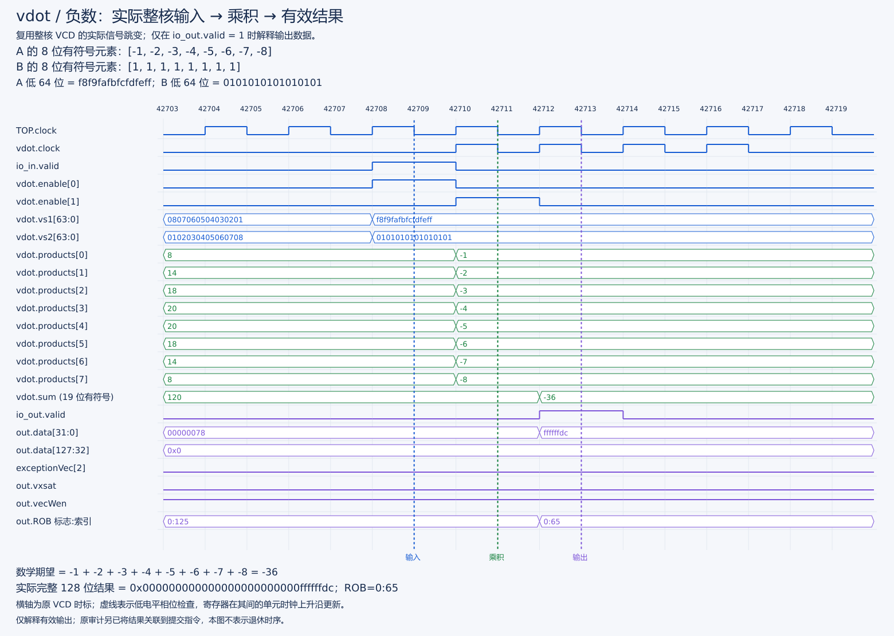
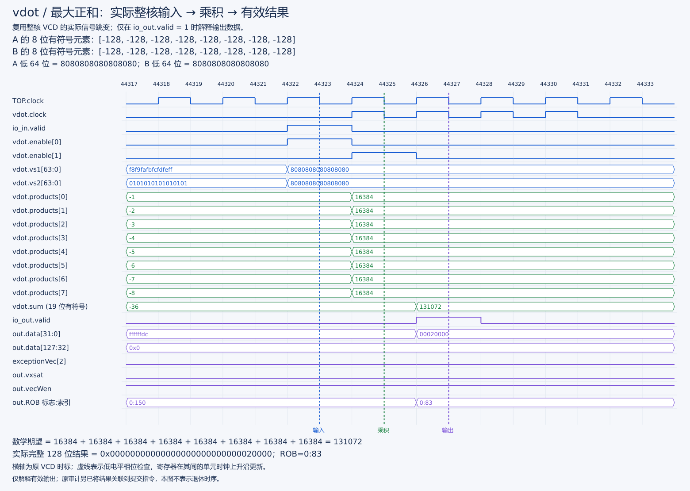

# vdot v0.1 整核执行与提交波形

实际运行：，完整 DefaultConfig、单核、DRAMsim3、断言、NEMU 差分和完整高/低时钟相位。运行 smoke 的 52 合法 / 10 非法用例；差分、PASS、GOOD TRAP、process/verification exit=0 均通过。

采集：原版本波形文件，窗口内另启用 commit trace。VCD 为 2,652,545,217 字节。完整采集日志 对应原始实验附件，采集摘要 对应原始实验附件。大 VCD/完整日志不提交 Git。

真实执行层级：

```text
TOP.SimTop.l_soc.core_with_l2.core.backend
  .inner_vfExuBlock.exus.Vimac.vdot
```

解析器根据 VDot8 的两个寄存器使能，从真实 128 位输入独立计算低八项 signed int8 点积；随后与 wrapper 的完整 128 位结果比较，检查非法标志、vxsat、vec/v0 写使能。使用顶层低时钟相位，而不是门控时钟下降沿：时钟停住时也可能出现下一拍要接收的输入。稳定采样与真实执行输出联合核对。

实际通过 **29 次完整执行结果**，与同窗口 **29 条实际 vdot 提交记录**按 ROB 序号和低 64 位结果顺序对应。机器码 `0x0294250b`，提交 PC `0x800003a2`，架构目标 v10；波形还记录物理目标与 ROB flag/value。各结果高 96 位均为零，vxsat 事件为 0。

| 结果类别 | 低 32 位 | 实际十进制值 |
| --- | --- | ---: |
| 正数 | `00000024` / `00000078` | 36 / 120 |
| 负数 | `ffffffdc` | -36 |
| 最大和 | `00020000` | 131072 |
| 最小和 | `fffe0400` | -130048 |
| 全 127 乘积 | `0001f808` | 129032 |
| 零 / 相消 | `00000000` | 0 |

### 关键图：输入、八路乘积、求和和有效结果



[清晰 SVG](../../stage3/reports/figures/functional/negative.svg)。图直接读取本报告已有整核 VCD 的信号变化：42709 检查负数输入，42710 的单元时钟上升沿后八路乘积变为 −1..−8，42712 上升沿后求和为 −36；42713 检查 `io_out.valid=1`、低 32 位 `ffffffdc`、高 96 位 0。异常与饱和标志均为 0，ROB=0:65，与原执行记录相同。



[清晰 SVG](../../stage3/reports/figures/functional/maximum.svg)。八个 −128×−128 的乘积均为 16384，19 位求和为 131072，有效输出为低 32 位 `00020000`、高 96 位零。不能把无效周期残留的前一次结果当作本次结果。

正数、最小值、全 127、零和非零相消等八组完整图及逐项计算见[基础功能测试报告](vdot基础功能测试与验收报告v0.1.md)。原[结果事件概览](../../stage3/reports/figures/evidence/vdot-result-events.png)保留作索引，不代替这些真实信号波形。窄窗[采样数据](../../stage3/reports/figures/functional/functional-samples.json)保留信号全名和实际值；只读原 VCD，未重新仿真或生成波形文件。

新图只展示物理计算与有效输出，不展示退休时序；29 条执行与 29 条提交的对应仍由[原关联日志](../logs/20261002T114458-core-wave-commit-audit.full.log)验证。

四种 ta/ma 已由整个 smoke 与全量测试程序独立检查；本窗口从第一定向组后部开始，涵盖其余定向边界。并未在此窗口证明 v0、非法指令或冲刷波形；后续隔离核的实际取消另见[整核控制报告](隔离版本整核构建与控制验证报告.md)，不能借用本图代替。不能以非法执行的数据线值代替架构写回判断。

复查：

已完成结果及当前复核方式见[版本与复核入口](../../docs/核与参考库版本选择.md)。

对应原始实验附件 已实测 `commit correlation PASS: execution_observations=29 vdot_commits=29` 与 `core waveform execution-path PASS: checked=29`，退出 0。波形时间戳为仿真 dump 时标，不当作综合频率或 PPA 证据。
