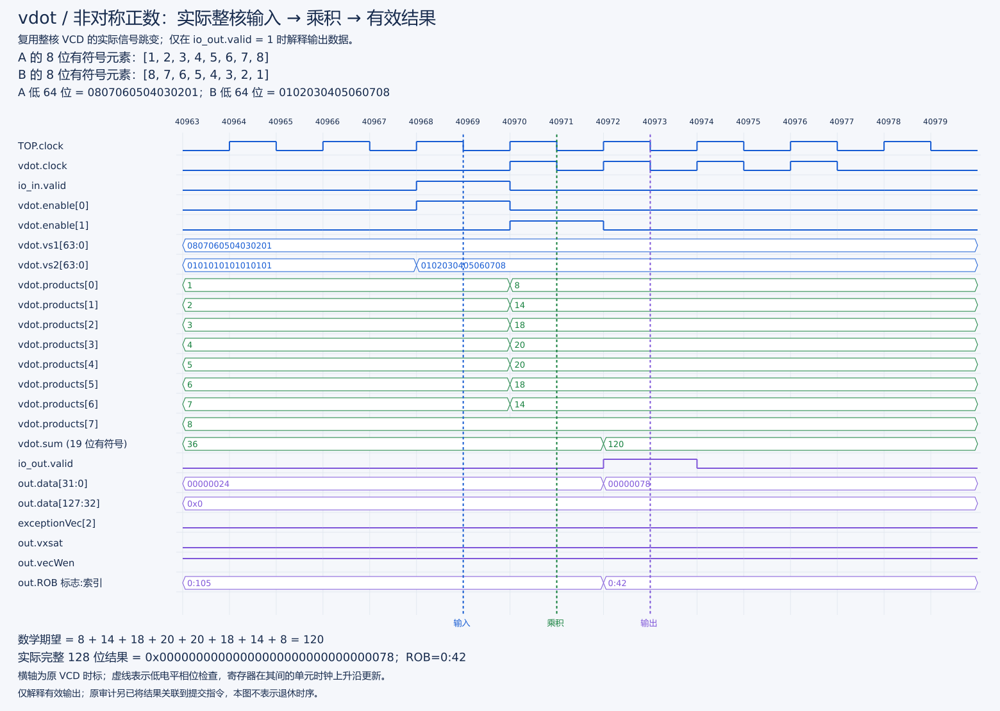
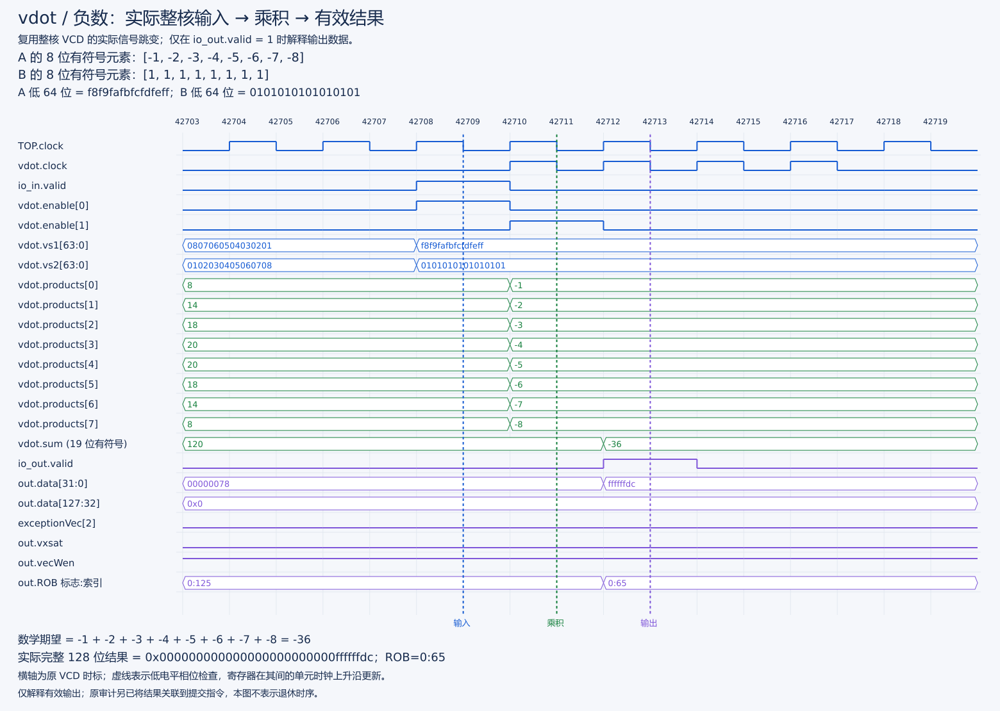
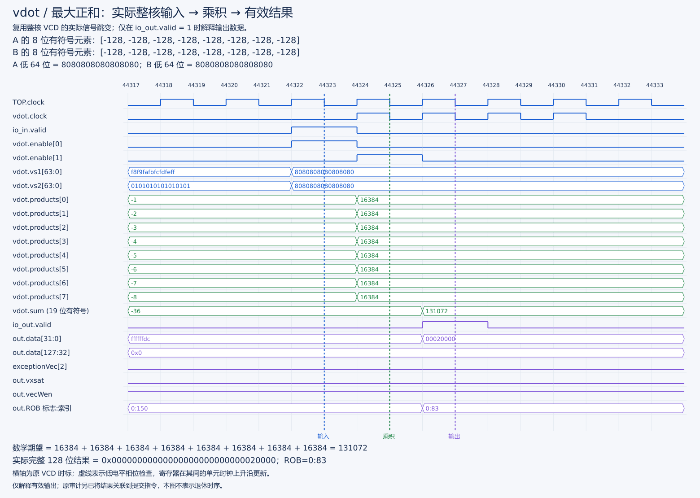
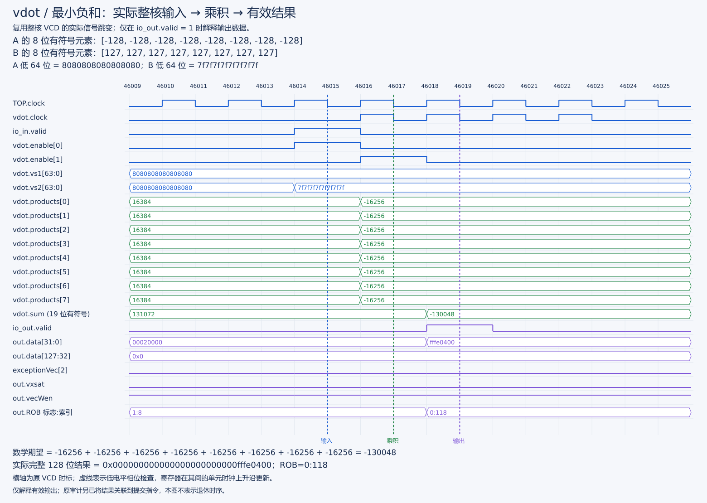
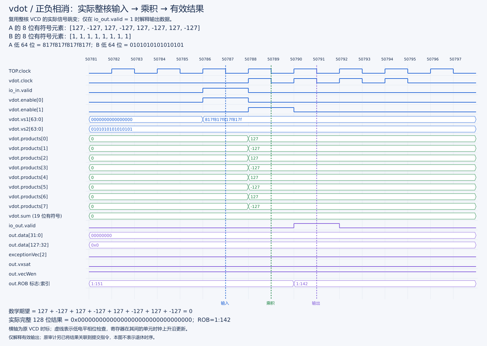

# vdot v0.1（e8）基础功能测试与验收报告

版本范围：本报告保留 v0.1 的正数、负数和边界测试及真实整核信号图。当前 e8/e16 核的完整结果见[扩展验收](固定八项e8e16实施与验收报告.md)和[整核图文总结](e16整核仿真与关键信号图解.md)。这些材料与下文历史用例分别对应各自的运行。

新核完整差分通过。此处验收针对项目约定的 v0.1，不代表比赛官方确认编码、语义或 PPA。

## 实现范围

custom-0；低八项 signed int8 点积，精确求和，低 32 位补码、高 96 位清零。仅 e8/m1/VL=8/vm=1/vstart=0/vill=0 且向量状态启用；非法配置产生非法指令异常，不改目的寄存器。支持源/目的重叠、v0、v31，保留 vxrm/vxsat/vl/vtype。

## 已取得证据

| 验证层级 | 实际结果与记录 |
| --- | --- |
| RTL 单测 | 三个 suite、四项测试全部通过；含 1,000 随机算术、流水使能、实际 wrapper、混发普通乘法和取消；对应原始实验附件 |
| NEMU API | 1,035 合法 + 10 非法；另检查非 vdot custom-0 的 tval 不被 VL-only 修正影响；对应原始实验附件 |
| 新核完整差分 | 1,052 合法 + 10 非法；32 定向、1,000 随机、别名/v0/v31/依赖链/v0-mask、完整 128 位结果与 CSR/异常/恢复、普通 vadd/vmul/vmacc/vsmul 饱和回归；[可提交摘要](../logs/20261002T113045-vdot-run.log) |
| 实际整核波形 | 29 个完整执行结果与 29 条提交记录关联，复核 ROB、目标和结果；[波形报告](vdot原始核执行与提交波形.md) |
| 补丁 | XS / NEMU 干净固定基线正向及当前树反向 `git apply --check` 通过；未修改 Git 索引；[补丁说明](../patches/vdot补丁选择与应用说明.md) |

完整差分记录包含 `Difftest enabled`、`vdot PASS: valid=1052 illegal=10`、`HIT GOOD TRAP`，process/verification exit 均为 0。507,883 条指令、429,067 个 DUT 周期；这是全测试程序统计，不是点积性能测量。

## 基础功能计算的真实信号波形

本节直接读取已有整核文件 原版本波形文件，提取输入、八路乘积、求和寄存器和有效输出的实际变化，**不是此前只有结果点的事件图**。没有重新仿真或生成 VCD/FST。原文件来自 v0.1 核，不作为隔离核新增测试；用例来源见[测试源码](../vdot-tests/main.c)。

### 怎样从波形核对计算正确

1. 看 `io_in.valid` 和 `vdot.enable[0]`，确认本次输入进入第一级；从 `vdot.vs1[63:0]` / `vs2[63:0]` 按低字节到高字节解释八个 signed int8。图上方同时列出十进制输入。
2. 在随后实际 `vdot.clock` 上升沿后，查看 `products[0..7]` 的八个 signed16 乘积，逐项与输入相乘核对。
3. 看 `enable[1]` 和下一次单元时钟上升沿，确认 `sum (signed19)` 等于八个实际乘积之和。
4. 只有 `io_out.valid=1` 时才认定本次输出有效；核对低 32 位补码、高 96 位为零、`exceptionVec[2]=0`、`vxsat=0`、`vecWen=1`，再用输出 ROB 标记关联原执行记录。

横轴保留原 VCD 时标，不当作芯片物理时间。虚线 INPUT/PRODUCTS/OUTPUT 是稳定低相位的检查点，寄存器在其间的实际单元时钟上升沿更新。无效周期也保留原数据线值，不能把提前出现或保持的数值误认为一次有效输出。若相邻测试数据相同，寄存器可能不翻转；图不会人为补画跳变。

### 正数点积：八个乘积相加得到 120

[清晰 SVG](../../stage3/reports/figures/functional/positive-asymmetric.svg)。A=`[1,2,3,4,5,6,7,8]`，B=`[8,7,6,5,4,3,2,1]`。实际乘积为 `[8,14,18,20,20,18,14,8]`，和为 120。

输入检查点为 40969，乘积检查点为 40971，输出检查点为 40973；对应更新上升沿为 40970、40972。有效输出低 32 位为 `0x00000078`，高 96 位为 0，ROB=。另一个正数 36 用例的完整信号见[PNG](../../stage3/reports/figures/functional/positive.png) / [SVG](../../stage3/reports/figures/functional/positive.svg)，不是只保留结果数字。

### 负数点积：符号正确且只扩展至低 32 位

[清晰 SVG](../../stage3/reports/figures/functional/negative.svg)。A=`[-1,-2,-3,-4,-5,-6,-7,-8]`，B 全为 1。输入检查点 42709，实际乘积在 42711 为 `[-1,-2,-3,-4,-5,-6,-7,-8]`，求和为 −36。

42713 的有效输出为低 32 位 `0xffffffdc`、高 96 位 0，ROB=0:65。图中先前数据线上的 120 不是本次输出；必须联合观察 `io_out.valid` 与本次 ROB 标记。

### 最大和：需要 19 位有符号求和

[清晰 SVG](../../stage3/reports/figures/functional/maximum.svg)。A、B 均全为 −128，八个实际乘积各为 16384，和为 131072。输入/乘积/输出检查点分别为 44323/44325/44327，输出低 32 位 `0x00020000`、高 96 位 0，ROB=0:83。131072 超过 18 位有符号数上界 131071，波形支持总和使用 19 位的设计要求。

### 最小和：负乘积和负结果均保持正确

[清晰 SVG](../../stage3/reports/figures/functional/minimum.svg)。A 全为 −128，B 全为 127，八个实际乘积各为 −16256，和为 −130048。输入/乘积/输出检查点为 46015/46017/46019，输出低 32 位 `0xfffe0400`、高 96 位 0，ROB=0:118。

### 零与正负相消：分开验证

[清晰 SVG](../../stage3/reports/figures/functional/cancellation.svg)。A=`[127,-127,127,-127,127,-127,127,-127]`，B 全为 1，八个非零乘积正负相消。50787/50789/50791 分别检查输入、乘积及有效输出，结果为零，ROB=1:142。这与“输入全零”不同：相消图必须看到非零乘积，而不是仅看零结果。

输入全零用例另见[PNG](../../stage3/reports/figures/functional/zero.png) / [SVG](../../stage3/reports/figures/functional/zero.svg)；全 127 的正端点用例另见[PNG](../../stage3/reports/figures/functional/all127.png) / [SVG](../../stage3/reports/figures/functional/all127.svg)。

### 八组代表用例的核对结果

| 用例 | 数学期望 = 八路乘积和 = signed19 实测 | 有效输出低 32 位 | 输入 / 乘积 / 输出检查时标 |
| --- | ---: | --- | --- |
| 正数、B 全 1 | 36 | `0x00000024` | 40143 / 40145 / 40147 |
| 正数非对称 | 120 | `0x00000078` | 40969 / 40971 / 40973 |
| 负数 | −36 | `0xffffffdc` | 42709 / 42711 / 42713 |
| 最大和 | 131072 | `0x00020000` | 44323 / 44325 / 44327 |
| 最小和 | −130048 | `0xfffe0400` | 46015 / 46017 / 46019 |
| 全 127 | 129032 | `0x0001f808` | 47563 / 47565 / 47567 |
| 全零输入 | 0 | `0x00000000` | 49133 / 49135 / 49137 |
| 非零正负相消 | 0 | `0x00000000` | 50787 / 50789 / 50791 |

八组均核对完整 128 位结果，高 96 位均为零；同时检查输出有效、合法配置、异常/饱和标志、目的写使能以及两个实际单元时钟上升沿。完整信号名称与窄窗采样见[图件数据](../../stage3/reports/figures/functional/functional-samples.json)，图件提取入口为 `stage2/tests/render-functional-wave.py`。

这些图验证选定用例的计算通路，不替代全部功能测试。程序还有 32 个定向用例（八组输入×四种 ta/ma）、随机和集成检查；原[执行/提交关联记录](../logs/20261002T114458-core-wave-commit-audit.full.log)关联 29 次执行与 29 条提交。图中 FU 输出不是提交时刻，完整功能结论仍结合 Difftest 与独立软件 oracle。后续隔离核的取消验证见[统一功能报告](vdot功能与整核控制验收报告.md)，不跨版本借用本图。

## 构建配置

- 配置：完整 DefaultConfig、单核、EMU_THREADS=0、DRAMsim3 COSIM=ON，保留性能统计、断言、差分及 trace 支持。

## 限制与复现

真实波形窗口仅覆盖部分定向输入，未覆盖全部 v0/非法/冲刷场景；取消证据来自 wrapper 单测，不据此宣称完整 CPU 错误路径验证。PPA/综合频率未取得；官方语义确认未取得。本轮等价基线及性能测量已通过，见 [性能报告](../../stage3/reports/vdot原始版本等价基线与性能实测.md)。

完整核构建已实际成功，但复用首次生成 FIR 的分离构建流程；新提供的 CHIRRTL 一键分离脚本尚未端到端复跑，不能宣称干净补丁全构建复现已经通过。工具链、固定依赖提交、兼容性修正和失败尝试见 [操作手册](../docs/vdot历史集成操作手册v0.1.md) 与 [实现与验收说明](vdot原始版本实施记录.md)。大型 emu/VCD/完整日志留在本地，不提交 Git。
