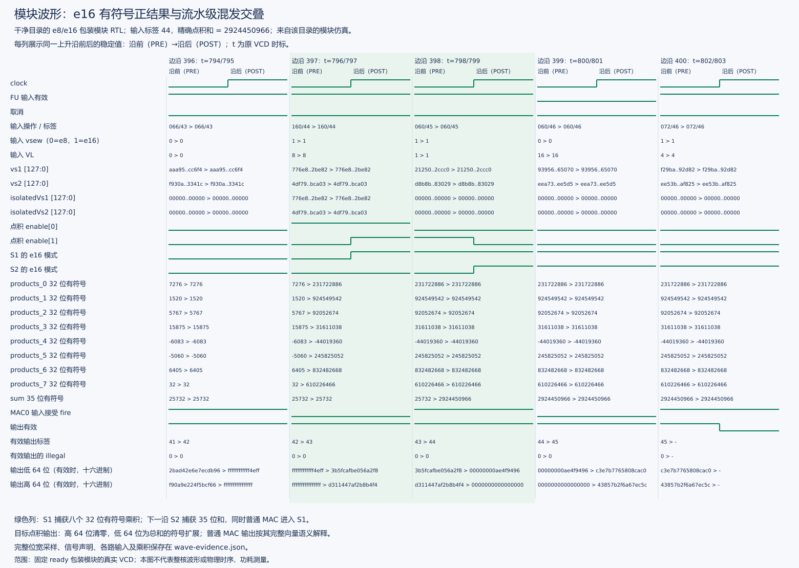
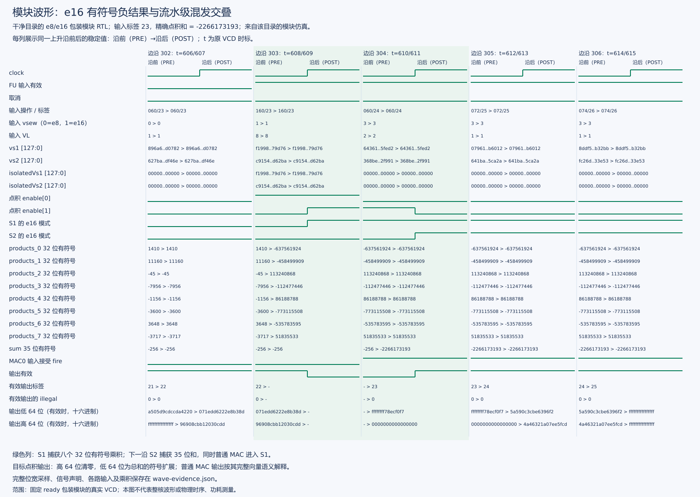

# 公开包独立目录复现报告

独立目录复现通过：依赖准备、NEMU 与 DRAMsim3、整核真实构建、Hello、37 元素向量加法、合同功能与控制、完整 e8/e16 扩展及两个性能烟雾均正常完成。另生成一份混发模块小波形并通过审核，附两张 e16 正负结果图。完整结果见[本轮汇总](../logs/clean-reproduction/summary.json)，发布范围见[材料清单](../../docs/发布材料清单.md)。

## 复现范围

本轮使用独立目录 `xs-env/cleanworkspaces/sew16-v2/`。准备脚本先从 Git 对象检出指定依赖，再复制发布候选作品树、生成新工作区的 `env.sh`，最后应用 XiangShan、NEMU 和 Difftest 三份补丁。没有复制原开发目录的 emu、NEMU 构建库、软件镜像、Scala 类文件或 C++ 对象文件。

复现沿用同一主机工具链，复用已下载的 Mill/Coursier 依赖；它不是全新操作系统或容器验收。上游 `ready-to-run` 和工具资源随指定依赖版本保留，实际差分参数明确使用本轮新编译的 NEMU 库。补丁涉及的 20 个源文件与原当前版本逐字节一致。

实际构建使用 `releases/sew16-public-v2/` 中的候选作品树；最终 `releases/sew16-public/` 在完成运行后收录了报告、图件和选定日志。41 份程序/配置/编译输入与实跑树完全一致，硬件、参考模型和兼容补丁涉及的 20 个文件也一致，见[程序输入核对](../logs/clean-reproduction/final-source-equivalence.json)和[补丁源码核对](../logs/clean-reproduction/patch-source-equivalence.json)。最终压缩包另做了解压、清单、链接和数据复算检查，没有再次从该压缩包启动完整整核构建。

详细依赖见 `manifest/release-dependencies.json`，实际工具版本见 `manifest/release-toolchain.json`。依赖准备结果保存在[准备记录](../logs/clean-reproduction/prepare-workspace.json)，另有[完整检出日志](../logs/clean-reproduction/prepare-workspace.full.log)和[本地工具准备记录](../logs/clean-reproduction/tool-setup.json)。

## 实际执行顺序

| 顺序 | 实际操作 | 对应记录或说明 |
| --- | --- | --- |
| 1 | 在前期 v1 目录准备依赖，发现 NEMU 隐式仓库和缺少 CMake；补全为 24 项依赖清单 | v1 是前期准备目录，未作为最终整核实跑目录 |
| 2 | 从候选树及本地 Git 对象准备 v2；修正 SoftFloat 源码目录判断后恢复检出，随后复制作品并应用三份补丁 | [准备记录](../logs/clean-reproduction/prepare-workspace.json)、[检出日志](../logs/clean-reproduction/prepare-workspace.full.log) |
| 3 | 在 v2 并行构建 NEMU、DRAMsim3，完成参考检查；启动整核构建，并在期间编译六份软件镜像 | [构建阶段记录](../logs/clean-reproduction/completed-build-stages.json) |
| 4 | 整核成功后并行启动三组回归：Hello→vadd→烟雾0→烟雾1；完整扩展→审核；合同功能→合同控制 | [运行汇总](../logs/clean-reproduction/summary.json)保存每步的命令、起止和退出 |
| 5 | 整核回归全部通过后，运行一次混发模块测试；修正波形查找路径后收集并审核同一份 VCD | [模块日志](../logs/clean-reproduction/module-mixed.full.log)、[恢复前状态](../logs/clean-reproduction/wave-collection-recovery-before.json) |
| 6 | 从该压缩 VCD 提取两张图，整理源码包和证据包；解压压缩包，在临时目录只读复查 | 复查不启动 CPU，也不重新采样正式性能 |

## 构建结果

| 步骤 | 结果 | 本机耗时 | 实际记录 |
| --- | --- | --- | --- |
| NEMU 当前参考库 | 编译成功 | 15 秒 | [构建日志](../logs/clean-reproduction/nemu-build.full.log) |
| 参考模型整数检查 | 2304 合法、96 非法、4 数据种子，ABI=1400 | 1 秒 | [参考检查](../logs/clean-reproduction/reference.full.log) |
| DRAMsim3 COSIM | 静态库及接口符号检查通过 | 11 秒 | [构建日志](../logs/clean-reproduction/dramsim-build.full.log) |
| Scala 编译及 CHIRRTL | 成功 | 869 秒 | [生成日志](../logs/clean-reproduction/chirrtl.full.log) |
| firtool 转换 | 成功 | 359 秒 | [转换日志](../logs/clean-reproduction/firtool.full.log) |
| 存储器生成 | 成功 | 1 秒 | [生成日志](../logs/clean-reproduction/memory-generation.full.log) |
| Verilator 与 C++ | 成功 | 1630 秒 | [编译日志](../logs/clean-reproduction/cpp-build.full.log) |
| 整核完整构建 | 成功，真实退出 0 | 2861 秒 | [总日志](../logs/clean-reproduction/core-build.full.log) |

表中 2861 秒只覆盖整核构建。其后的完整扩展约 2589 秒、合同组约 1102 秒、两个烟雾分别约 1761/1623 秒；三组回归有重叠，不能把这些时间简单相加作为总墙钟时间。从启动整核构建到波形收集恢复完成约 1 小时 49 分，不含此前准备依赖和工具。耗时来自本机日志，硬件性能仍按既定仿真周期协议评价。

两份合同镜像、完整扩展镜像、性能镜像，以及 Hello/vadd 镜像均在本轮从源码编译。裸机链接保留 RWX 段提示

## 已完成整核差分

本轮这些整核进程的初始化 seed 均为 101；完整扩展在同一进程内使用四个数据种子。新工作树没有重新执行四初始化种子的内部事件模型实验，原对应证据仍单独保留。

| 测试 | 本轮结论 | 指令数 | 核周期 | 证据 |
| --- | --- | --- | --- | --- |
| Hello | 指定团队输出、差分、GOOD TRAP、退出 0 | 1418 | 14542 | [本轮日志](../logs/clean-reproduction/hello.full.log) |
| 标准 vadd | 37 元素结果正确、差分、GOOD TRAP、退出 0 | 5983 | 27434 | [本轮日志](../logs/clean-reproduction/vadd.full.log) |
| 合同功能 | 52 项既有合法检查、10 项非法检查及 32 项 e16 合法检查通过 | 27074 | 79758 | [功能日志](../logs/clean-reproduction/contract-functional.full.log) |
| 合同控制 | 随机、配置、分支/非法路径、混发与长链的架构检查通过 | 368214 | 232893 | [控制日志](../logs/clean-reproduction/contract-control.full.log)、[架构审核](../logs/clean-reproduction/contract-control.architectural.json) |
| 完整 e8/e16 扩展 | 1564 项 e8、836 项独立 e16 检查及额外 32 项共享 e16 检查通过，四个数据种子 | 939603 | 779773 | [整核日志](../logs/clean-reproduction/sew16-core.full.log)、[审核结果](../logs/clean-reproduction/sew16-audit.json) |

两套合同测试的指令数与周期均复现了历史成功记录；运行输入为本轮的新 emu、新参考库和新镜像。[构建阶段与合同统计](../logs/clean-reproduction/completed-build-stages.json)保留原始日志位置及结果。

本轮完整扩展镜像由当前源码重建，共享测试适配器增加的 32 项 e16 正例也实际执行。它与原保留镜像的工作量不同，因此本轮总指令数、总周期不与旧完整回归直接作性能比值。性能测量继续使用独立基准和预定协议。

两个性能烟雾均通过：每进程、每位宽、每实现各 40 次完整结果/CSR 等价性检查，两进程合计 320 次；每进程保留 120 条预热与计时采样，共 240 条，独立整数 oracle 通过。

| 初始选序 first | 初始化种子 | 指令数 | 核周期 | 证据 |
| --- | --- | --- | --- | --- |
| 0 | 101 | 280228 | 521405 | [原始日志](../logs/clean-reproduction/performance-smoke0.full.log)、[审核](../logs/clean-reproduction/performance-smoke0.audit.json) |
| 1 | 101 | 280226 | 521471 | [原始日志](../logs/clean-reproduction/performance-smoke1.full.log)、[审核](../logs/clean-reproduction/performance-smoke1.audit.json) |

两进程使用同一实际数据种子，初始选序相反。此处验证新构建的核、参考库和性能镜像能配套运行；它们不是八进程正式统计的补采样，不与原 1920 行数据混合。

这里的控制通过是架构状态验收，不代替内部 ROB 同代次取消/提交审计。已有内部事件证据及其四种子轨迹相同的边界仍见[独立取消实验](e16整核取消与独立初始化实验报告.md)。

## 干净构建发现并修复的问题

1. NEMU 的 nanopb、LibCheckpoint 及其 nanopb、gcpt_restore、SoftFloat 会由 Makefile 隐式拉取，初版子模块清单未覆盖。现已将这五项与其他依赖一起指定版本，共 24 个仓库。
2. 原 CMake 位于临时目录，新的环境没有可直接调用的 CMake。本轮在工具目录独立解包 CMake 4.2.3 及所缺运行库，使用 `VDOT_CMAKE` 和对应库路径完成构建；没有修改系统安装。
3. SoftFloat 的 `build/` 含受版本管理的 Makefile，不能仅凭目录名判定为缓存。准备脚本已修正，并允许在源码仍干净、作品尚未复制时恢复依赖检出。
4. Mill 的 `testOnly` 将波形放在 `out/xiangshan/test/testOnly.dest/sandbox/test_run_dir/`。首次收集脚本仅查询顶层目录，导致收集步骤退出；已修正路径查找，复用同一次成功测试生成的 VCD，未重新运行仿真。[收集恢复前状态](../logs/clean-reproduction/wave-collection-recovery-before.json)与完成记录分别保留。

这些问题的失败和恢复过程保留在工作区准备日志及本轮操作记录中，不据此改写历史成功实验。

## 新模块波形与逐项核对

混发模块测试共发出 1027 项、检查 1003 项、取消 24 项，四数据种子通过。波形审核覆盖 1158 个边沿，观察到 113 次 e8、80 次 e16 输入、13221 次禁用保持检查和 142 次混合级重叠。[模块测试日志](../logs/clean-reproduction/module-mixed.full.log)、[隔离与保持审核](../logs/clean-reproduction/module-isolation.json)及[精确采样](figures/clean-reproduction/wave-evidence.json)可复查。

本轮只执行一次混发模块波形测试。原始 VCD 由 Verilator 生成，压缩副本为 8408599 字节，约 8.02 MiB；PNG/SVG 和精确采样均从同一份文件提取。没有重新生成历史波形或整核连续大波形。

正数窗口的目标 tag=44。输入为 e16、VL=8；第一级采集八个 signed32 乘积，下一边沿第二级得到 signed35 总和 **2924450966**。有效输出 tag=44、异常为 0，低 64 位与期望一致，高 64 位为零；该正结果已超出 signed32 上限。图中同时观察到普通乘法进入第一级，与点积第二级重叠。

负数窗口的目标 tag=23。八个有符号乘积之和为 **−2266173193**；有效输出的低 64 位为该数的补码扩展，高 64 位仍为零。必须联合输出有效、tag 和异常行读取结果，不能把相邻普通乘法的全向量输出当作点积输出。

两图使用模块测试的真实端口、寄存器和时钟边沿；它们证明算术及两级对齐，不是整核连续 VCD 或架构提交证明。整核正确性由上方本轮差分与实际退出记录验证，内部取消仍引用其独立事件实验。

## 性能复算与发布范围

源码发布包保留设计、代码、三份补丁、图件、所引日志及可搬迁复算材料；本轮压缩模块 VCD 单独放入复现证据包。原核、旧镜像及已有归档维持原状态，本轮没有删除原产物；历史 VCD 已清理与仍保留的范围见[清理台账](../../manifest/存储清理台账.md)。发布清单、检查命令和重建步骤见[交付复现手册](../../docs/公开交付与干净复现操作手册.md)。官方语义确认、录屏、PPT 及正式上传仍需按比赛要求完成。
