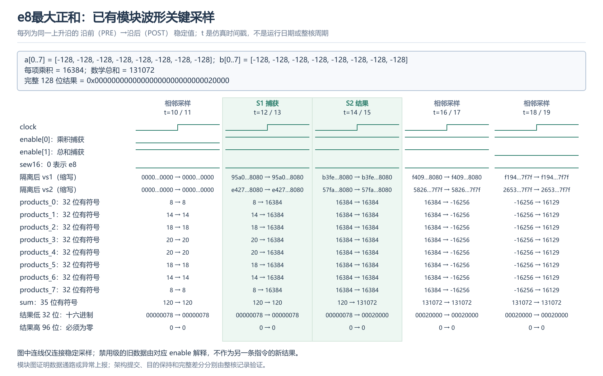
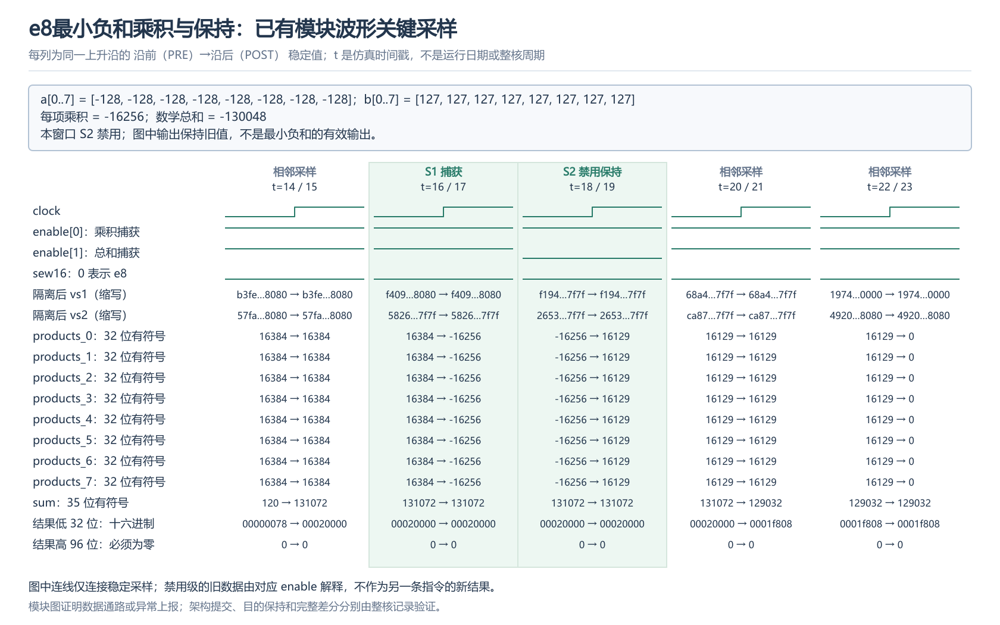
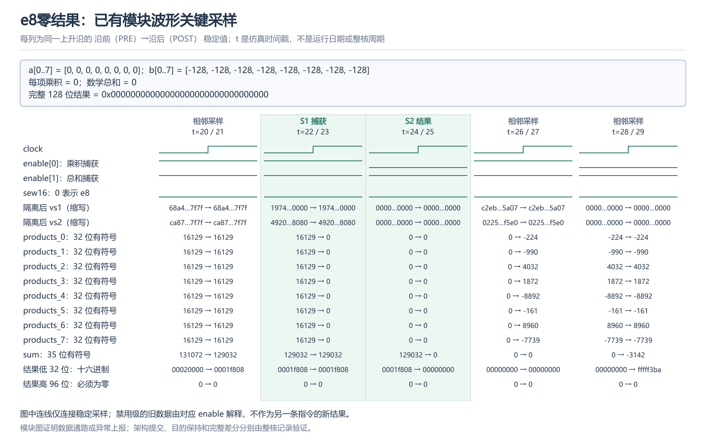
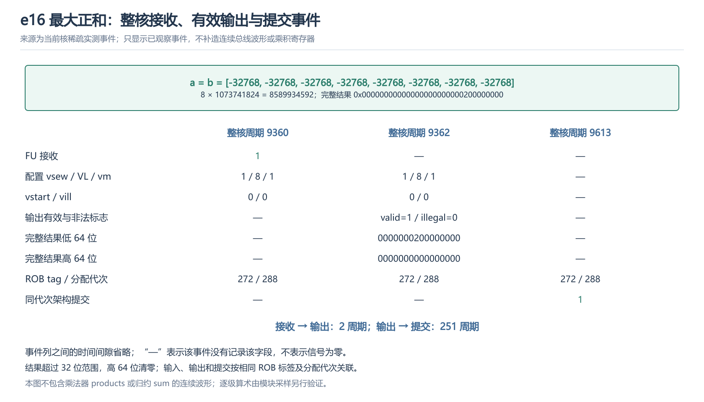
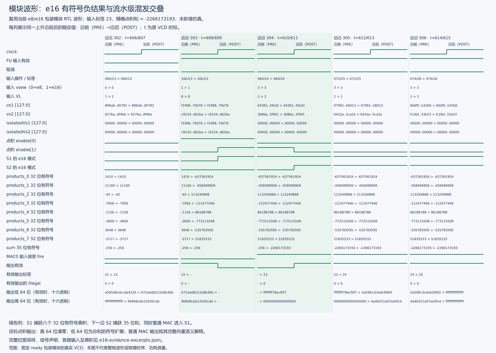
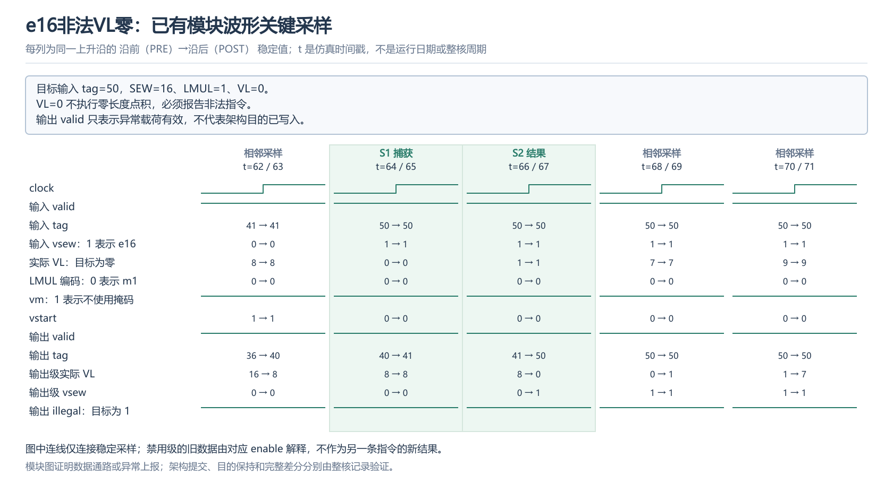

# 固定八项 e8/e16 功能与边界验收报告

当前 `sew16-fixed8` 核已通过模块、NEMU 参考模型和完整整核差分验收：e8 检查 1564 项，e16 检查 836 项，GOOD TRAP、进程退出码与审核结果均通过。本报告说明整数极值、零、结果位宽及配置边界，并用已有模块波形和整核事件逐项解释关键信号。

## 1. 验收对象与判定方法

VLEN=128、LMUL=1、VL=8、vm=1、vstart=0。每条点积对八对有符号元素精确求和，不累加 oldVd。e8 结果放在低 32 位、高 96 位清零；e16 结果放在低 64 位、高 64 位清零。指令定义见[设计说明](../docs/vdot指令设计说明.md)。

| 验证层次 | 判定内容 | 已完成结果 |
| --- | --- | --- |
| 模块功能 | 八路乘积、精确总和、使能、模式对齐、普通乘法混发及非法配置 | 4 个 suite、8 项测试通过；随机混发 issued=1027、checked=1003、cancelled=24 |
| NEMU 参考模型 | 独立整数参考计算、完整向量寄存器及配置 CSR 比较 | 2304 项合法、96 项非法检查通过 |
| 整核差分 | 实际软件输入、完整目的结果、CSR、异常恢复及依赖 | e8 检查 1564 项、e16 检查 836 项，通过 |
| 模块活动 | 操作数隔离、禁用保持、混合级推进 | 1158 个边沿、13221 次禁用保持、142 次交叠检查通过 |
| 精确控制 | 分支错误路径与较老非法指令取消年轻点积 | 四独立初始化进程，共取消 112 条已执行 e16，同分配代次均未提交 |

模块波形说明算术与执行控制，整核事件说明接收、结果和提交，完整差分程序说明已执行测试集合的架构结果。这三类证据按各自范围使用。

## 2. 数值及配置边界

| 配置与输入 | 精确总和 | 结果格式 | 验收证据 |
| --- | --- | --- | --- |
| e8：两源全 −128 | 131072 | 低 32 位 `0x00020000`，高 96 位零 | 当前模块完整乘积与输出波形、整核功能检查 |
| e8：一源全 −128，另一源全 127 | −130048 | 低 32 位 `0xfffe0400`，高 96 位零 | 当前乘积/禁用保持波形、独立极值功能检查及整核差分 |
| e8：任一源全零 | 0 | 完整 128 位为零 | 当前模块完整波形、整核功能检查 |
| e16：两源全 −32768 | 8589934592 | 低 64 位 对应原始实验附件，高 64 位零 | 当前整核接收、有效结果及同代次提交事件 |
| e16：一源全 −32768，另一源全 32767 | −8589672448 | 低 64 位 `0xfffffffe00040000`，高 64 位零 | 模块极值功能检查、独立参考计算及整核定向测试 |
| e16：任一源全零 | 0 | 完整 128 位为零 | 独立参考计算及整核定向测试 |
| VL=0、其他非法 VL、vm=0、vstart≠0、不支持的 SEW/LMUL | 非法指令 | 异常时不提交目的结果 | wrapper 异常波形、精确异常及目的保持检查 |

e8 精确和需至少 signed19，e16 需至少 signed35。当前共享数据通路使用八个 signed16×16 乘法器、八个 signed32 乘积寄存器，以及 signed33→signed34→signed35 加法树，保留全部进位。

## 3. 读图顺序与信号含义

| 信号 | 应核对的内容 |
| --- | --- |
| `io_vs1/2`、`io_sew16` | 本次输入及元素模式；e8 只取低八字节，源高位可含非零干扰数据 |
| `isolatedVs1/2` | S1 关闭时输入夹零；图中长向量缩写，完整值保存在信号摘录中 |
| `enable[0]`、`products_0..7` | 第一级允许捕获时，八个乘积才属于当前输入 |
| `enable[1]`、`sum` | 第二级允许捕获时，当前乘积才进入总和寄存器；关闭时保留旧值 |
| `io_result` 的低位及高位 | 既要核对低位补码，也要核对未使用高位清零 |
| wrapper 的 `outValid/outTag/outVl/vsew/illegal` | 使用输出级配置与标签解释异常，不能用较年轻输入配置解释较老输出 |
| 整核 `FU accept/result/commit` | 区分执行接收、物理结果与架构提交，按 ROB 标签及分配代次关联 |

以下模块图按上升沿前后稳定采样显示 `PRE → POST`。t 是原 VCD 仿真时间戳，不是运行日期或整核周期；独立算术模块没有自己的 valid/tag，结果归属由两级使能和保存的乘积来源确定。

## 4. e8 最大正和：完整乘积、总和与写回格式

图 1 的两个源低八字节均为 `0x80`，按 signed8 解释为 −128。两个源高 64 位仍含干扰数据，不参与 e8 点积。

1. `t=12 PRE`：`enable[0]=1`、`sew16=0`，输入为八对 −128。
2. `t=13 POST`：`products_0..7` 全部为 16384，即 `(−128)×(−128)`。乘积按 signed32 保存。
3. `t=14 PRE`：`enable[1]=1`，第二级使用已经保存的八个乘积。
4. `t=15 POST`：`sum=131072`，结果低 32 位为 `0x00020000`，高 96 位为零。该值超过 signed18 的正上界，说明不能只保留 18 位总和。

此处同时验证了输入补码解释、八路并行乘法、求和进位保留和完整目的格式。

## 5. e8 最小负和：乘积正确与 S2 禁用保持

图 2 中 a 全为 −128、b 全为 127，数学期望为 `8×(−16256)=−130048`。

1. `t=16 PRE`：第一级使能有效，当前输入为最小负和向量。
2. `t=17 POST`：八个乘积均更新为 −16256，证明乘法使用有符号数，且负乘积保留完整精度。
3. `t=18 PRE`：`enable[1]=0`，总和寄存器不接受这组乘积；同时 S1 接收下一组输入。
4. `t=19 POST`：sum 仍为先前的 131072，输出保持 `0x00020000`；乘积寄存器已被后续输入更新为 16129。

**该窗口只证明最小负和的乘积和 S2 禁用保持，不能用保持的旧输出证明 −130048 已完成写回。** 最小值完整结果的通过结论来自独立负极值功能检查，以及当前整核的定向用例和 NEMU 差分；该窗口不补造未记录的总和或输出。

## 6. 零结果：乘积到全寄存器清零

图 3 的 a 低八字节为零，b 低八字节均为 `0x80`。`t=23 POST` 的八个乘积全部为零；下一有效归约边沿 `t=25 POST` 将 sum 更新为零，结果低 32 位和高 96 位都为零。

捕获零乘积时，sum 仍可能显示前一组结果 129032；只有第二级推进之后才变为本组零结果。该图说明不能提前一个流水级读取结果，也不能只检查最低字节就认为完整目的清零。

## 7. e16 最大正和：完整整核结果与提交

图 4 来自当前核已保存的整核事件记录，输入为两组全 −32768 的半字，精确和为 8589934592。其输入、结果和提交属于同一条指令：

| 事件 | 整核周期 | 关键值 |
| --- | --- | --- |
| FU 实际接收 | 9360 | vsew=1、VL=8、LMUL=1、vm=1、vstart=0、vill=0 |
| FU 有效输出 | 9362 | illegal=0，完整结果 对应原始实验附件 |
| 同代次架构提交 | 9613 | ROB tag=272，分配 seq=288，与输入/结果一致 |

接收至结果相差两周期，结果至提交另有等待。8589934592 已超过无符号 32 位范围，因此低 64 位结果证明 e16 未被截断为 32 位；高 64 位清零符合完整目的格式。

此图是稀疏整核事件图，空白字段表示该事件未记录该项，不表示信号为零；图中不含连续乘积和 sum 波形。

### e16 负数的宽位打包

图 5 补充当前 wrapper 的真实模块波形：tag=23 的八个乘积在 `t=609 POST` 捕获，`t=611 POST` 的 signed35 总和为 −2266173193，完整结果为 `0x0000000000000000ffffffff78ecf0f7`。低 64 位内部符号扩展，高 64 位为零；没有把负数扩展到整个 128 位目的。

该输入超过 signed32 的负范围，检验了 35 位归约与 64 位打包，但不等同于 e16 最小值用例。e16 最小值及零结果已通过定向功能和整核差分；现有归档没有对应的完整逐级波形。

## 8. VL=0 边界：输出级配置与异常必须对齐

图 6 的目标输入在 `t=64 PRE` 进入，SEW=16、LMUL=1、VL=0、vm=1、vstart=0。`t=67 POST` 的输出 valid=1、tag=50、输出级 VL=0、输出级 vsew=1，且 illegal=1。

此时新输入 VL 已经变为 1，仍须用输出级的 VL=0 解释较老异常。相邻测试复用了 tag=50，因此图中同时展示输出级 VL，避免仅凭相同标签关联错误用例。

VL=0 按本项目约定必须报非法指令，不作为零长度 no-op。wrapper 输出 valid 表示该条异常载荷有效，不代表目的已提交；目的保持、cause/PC/tval 和异常恢复由当前整核非法用例核对。

## 9. 整核覆盖、资料与结论

当前完整整核回归覆盖四组独立数据种子、e8/e16 交替、ta/ma 四组合、v0/v31、源目的别名、普通乘法混发、配置依赖、32 级非恒定依赖链、非法恢复及错误路径架构保持。主功能进程使用一个初始化 seed=101；四独立初始化进程的执行后取消另见[控制验收](e16整核取消与独立初始化实验报告.md)，二者不混作同一种覆盖。

关键资料：

- [完整整核差分记录](../logs/20261026T205315-sew16-core.full.log)与[原验收结果](../logs/20261026-sew16-core-audit.json)。
- [本报告全部边界采样、完整输入及声明位宽](figures/current-boundary/boundary-evidence-excerpts.json)。
- [当前整核图文总结](e16整核仿真与关键信号图解.md)、[操作手册](../sew16/固定八项e8e16扩展操作手册.md)及[正式性能分析](../../stage3/reports/e8e16正式性能分析报告v4.md)。

本报告的五张新增图件均从已有 VCD 或整核事件生成，并保留 SVG 矢量源。极值功能通过与波形覆盖分别列明；模块数据通路、实际整核提交及性能结果按对应证据判定。
