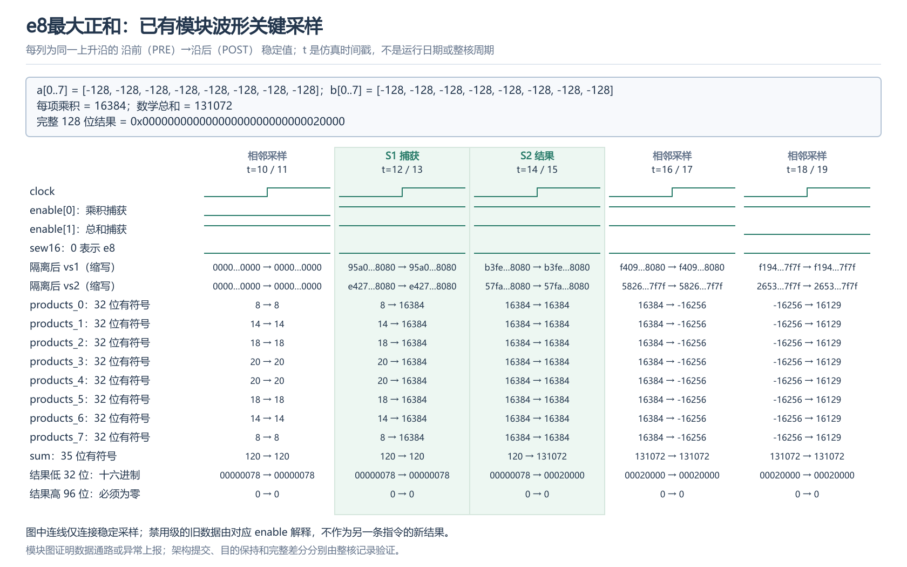
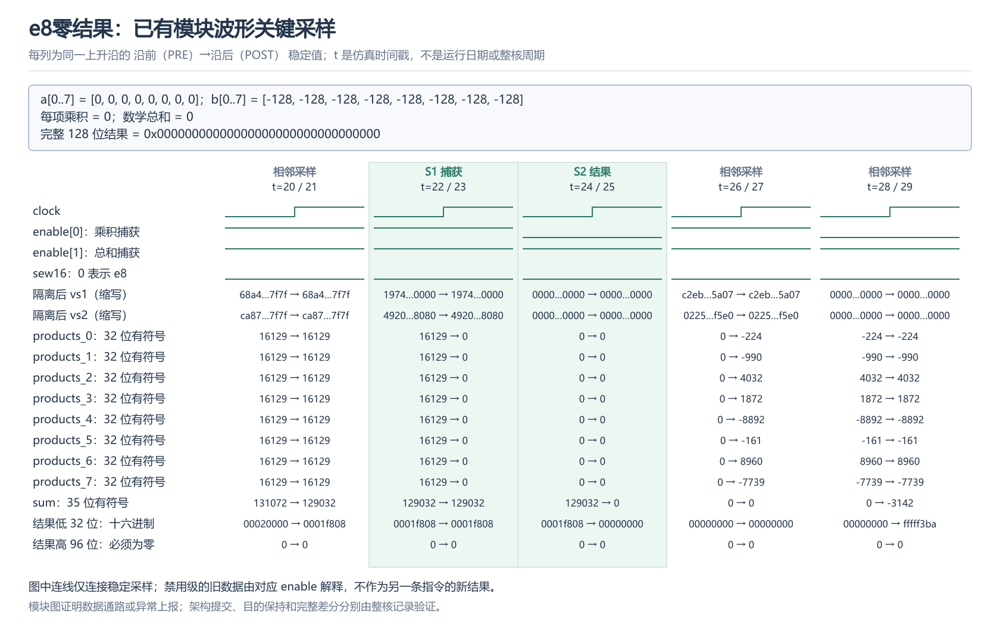
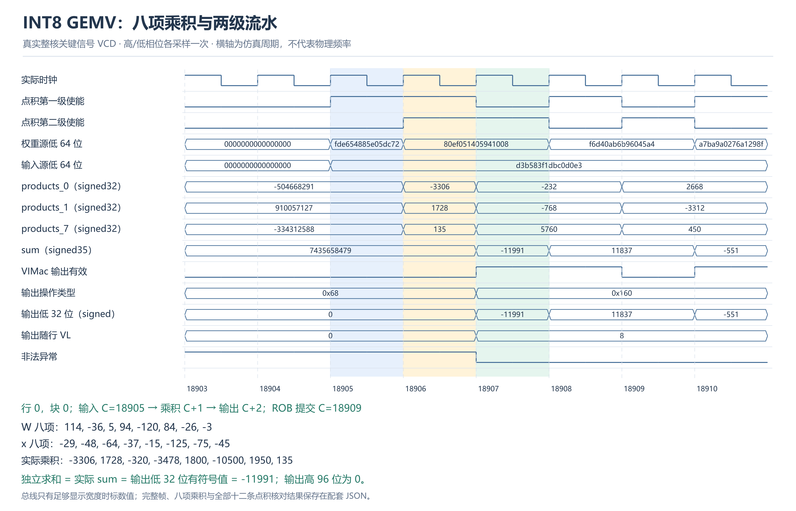

# 当前 vdot 基础功能测试报告

## 验收对象

当前 `sew16-fixed8` 实现在香山昆明湖 V2 上运行，参考库为 `NEMU/build/sew16/riscv64-nemu-interpreter-so`。基础功能使用 SEW=8、VLEN=128、LMUL=1、VL=8、vm=1、vstart=0；e16 作为扩展另行验证。

测试程序为 [e8 共享测试](../vdot-tests/main.c)和[当前完整套件](../sew16/main.c)。原完整整核回归 e8 检查 1564 项、独立 e16 检查 836 项，差分、GOOD TRAP 和进程退出 0 均通过。独立目录重建后的程序还执行了 32 项共享 e16 正例；两套程序工作量分别记录，不直接比较总周期。

## 正数、负数与数值边界

下表列出当前完整套件包含的 e8 定向输入，每组覆盖 ta/ma 四种组合。输入均指各源的低八项，源高八字节另放干扰数据；数学期望由独立整数循环生成。

| 分类 | a | b | 期望总和 |
| --- | --- | --- | ---: |
| 正数 | 1,2,3,4,5,6,7,8 | 全 1 | 36 |
| 正数 | 1,2,3,4,5,6,7,8 | 8,7,6,5,4,3,2,1 | 120 |
| 负数 | -1,-2,-3,-4,-5,-6,-7,-8 | 全 1 | -36 |
| 最大正和 | 全 -128 | 全 -128 | 131072 |
| 最小负和 | 全 -128 | 全 127 | -130048 |
| 正端点 | 全 127 | 全 127 | 129032 |
| 零 | 全 0 | 全 1 | 0 |
| 正负抵消 | 127,-127,127,-127,127,-127,127,-127 | 全 1 | 0 |

每例同时核对结果低 32 位、高 96 位清零，以及 VL、vtype、vcsr、vstart。e8 精确总和范围为 -130048～131072，19 位有符号数可完整表示。程序还检查源目的别名、v0/v31、普通乘法混发、配置依赖及非法配置后的目的保持。

运行日志中的 `vdot directed PASS: 32 cases` 对应八类输入与四种策略。完整记录见[原整核日志](../logs/20261026T205315-sew16-core.full.log)及[独立目录整核日志](../logs/clean-reproduction/sew16-core.full.log)。日志记录汇总通过，逐例输入和比较逻辑保存在上述源码中。

## 当前核波形与实际执行

八项 (-128)×(-128) 的乘积均为 16384，乘积级捕获后，下一有效归约级产生 131072；低 32 位为 `0x00020000`，高 96 位为零。源高位干扰数据不影响结果。

零乘积先进入第一级，归约级推进后总和与完整目的结果为零。禁用级保持的旧值不作为本组输出。

这张图来自当前核的独立 INT8 应用调用，八个实际有符号乘积求和为 -11991；接收到有效结果相差两周期，完整输出高 96 位清零。它补充当前核 e8 负数计算的实际信号，不替代上表定向基础用例。

e8 最小负和的现有逐级窗口展示负乘积及第二级禁用保持，对应完整结果由定向用例和整核差分验证。其他极值、e16 正负宽位结果与 VL=0 异常见[功能与边界图解](固定八项e8e16实施与验收报告.md)。

## e16 扩展与控制验证

e16 八项和使用 signed35 精度，低 64 位符号扩展、高 64 位清零。正数、负数、最大/最小、零、别名和配置切换均纳入当前套件；原独立 e16 检查共 836 项。

分支错误路径和较老非法指令之后的年轻点积允许推测执行，但不能提交架构状态。四独立初始化进程合计观察到 112 条已执行 e16 被取消，同分配代次均未提交，完整事件见[控制报告](e16整核取消与独立初始化实验报告.md)。
