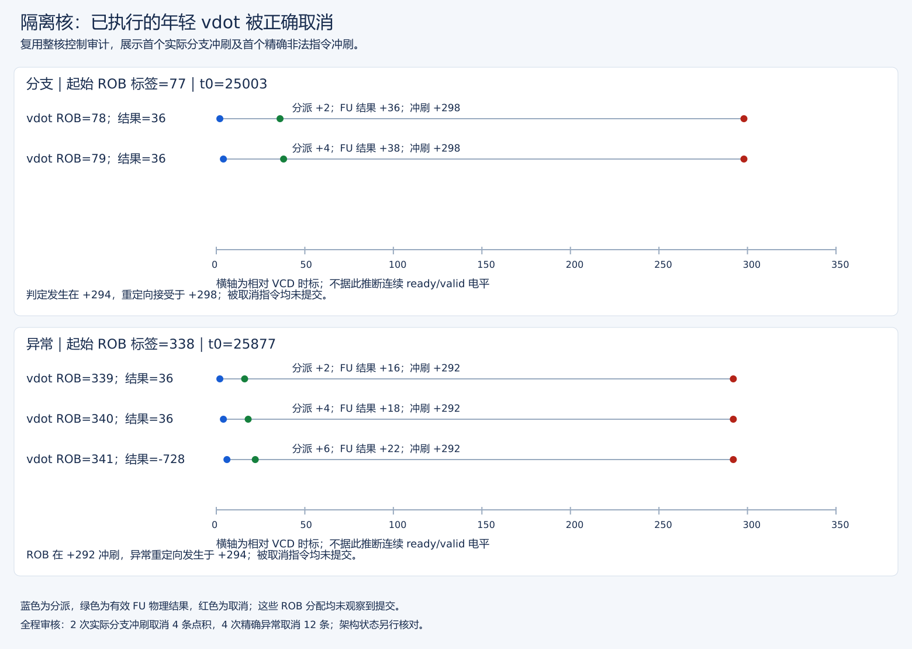
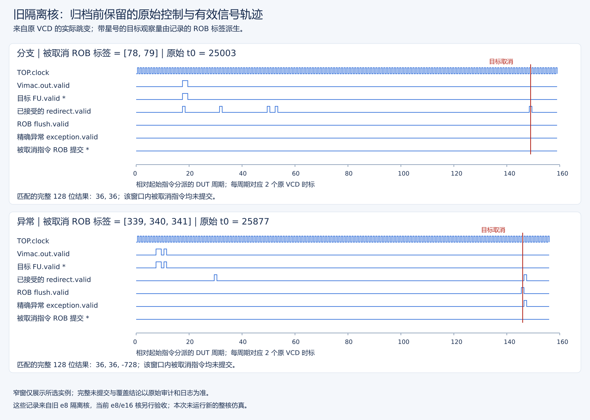

# 隔离版本整核构建与控制验证

实施范围：独立构建隔离版本并完成回归，补强错误路径不提交、异常后年轻指令不改变架构状态、VL/vtype 配置依赖、混合普通乘法/vdot/v0/长依赖链及多随机种子。

## 状态与证据门槛

**本轮要求全部完成，最终恢复流程于退出0。** 隔离新核构建、52合法/10非法烟雾、1052合法/10非法完整功能回归、四seed控制架构检查、新核真实波形严格联合审计及末尾版本复核全部PASS。实际覆盖2次误预测取消4条已执行vdot、4次精确异常取消12条已执行年轻vdot，均没有ROB提交；128条合法训练vdot正常提交。连续配置、非法最终配置、普通乘法混发、v0读写、长链和1024个多seed随机均通过。

P1控制程序/联合波形审计仅用于验证测试方法，不替代上述隔离核证据。初始中断恢复检查没有发现遗留构建/仿真，因此启动新独立构建 `XiangShan/build/operand-isolation/`；原默认核和 P1 核保留。与 P1 相同 DefaultConfig/一核/DRAMsim3/COSIM/差分/断言/trace/EMU_THREADS=0，先 Java CHIRRTL，再 firtool，再 C++，不同时保留大 Java/firtool 进程。服务器再次中断时保留此前完成结果，仅恢复末尾波形/审计，原中断进程不伪报成功。

既有六/七项模块测试、活动计数和历史整核通过不能代替本次验收。错误路径测试必须确认实际推测/冲刷覆盖，不能只因结果正确或源码含分支就记为错误路径验证通过。检查提交 PC/指令、架构完整128位目的/v0值、异常恢复和实际差分退出状态。多 seed 分别列出镜像/seed/用例数/文件/退出，不将同 seed 增量冒充多 seed。

## 验收矩阵

| 隔离新核验收项 | 当前结果 | 证据 |
| --- | --- | --- |
| 相同配置整核构建 | PASS | 对应原始实验附件 |
| 原烟雾52合法/10非法 | PASS | 对应原始实验附件 |
| 原完整1052合法/10非法 | PASS | 对应原始实验附件 |
| 控制56444f54 / 初始化101 | 架构PASS | 对应原始实验附件 |
| 控制00000001 / 初始化202 | 架构PASS | 对应原始实验附件 |
| 控制9e3779b9 / 初始化303 | 架构PASS | 对应原始实验附件 |
| 控制deadbeef / 初始化404 | 架构PASS | 对应原始实验附件 |
| 新核实际分支/异常取消审计 | PASS，2分支/4异常，16条已执行dot取消且不提交 | 对应原始实验附件 |
| 测试版本一致性检查 | PASS | 源码、仿真核与参考模型采用同一组配置 |

各控制seed含256随机及所有固定定向项；“架构PASS”不等于已验证实际错误路径推测执行。P1诊断结果另列于操作记录，不混入本表的隔离核结果。

## 关键取消事件时序图

[查看清晰 SVG](../../stage3/reports/figures/evidence/control-cancellation.svg)。图取自已有隔离核联合审计，分别使用首个已确认的分支和异常事件，未重新采集波形。

- 上图原分支 ROB tag=77；两条年轻 vdot 的 tag 为 78、79，先产生结果 36，再随接受的分支重定向取消。相对原分支分派时标为：决策 +294、取消 +298。
- 下图非法指令 ROB tag=338；年轻 tag=339、340、341 先产生 36、36、−728，再在 +292 被 ROB 冲刷，+294 观察到异常重定向。两拍先后不能混成同一个事件。
- 每个点都是审计记录中的实际时刻；连线只连接同一条指令的事件，不表示有效电平持续为 1。原 JSON 跟踪同一 ROB 分配未提交，架构状态由完整目的寄存器检查、异常恢复和 Difftest 另行验证。

这里使用的是 ROB tag，不把它当作记录数组下标。图只展示两类首个样例，完整覆盖数量仍以验收矩阵为准。

## 新核控制证据索引

### 原始波形精简前保存的实际信号

[可放大 SVG](../../stage3/reports/figures/isolation-retained/control-signals.svg)。这张图读取旧隔离核原 VCD 的实际跳变，不是重新仿真或理想示意。上半为首个已确认的分支取消，下半为首个精确非法异常；红线标出目标取消。未加星的 valid 行保留所有请求，较早的其他重定向不代表本组目标已取消；加星的执行和提交行按本组 ROB 标签过滤，是由原信号派生的观察量。

执行结果分别为 36/36 和 36/36/−728；图中的目标提交始终无效。窄窗只证明所选区间，完整的 2 次分支、4 次异常及同一分配未提交仍以原联合审计和日志为准。完整信号名及每次跳变保存于[真实信号摘录](../../stage3/reports/figures/isolation-retained/signal-excerpts.json)。它们是旧 e8 隔离核的证据，不冒充最新 e8/e16 核的结果。

用户授权在这些图、信号摘录和复现入口就绪后精简旧大 VCD，状态见[存储台账](../../manifest/存储清理台账.md)。原始审计 JSON、完整运行日志、旧核、参考库、原 bin/elf/符号表均保留。下方此前“成功 VCD 未删除”的文字是历史保存状态；删除后不能继续用原 VCD 路径完整重审，也不能推断未保存信号。

从作品目录只读复核，不启动 CPU：

需要真正重新采集时，显式选择旧隔离核的固定重放入口并指定不存在的新目录：

该命令使用原控制镜像、旧参考库、初始化 seed=101、原双相位窗口和提交轨迹，不重建当前源码。它会执行长仿真、重新生成 VCD，并再次进行架构和实际取消联合审核。原实验结果不覆盖；本轮只核对复现就绪条件，没有执行这个长测。输入/运行库或旧核改变时入口会拒绝，不把改用最新核算作复现。准确原件及配置见[固定重放清单](../../manifest/isolation-evidence-replay.json)。

正式证据为 [联合审计JSON](../waveform/20261006T033620-isolation-control-resumed.vcd.control.json)、原始双相位VCD和对应 对应原始实验附件，不是P1波形或合成fixture。

后续存储状态： 经用户批准删除不完整的原版本波形文件，对应中断日志仍保留。上面的正式恢复成功VCD及JSON/日志未删除，删除后版本复核一致；历史操作记录中的“保留中断原波形”是清理前状态。见[精确清理记录](../../manifest/不完整波形清理记录.md)。

| 类型 | VCD时间（不是架构cycle计数） | 来源ROB编码标签 | 已执行后取消的目标vdot | 结果 |
| --- | ---: | ---: | --- | --- |
| taken误预测 | 25301 | 77 | v20、v0，物理输出均36 | 无提交，分支正常提交 |
| taken误预测 | 33359 | 384 | v20、v0，物理输出均36 | 无提交，分支正常提交 |
| 精确非法异常 | 26169 | 338 | v20、v0、v21别名，物理输出36/36/-728 | 无提交，异常信息26171确认，恢复正常 |
| 精确非法异常 | 34069 | 133 | 同上 | 无提交，异常信息34071确认，恢复正常 |
| 精确非法异常 | 40963 | 31 | 同上 | 无提交，异常信息40965确认，恢复正常 |
| 精确非法异常 | 47693 | 334 | 同上 | 无提交，异常信息47695确认，恢复正常 |

编码标签为flag×256+value，实际ROB160项；不是按编码差值计算指令数量。JSON记录每次分配身份，避免标签重用被误认为同一指令。上述物理输出不是架构更新：软件毒值、完整128位和CSR检查以及NEMU差分独立验证最终架构状态没有被取消指令改写。

所有原始日志和成功/失败/中断诊断保留。VCD及构建目录可能被Git忽略，这里是本地实际证据，不声称已经提交或推送。

## 交付文件与复查

- `stage2/control-tests/{main.c,control.S,trap.S,legacy.S,Makefile}`：独立C oracle、延迟分支/异常、精确跳过年轻区间、连续配置、混发与真实v0反馈链；复用原功能汇编而不覆盖原镜像。
- `scripts/build-vdot-isolation-core.sh`：独立产物目录、锁、逐阶段构建及原核/ref/源文件保护。
- `scripts/build-vdot-control.sh` / `run-vdot-control.sh`：每seed独立对象/镜像/符号，记录命令、版本、实际退出及架构审计。
- `scripts/run-vdot-isolation-regression.sh`：原烟雾/完整功能、四seed、单独波形、严格审计及固定复核的串行入口；这次中断后的末尾恢复命令完整保存于外层resume日志。
- `scripts/check-vdot-control.py` / `stage2/control-tests/test_control_audit.py`：真实ROB身份/执行/接受冲刷/提交关联，正例与必须拒绝的反例。
- [操作手册](../control-tests/整核控制与多种子验收手册.md)、本报告、隔离优化报告和README导航：覆盖表、证据门槛、恢复规则及剩余边界同步。

在作品仓库复查固定产物和闭合控制证据（JSON路径必须不存在，审计器拒绝覆盖）：

已完成结果及当前复核方式见[版本与复核入口](../../docs/核与参考库版本选择.md)。

重跑前应确认源码、仿真核与参考模型版本匹配。四seed及全部功能回归可使用操作手册的入口，不覆盖已有仿真核。

## 验收边界与后续工作

- 本轮契约仍为既有 v0.1：e8/m1/VL8/vm1/vstart0、低8个有符号字节点积、低32位结果/高96位零；不扩充 ISA，赛题语义中尚待确认的问题仍须独立闭合。
- 四个软件seed采用独立数据流、镜像和对象目录，并分别改变仿真初始化seed。定向的分支/异常结构会重复，不能把所有调用称为不同随机场景。波形另重复第一颗seed，仅为获取原始控制证据，不算第五颗独立随机seed。
- 精确取消验收结合架构完整128位/CSR/异常检查与真实ROB标签关联，能验证实际覆盖到的错误路径；不是所有分支、异常组合的形式化证明。合法训练路径正常提交是审计的正向覆盖条件。
- 普通运算保留原功能回归与新混发检查；不声称覆盖普通向量指令的全部 widening/LMUL/背压组合。
- 没有为通过测试修改共享 ROB/分支/异常机制或参考模型；隔离门控保持原提交/取消接口。P1仅用于测试方法调试，新核结果独立记录。
- 本次功能运行的周期值不是正式性能测量。随后完成隔离核独立两烟雾/四进程正式数据审核，见 [正式性能报告及P1对比](../../stage3/reports/隔离核正式性能分析报告v3.md)及[测量结果说明](../../stage3/reports/隔离核正式测量进度与恢复记录.md)。综合/布局/PPA、映射网表活动及实际频率确认仍是后续事项，不将寄存器活动下降外推成整核功耗下降。
