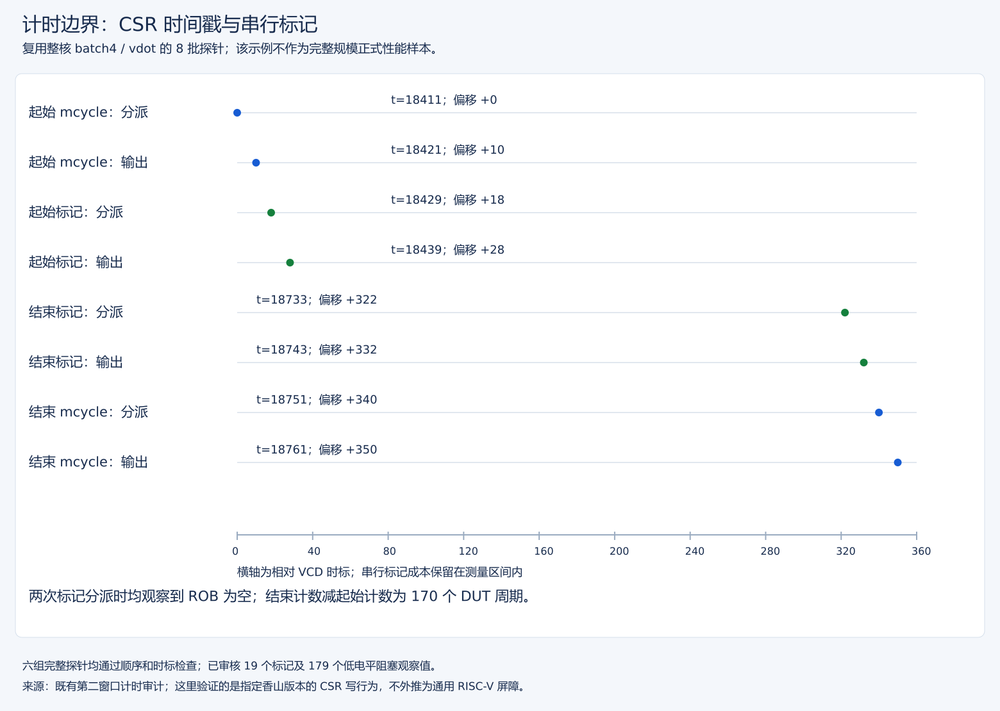
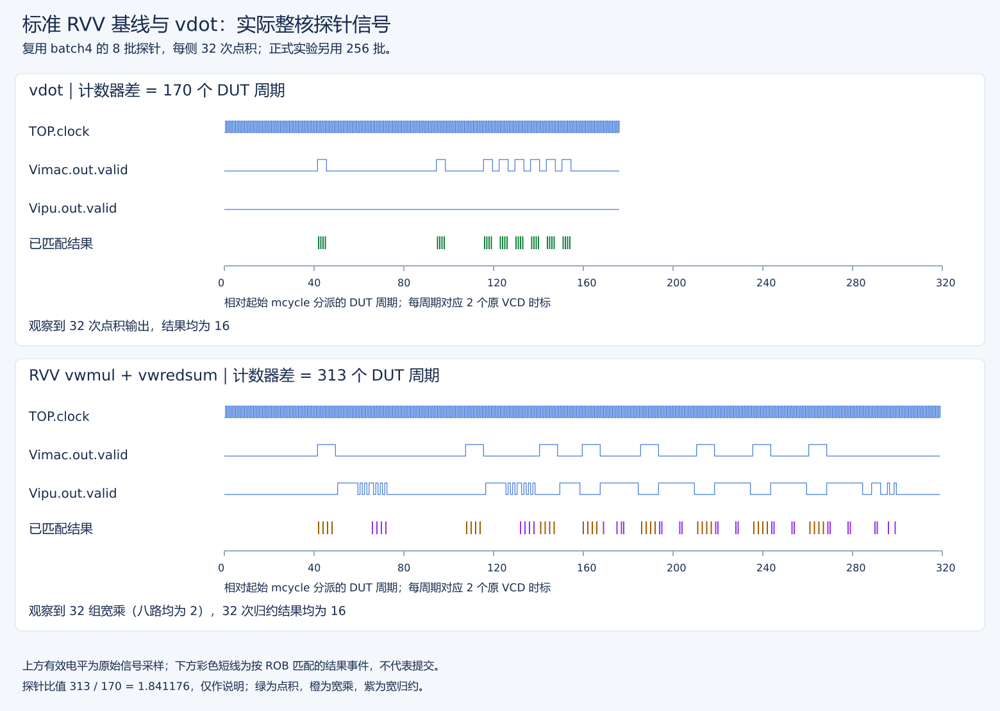
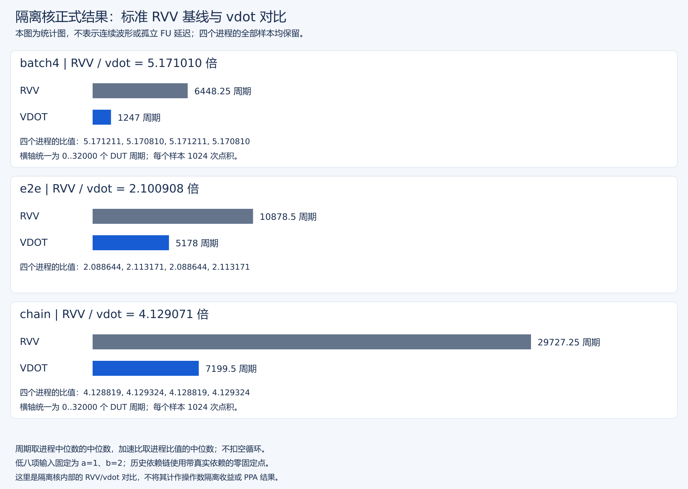
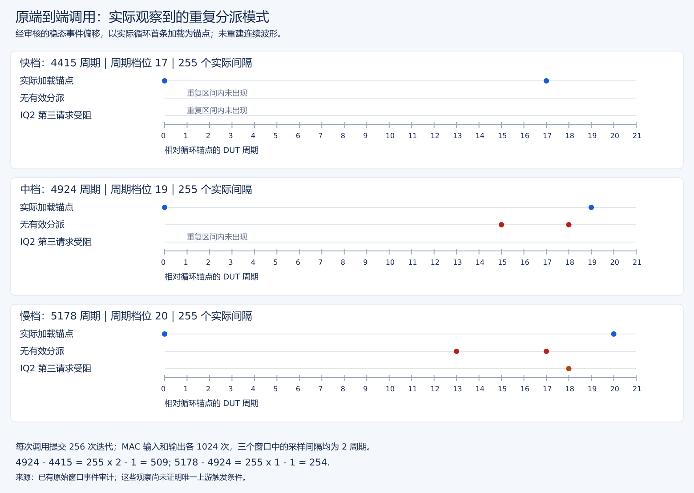

# 历史 e8 隔离核性能测量与复核手册（v3）

版本范围：本手册说明旧 e8 隔离核的 v3 协议。当前 e8/e16 核采用独立 [v4 测量](../sew16-perf/性能测量与复核手册v4.md)及[八进程报告](../reports/e8e16正式性能分析报告v4.md)。

合并当前测量合同、版本选路、复核及队列恢复入口；v1/v2/P0/P1/隔离各次原始数据、版本和操作时间线保持原路径。本次没有启动正式长测、重建镜像或改变门槛。

## 1. 先选核与协议

| 目标 | 路径（作品根目录为工作目录） | 使用目的 |
| --- | --- | --- |
| v0.1默认核 | `../XiangShan/build/emu` | 原v3/P0硬件基线，不包含P1/隔离 |
| P1核 | `../XiangShan/build/p1-oldvd/emu` | oldVd去依赖后的正式基线 |
| 隔离核 | `../XiangShan/build/operand-isolation/emu` | 当前正式结果，含P1与分支隔离 |
| 当前v3程序 | `stage3/vdot-bench-p0/` | 同镜像运行时选序，复用bench算术与计时源码 |
| 历史v2程序入口 | `stage3/vdot-bench/` | 两个编译选序镜像；不能误作当前v3运行入口 |
| v2 历史源码 | `stage3/history/v2-before-p0/` | 旧报告对应的复算工具，不从存档目录直接构建/仿真 |

核与参考模型的版本见[功能验收](../../stage2/reports/vdot功能与整核控制验收报告.md)。v3 使用同一程序镜像，仅通过运行时 first 参数选择先后顺序。旧镜像和原报告保留，不把协议差异当成硬件提升。

## 2. 当前合同

| 项目 | 正式full | smoke |
| --- | --- | --- |
| oracle | 每实现1032检查（1000随机+32定向策略检查） | 每实现32定向 |
| 预热/采样 | 每实现每内核8预热、8配对采样 | 2预热、4配对采样 |
| 每样本点积 | 256批×4=1024 | 8批×4=32 |
| 独立进程 | 4个，first=0/1/0/1 | 2个，first=0/1 |
| 对内顺序 | first XOR (rep & 1) | 同机制 |
| 输出 | 所有计时/检查结束后统一打印 | 同机制 |

RVV使用signed宽乘和宽归约，不是会截断的e8乘积归约；双方比较完整128位结果、CSR与高96位清零。随机输入用于等价性检查，**不是正式计时数据分布**；batch4/e2e低八项固定a=1、b=2、结果16，chain为零固定点但存在真实vd=vs1依赖。

batch4预加载四个独立目标；e2e包括加载/初始化/存储；chain有真实反馈；empty仅作对照，**不扣除空循环**。实际DUT周期包含循环、配置和串行标记，不是孤立FU延迟、峰值II或访存全部落入DRAM的时间。

## 3. 计时边界与统计口径

保存方式更新：旧核计时探针的原始大 VCD 列入授权精简范围，实际边界审计、信号采样 JSON、图件及所有正式测量日志保留。原始 VCD 的重新选窗与完整重审不再可用，现有摘录可用 对应原始实验附件 只读核查。

该固定XS实现中普通mcycle只读可能不串行，不能单凭程序中两次读计数器断定向量已完成。当前使用 `csrwi vstart,0` 对计时边界进行串行化，保持vstart最终为0：

```text
初始化/选路 → 首次排空（计时外） → mcycle起点读
→ 串行标记 → 内核 → 串行标记 → mcycle终点读
→ 输出保存及oracle检查（计时外） → 全部结束后打印
```

静态控制依据和真实CSR/ROB边界波形见[P0原验收](../reports/P0完善与验收记录.md)；这是已检查XS版本的工程方法，不是通用RISC-V屏障。换核配置/实现应重新审核。



该图来自已有 8 批探针，而非正式 256 批样本。先完成起点读，再接收起始标记；末尾标记完成后才能接收终点读，两次标记分派时 ROB 均为空。横轴为相对 VCD 时标，计数器差是 170 DUT 周期，不将时标直接当芯片时间或 FU 延迟。图只支持这个固定 XS 版本的计时方法；不声称 DRAM 存储持久完成或通用 RISC-V 屏障。[图的数据与判据](../reports/P0完善与验收记录.md)。

跨进程以各进程中位数和比值为单位，不池化样本虚增独立次数，不宣称统计置信区间。预热末次偏差也按固定规则审查。队列数据通过退出0并不否定其单独记录的strict=3。

## 4. 当前结果与历史数据

### RVV 基线与 vdot 的实际执行信号



图复用旧 v0.1 核的 8 批探针：Vimac 执行宽乘/vdot，Vipu 执行宽归约；原始 valid 电平下的彩线为 PC/ROB 匹配的结果事件，不是提交。低八项宽乘为 2，归约/点积完整输出为 16。170/313 周期仅属于这次小探针，不参与当前正式加速比；循环退出有推测执行，不能将物理输出数当作程序提交数。中文判读及与 NEMU/Difftest 的对应见[图文对照](../reports/基线与vdot延迟加速图文分析.md)。

### 四进程正式周期统计



此图由正式 JSON 的全部采样复算，不是逐拍波形；它衡量内核周期，不是孤立 FU 延迟或隔离优化收益。

| 实验 | 原报告 | 定位 |
| --- | --- | --- |
| v1 | [首次性能](../reports/vdot原始版本等价基线与性能实测.md) | 较早计时协议，历史结果 |
| v2 | [四进程v2](../reports/vdot正式性能实测报告v2.md) | 串行边界/延后打印等可信度改进 |
| v0.1/P0 v3 | [旧核v3](../reports/原始核正式性能实测报告v3.md) | 同镜像选序、动态边界，P1的对照基线 |
| P1 v3 | [P1正式报告](../reports/P1核正式性能实测报告.md) | 隔离优化之前的性能对照 |
| 隔离v3 | [当前正式报告](../reports/隔离核正式性能分析报告v3.md) | 两smoke+四full独立进程，全部样本保留 |

同协议P1/隔离核batch4/e2e/chain周期比均1.000000；隔离核内部RVV/vdot为5.171010/2.100908/4.129071，不能将后者写成隔离优化收益。未证明物理PPA、不同计时输入分布或真实应用收益。

## 5. 已完成的后续诊断与指标边界

八组上下文诊断、原 4415/5178 快慢窗口及唯一新增的 4924 压缩窄窗均已完成。后者约 214 MiB，无原始 VCD 副本；原快慢数据复用。三档分别呈 17/19/20 拍真实迭代间隔，净差 509/254/763 精确闭合，所选窗口的直接机制为译码空拍和 IQ 入队冲突，而非更多 MAC 计算或有效 L1 miss。

固定 12 组无波形受控矩阵及全部 144 调用已审核；pressure 配对差全 0，phase 对 vdot 仅 0..+1 周期，没有独立证明实际入口相位或 IQ 初态被控制。结果见[三档与受控报告](../reports/端到端单调用与上下文受控验证报告.md)，不要重复运行已完成采集。



该事件图从已有区间审计提取：4415/4924/5178 三窗口各有 255 个真实间隔，分别为 17/19/20 拍；红点表示该偏移分派全空，棕点表示 IQ2 第三请求阻塞。

提交报告需明确区分 FU 内部端口间隔、相依链有效周期、独立吞吐和含访存端到端周期；本旧协议的三个比值不是三个纯 FU 延迟。 已在独立 v4 协议补齐非零反馈、多链长和当前计时边界，不把新增数据回写旧正式报告。

## 6. 优先复核现有证据，不重跑长测

从作品根目录运行工具测试，不启动整核仿真：

```bash
python3 stage3/tests/run-tool-tests.py
```

当前四正式进程清单为[full.paths](../logs/20261006T060358-16-isolation-perf-full.paths)，配套[全样本JSON](../logs/20261006T060358-16-isolation-perf-report.json)、[P1对比JSON](../logs/20261006T060358-16-isolation-perf-comparison.json)。核对时按清单选精确四份日志，不用通配符混入smoke、旧队列或中断尝试。

派生报告/JSON使用新输出路径；已有正式证据不覆盖。队列已完成6/6、DATA_REPORT_PASS，无pending；这不是仍在后台运行的任务。

## 7. 新实验与恢复入口（会执行长仿真）

下面只供之后明确需要重测时使用，不是本轮文档整理的执行步骤。既有full和smoke镜像已固定；若需要构建新镜像，使用 `build-vdot-bench-p0.sh --full/--smoke`并另立身份/实验，不能改写旧实验镜像后套用旧版本。

```bash
# 新隔离核队列：固定现有核/ref/镜像和P1基线，自动两smoke+四full
bash scripts/vdot-step.sh isolation-performance \
  python3 -u scripts/complete-vdot-isolation-performance.py

# 中断恢复：先检查原进程、锁和完整日志，再填入原队列的精确检查点
bash scripts/vdot-step.sh isolation-performance-resume \
  python3 -u scripts/complete-vdot-isolation-performance.py \
  --resume stage3/logs/EXACT_QUEUE.state.json
```

该入口固定隔离emu和ref路径，不是通用选择核入口；旧核/P1重测需使用其原专用手册并显式选择emu，不用环境变量猜测队列会切核。新队列独立ID、不覆盖原报告；恢复复核已完成日志后跳过，不将缺少GOOD TRAP/实际退出的尝试补写成功。工具固定不匹配则停止，不改清单强行继续。预计数小时，宿主耗时不是硬件性能指标。

v2源码快照复算见[存档手册](../history/v2-before-p0/v2历史源码快照说明.md)；新版分析器不要求旧数据适配新版本。方法演进详见[v2原记录](../reports/性能测量可信度改进记录v2.md)、[P0原记录](../reports/P0完善与验收记录.md)。
