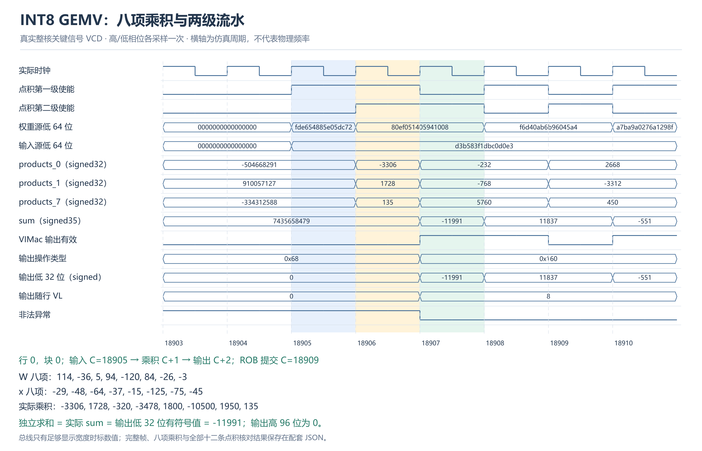
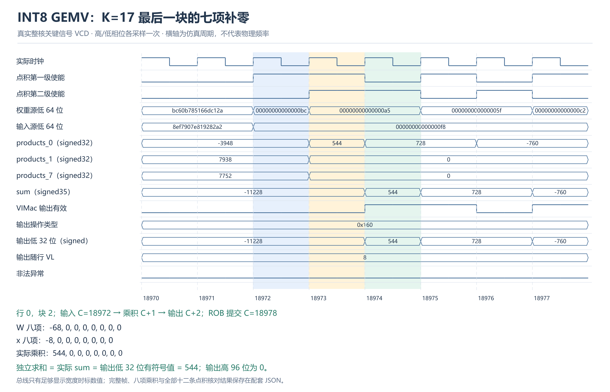
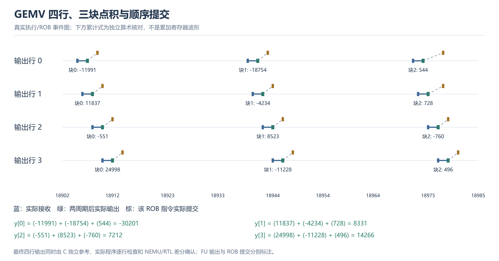

# 小型 INT8 矩阵向量乘应用测试与性能报告

本应用在当前固定八项 e8/e16 核上执行有符号 INT8 GEMV，输出 INT32。完成了标量、标准 RVV、单行 vdot、四行 vdot 四种实现，并把加载、跨块累加、配置切换、尾部及存储纳入应用验证。本轮没有修改 RTL 或 NEMU 语义。

**实测结论：** 已打包计算的 RVV/四行 vdot 比值为 1.166～1.180×。 每次重新打包的单次端到端实现未获得应用加速，四行 vdot 耗时为 RVV 的 3.286～3.302 倍。

算法、接口和重跑命令见[应用说明](../int8-gemv/INT8矩阵向量乘应用说明.md)；修改文件、原因、失败及执行经过见[独立实施记录](INT8GEMV实施与操作记录.md)。该应用补充实际工作负载证据，原点积指令延迟与 v4 微基准报告保持原范围。

## 1. 实现与公平对照

`y[r]=Σ W[r*K+c]*x[c]`，W 按行存储，零点为 0，无偏置、缩放或重新量化；支持 M≤32、K≤256。INT64 独立参考检查 INT32 范围，待测内核使用 INT32 累加。

| 实现 | 计算方式 |
| --- | --- |
| Scalar | 关闭自动向量化；有符号字节加载、INT32 乘加 |
| 标准 RVV 四行 | 最多 16 个 e8 元素，宽乘至 e16，再宽归约至 INT32；上次部分和作为 seed |
| vdot 单行 | 八项点积，在 e32 下提取部分和并标量累加 |
| vdot 四行 | 一个 x 块供四行复用，四条点积后在 e32 下分别累加 |

标准 RVV 同样共享四行输入，未限制为八项，也未故意加入逐块标量中转。vdot 的 K 向上补齐到八的倍数，补齐位置置零，每次只加载八字节。M 的剩余行使用单行尾部路径。

## 2. 正确性与整核验收

| 检查 | 实际覆盖 | 结果 |
| --- | --- | --- |
| NEMU 快速预检 | 四数据种子、96 用例、六个计算/端到端入口，576 次调用；核对每行、输入未改写及输出保护区 | 通过 |
| 新镜像计时探针 | 九次实际调用，覆盖四种实现及两种口径；60 条已提交 vdot 的输入、完整结果和两周期接口延迟 | 通过 |
| 整核烟雾 | 一个初始化进程；12 功能用例、144 次内核调用、48 条计时值 | 差分、GOOD TRAP、真实退出 0 |
| 四进程正式测试 | 初始化 seed=101/202/303/404，四种起始顺序、四组实际性能输入；每进程 30 功能用例、368 次内核调用 | 全部差分、GOOD TRAP、真实退出 0 |
| 波形观察开关对照 | 九次调用的执行周期、ROB 事件、点积数据及程序输出一致 | 通过 |

功能用例包括零、−128/127 极值、负结果、抵消、超过 16 位的跨块和、K 非八倍数、M 非四倍数及 M/K 为零。正式测试每次调用逐行核对输出并检查保护区；分析器还独立重建性能输入、重新计算所有输出，严格拒绝缺样本、错参数和失败记录。NEMU 快速预检不是 RTL 证明，整核差分和实际信号分别提供后续证据。

## 3. 周期口径与统计

计算模式让四种实现读取同样的已补零数组，计时包括配置、加载、计算、累加、存储和调用返回。单次端到端模式让标量/RVV 读取原矩阵，vdot 每次重新复制、补零后计算。输入生成、独立结果校验及成功打印均在计时外。

正式尺寸为 16×64 和 17×65；每实现、每尺寸、每口径预热 2 次、正式采样 6 次。四进程共保留 512 条周期，其中 128 条预热、384 条正式采样。先取每进程正式中位数并求比，再汇总四进程中位数；不扣空循环、不丢弃慢样本。下表周期为四个进程中位数的中位数，加速比为四个进程比值的中位数。

| M×K | 口径 | Scalar 周期 | RVV 周期 | vdot 单行周期 | vdot 四行周期 | RVV / 四行 vdot | Scalar / 四行 vdot |
| --- | --- | ---: | ---: | ---: | ---: | ---: | ---: |
| 16×64 | 计算 | 2169.75 | 768.5 | 2125 | 659 | 1.166× | 3.294× |
| 16×64 | 单次端到端 | 2172.25 | 771 | 4016 | 2543.75 | 0.303× | 0.854× |
| 17×65 | 计算 | 2263 | 1033.5 | 2526 | 876 | 1.180× | 2.583× |
| 17×65 | 单次端到端 | 2256.25 | 1038 | 5061 | 3410.75 | 0.304× | 0.661× |

四进程各自的 RVV/四行 vdot 比值：

| M×K / 口径 | seed 101 | seed 202 | seed 303 | seed 404 | 单行 / 四行 vdot 中位比值 |
| --- | ---: | ---: | ---: | ---: | ---: |
| 16×64 / 计算 | 1.171× | 1.162× | 1.162× | 1.170× | 3.225× |
| 16×64 / 端到端 | 0.301× | 0.303× | 0.303× | 0.303× | 1.578× |
| 17×65 / 计算 | 1.170× | 1.189× | 1.189× | 1.170× | 2.884× |
| 17×65 / 端到端 | 0.304× | 0.304× | 0.307× | 0.304× | 1.484× |

比值大于 1 表示四行 vdot 更快，小于 1 表示对照更快。四进程使用不同输入，表中范围不是同输入的置信区间。结果只描述本仿真配置与这些尺寸，不换算 GHz、功耗或物理 PPA。

## 4. 实际关键信号波形

当前推荐核没有启用完整波形编译。本轮复用已有编译 RTL 模型，只重新链接只读 C++ 包装，在同一调用的每个高/低相位求值后记录真实信号，未重新生成硬件。VCD 时间戳为 `2*cycle+phase`，图按仿真周期解释。观察器与关闭观察的九次调用周期、ROB 历史及数据完全相同。

只采一个 4×17 的四行调用，范围为周期 18663～19052；选择性 VCD 为 680,006 字节，压缩副本为 7,342 字节。四个正式性能进程不生成波形。

### 八项点积的真实算术过程

图中从实际源操作数独立重建八个有符号乘积，核对下一周期的八路乘积寄存器、再下一周期的 signed35 求和及完整 128 位输出。e8 结果高 96 位为零，合法配置下异常信号为零。FU 输出与 ROB 提交分别核对，未将输出有效当作已经提交。

使能到来前的数据寄存器及输出无效时的控制字段保留旧值，因此图左侧可能出现较大的历史值或无效异常位。只有按使能、ROB 标签及 `out_valid && fuOpType==0x160` 对齐的周期属于本次结果判定；未对原信号做清零美化。

### K=17 的最后一块

第三块只剩一个有效元素，其余七项输入为零；实际乘积与求和同参考结果一致。vdot 仍使用 VL=8，未用非法短 VL 或掩码绕过当前指令约束。

### 四行结果和提交

该图为实际执行/ROB 事件图。四行各三条点积均有真实接收、两周期后输出和提交记录。累计式是独立算术核对，不冒充硬件累加器信号；最终 y=[-30201, 8331, 7212, 14266]，程序逐行检查及差分同时通过。

## 5. 收益与限制

四行版本通过复用 x 加载、保留四个 INT32 累加值并共同承担配置切换，减少单行逐块搬到标量寄存器的开销。应用加速比同时受循环、配置、加载、归约、尾部和打包影响，不能照搬八项微基准约 4.7 倍的结果。

当前标准 RVV 的一块最多处理 16 项，vdot 一块固定处理 8 项；以 K=64 为例，前者每四行组需四轮，后者需八轮。四行 vdot 仍在每轮切换 e8/e32，并执行显式 INT32 累加。这是源码可核对的额外工作量，说明需要继续优化循环和累加组织；本轮没有将全部周期差归因于某一条指令。

本轮端到端采用统一复制打包入口，即使 K 已经是八的倍数也复制输入；尚未加入整齐尺寸的零拷贝快路径或预打包权重缓存。重复调用会使小数据驻留缓存，未测冷 DRAM、操作系统、线程调度或完整推理框架。上述限制均计入本轮结果的解释范围。下一步可按实测瓶颈增加零拷贝路径、权重复用和更多矩阵尺寸，另立实验，不事后更改本轮数据。

本轮没有单独计时打包函数，两个口径还存在缓冲区位置及调用包装差异，不能把周期相减直接称为纯打包耗时。计算内核后续可比较多块展开、集中切换 e32 再累加，标准 RVV 也可进一步比较延后归约的策略；当前结果只针对本文列出的实现，不宣称所有实现中的最优算法。

## 6. 原始证据

整核探针、烟雾、波形及正式目录分别为 `stage3/logs/int8-gemv-20261107-probe/`、`…-smoke/`、`…-wave/`、`…-full/`。每次调用记录完整启动命令、参数、开始结束时间、实际进程退出码和原始日志。

[四进程运行记录](../logs/int8-gemv-20261107-full/results.json) · [统计 JSON](../logs/int8-gemv-20261107.analysis.json) · [全部采样 CSV](../logs/int8-gemv-20261107.analysis.csv) · [计时审核](../logs/int8-gemv-20261107-probe/timer-audit.json) · [实际信号帧与逐条核对](figures/int8-gemv/signal-evidence.json)

四份原始日志：[seed 101](../logs/int8-gemv-20261107-full/full-101.full.log)、[seed 202](../logs/int8-gemv-20261107-full/full-202.full.log)、[seed 303](../logs/int8-gemv-20261107-full/full-303.full.log)、[seed 404](../logs/int8-gemv-20261107-full/full-404.full.log)。分析器只读取指定目录中的日志，搬迁后不会回到旧工作区寻找文件。

功能与预检：[NEMU 六入口预检](../logs/int8-gemv-20261107-development/nemu-zero-row-groups.log)、[整核探针日志](../logs/int8-gemv-20261107-probe/probe.full.log)、[烟雾日志](../logs/int8-gemv-20261107-smoke/smoke.full.log)、[烟雾运行记录](../logs/int8-gemv-20261107-smoke/results.json)。
