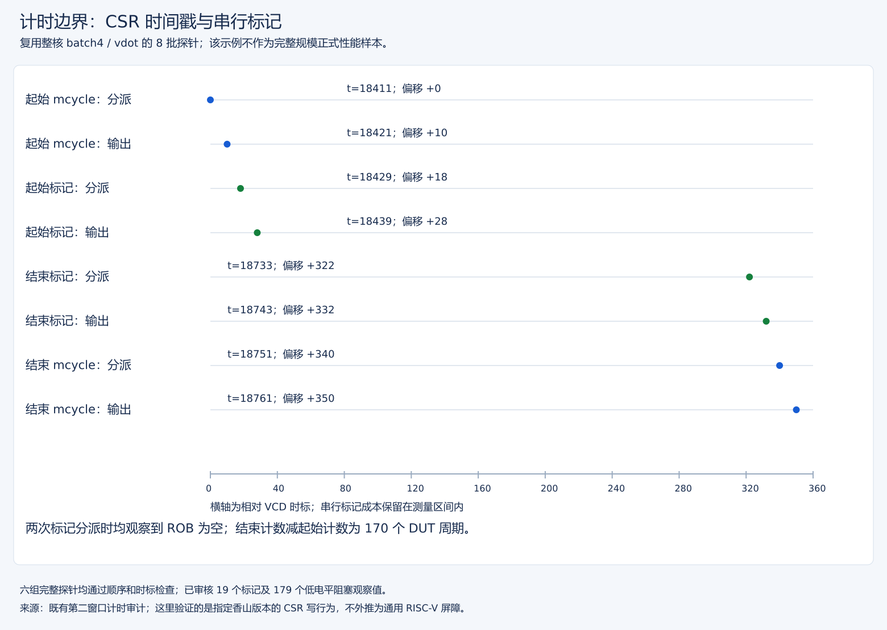

# 第三阶段 P0 完善与验收记录

范围：文档一致性、同镜像运行时选序、动态 CSR/ROB 计时边界证据、e2e 波动调查。不修改 vdot RTL、NEMU、指令语义，不宣称硬件优化收益。v1/v2 历史日志、镜像及正式报告保留。

## 验收结论

P0 四项操作已完成：文档同步、同镜像运行时选序、动态计时边界证据、保留全部数据的e2e调查。新版报告为 [正式实测 v3](原始核正式性能实测报告v3.md)，不覆盖v2历史结论，不宣称硬件提升。

- 文档：旧报告“新版未取得”和当前设计状态已纠正，最新入口指向v3；历史数据明确标注版本。
- 四个正式进程顺序执行，均取得双方各1032次等价性通过、差分启用、GOOD TRAP和零退出。相同顺序重复的全部计时统计完全一致；全部15个固定源码版本在正式实验期间不变。
- 动态边界：六组时间戳差逐项匹配，19次标记入队条件及179个阻塞低相位通过；整核差分、输出/CSR、GOOD TRAP和零退出通过。首个不完整VCD窗口被拒绝，失败证据保留。
- e2e：排除两个编译镜像的布局差异后，仍有位置/起始顺序相关的可复现差别。进程0、2末次预热4415、采样中位数5178，偏差=-14.7354%，触发既定10%门槛；不剔除样本、不放宽阈值。不能直接归因于缓存、分支或存储。

| 进程/first | 指令数 | DUT 周期 | 宿主 ms（非性能指标） |
| --- | ---: | ---: | ---: |
| 0/0 | 1300757 | 2000192 | 6358619 |
| 1/1 | 1300755 | 1999380 | 6250826 |
| 2/0 | 1300757 | 2000192 | 6265147 |
| 3/1 | 1300755 | 1999380 | 6273205 |

各进程比值的中位数：batch4=3.528937、e2e=2.127377（范围2.088451–2.166304）、chain=4.129215；最大单组CV=2.524%。全部周期、统计定义、及局限见v3报告。

## 同一镜像如何接收运行时顺序

独立目录 `stage3/vdot-bench-p0/` 构建 v3。复用基准 C/汇编，C 在启动时读取 `bench_runtime_order` 一个字节，后续选路、样本排列与元数据使用该运行时值。参数符号位于程序不会执行的启动前缀数据位置；其默认值为 0，地址由 ELF 符号解析，不猜偏移。

固定仿真器没有裸机 mainargs 命令行入口。使用既有 `--gcpt-restore` / `--overwrite-nbytes` 在加载 -i 镜像后、DUT执行首条程序指令前以及参考/黄金内存初始化前注入启动参数。此时DUT的simMemory已由init_ram创建，并不是在创建DUT内存之前；实际调用顺序见 `XiangShan/difftest/src/test/csrc/verilator/emu.cpp` 的init_ram→overwrite_ram→difftest_init。正式测量结束后纠正了启动注释/报告措辞，未改变指令或测量规则。不更改仿真器、RTL或参考模型。覆盖文件复制原镜像前缀，仅在参数偏移处写入 0/1；全部代码、控制流布局及输入/输出地址相同。**-i 镜像文件完全相同，参数覆盖文件不同，启动内存仅参数字节不同**，不把两份覆盖文件冒充相同文件。

`prepare-runtime-order.py` 校验参数唯一、初始化为零、偏移小于 0xf00、覆盖前后除参数字节外逐字节一致，拒绝覆盖现有产物。runner 记录镜像、参数地址、改动偏移和覆盖长度。schema=3 分析器拒绝缺失参数、顺序不符、非参数改动及跨顺序不同镜像。继续保留 v1/v2 的分析入口。

对象采用本地 include 包装源和独立 DST_DIR，避免 `../` 源路径导致对象逃逸目录、full 意外复用 smoke 编译参数。反汇编已核对实际传入的批次数。

## 预先固定的新实验合同

正式仍为预热8、采样8、每样本256批×4点积、双方各1032次独立oracle检查。四个新进程顺序0/1/0/1；相同 emu/ref/-i image ，不并行跑正式仿真。不删除异常样本，不事后放宽。烟雾2进程、预热2、采样4、8批，不能当作性能结论。

v3 改变了运行时控制流，不能把与 v2 的周期差解释成 RTL 提升。目标是排除两个重新编译镜像的布局差异、记录剩余状态效应，不是强行使 CV 降低。

## 动态边界的验收要求

探针使用与正式基准完全相同的 `bench.S`，依次执行 batch4/e2e/chain 双方各一次，8批，独立检查输出和向量 CSR。不包含随机等价性全测，也不产生正式性能样本。

完整 CPU VCD 流式审计检查：

1. CSRWI vstart 每次实际进入 ROB 时 waitForward/blockBackward 为1、ROB为空、同拍没有其他指令入队。
2. hasBlockBackward 置位期间禁止年轻指令入队。
3. 起始 mcycle 结果完成之后，计时内起始标记才能入队；末尾标记结果完成之后，结束 mcycle 才能入队。
4. 六组真实 CSR 输出时间戳差与探针打印周期逐项一致，全部六组必须完整覆盖。
5. 同次整核差分、GOOD TRAP、输出/CSR检查和实际退出0同时成立。

不证明 DRAM 存储持久完成、任意版本通用屏障、错误路径/冲刷或 PPA。人工 VCD 三项回归只证明解析器能接受正确夹具、拒绝串行标志/阻塞/差值损坏，以及处理 UART/commit trace 交错，不冒充 CPU 波形。

实际证据：原版本波形文件；同次完整日志 [原始运行日志](../../stage2/logs/20261003T152953-timer-probe-wave-window2.full.log)。审计 JSON [原始审核结果](../logs/timer-probe-20261003-window2-audit.json)，成功操作日志 [原始审核结果](../../stage2/logs/20261003T153443-p0-timer-wave-audit.full.log)。

实际窗口8000–15000，六组周期依次为 batch4 vdot/RVV=170/313、e2e=302/497、chain=255/959，均为8批探针，不是正式结果。19个标记包含初始化vstart一次和六次调用的三个标记；初始排空位于计时外。



[查看清晰 SVG](figures/evidence/timer-boundaries.svg)。图直接使用上述成功审计 JSON 中第一组 kind=0/impl=0 的实际时间：18421 起点读完成、18429 起始标记分派；18743 末尾标记完成、18751 终点读分派。读值之差为 170 DUT 周期，横轴则是 VCD 时标，不混为一种单位。没有重新解析或生成波形，也不把这个小探针结果当正式加速比。

初次窗口0–10000只有3个起始读、2个结束读，被拒绝；没有修改六组验收门槛。扩大窗口后发现 commit trace 与 UART 共用stdout、插入打印字符之间，原始文本不能直接解析全部六行。解析器只去掉格式完整的commit记录及其宿主换行，恢复UART字符序列；保留原始日志与，并增加人工交错回归。随后实际波形审计通过。

后续存储状态： 经用户批准删除初次不完整窗口原版本波形文件。正式成功的原版本波形文件及审计JSON/原始日志保留，删除后版本复核一致；此次清理不改变上述验收结论。见[精确清理记录](../../manifest/不完整波形清理记录.md)。

最终28项工具回归通过（8解析、7runner、5旧报告、5运行时参数/新版报告、3动态波形工具）；一次通用 unittest discover 因文件名带连字符发现0项、退出5，不计入通过。新增显式加载入口 `run-tool-tests.py` 并要求至少28项，防止零测试假通过。既有第一阶段日志有用户原有空白差异，未作清理。

v3正式及烟雾镜像均保持原版本；旧v2两个正式镜像、emu/ref 均再次核对未变。共享C源码和分析器后续增加v3支持，v2报告中的源码版本是当时版本，不声称等于当前文件。

已补 [v2交付源码快照](../history/v2-before-p0/v2历史源码快照说明.md)：8个文件均与原报告版本完全匹配，存档源码复算原四份日志所得严格JSON和Markdown与原交付逐字一致。没有改变在途v3测量文件；不将此存档/复算等同于干净环境全构建。

## e2e 调查：现有 v2 证据

`analyze-e2e-variation.py` 从所有完整日志审计后按对内先后位置分组，保留全部样本。

| 运行 | first | vdot 先测中位数 | 后测中位数 | 差值/256批 |
| --- | ---: | ---: | ---: | ---: |
| 0、2 | 0 | 5179 | 4923 | 1周期/批 |
| 1、3 | 1 | 5178 | 4923.5 | 0.994140625周期/批 |

first=1 的 rep=1 出现4415周期，原样保留；最大 CV=4.942%。同镜像重复完全复现这些序列，体现确定性状态，不是随机噪声证明。能够确认“位置相关、可复现”，不能确认“缓存 miss 导致”或“存储未排空导致”。后续若要因果定位，应在新实验开始前固定批次/预热/工作集矩阵，并关联分支、LSQ、缓存和发射事件；不能只挑最快一组。

## e2e 调查：同镜像 v3 结果

全部四进程审计后的分组见 [原始实验附件](../logs/20261003T155604-301-series-full-runtime-e2e-diagnosis.json)。

| 运行 | first | vdot先测中位数 | 后测中位数 | 差值/256批 |
| --- | ---: | ---: | ---: | ---: |
| 0、2 | 0 | 5178 | 5051 | 0.49609375周期/批 |
| 1、3 | 1 | 5178.5 | 4924 | 0.994140625周期/批 |

first=0的全部采样为5178,5178,5178,5179,5179,4923,5178,4924；first=1为5178,4923,4924,5179,4923,5178,4924,5179。此轮已排除编译布局混杂，尚未定位预热/调用方控制流、预测器或访存状态的具体因果关系。

后续方向（本轮未执行）：预先固定上下文一致的预热/测量驱动、批次数与工作集矩阵，再关联LSQ/缓存/分支/发射事件进行因果验证。保留现有结果；不无限重跑直至通过，也不将增加预热次数未经验证地当作修复。硬件oldVd去依赖、门控和PPA属于后续独立任务。

## 操作手册

在作品仓库根目录执行：

```bash
bash scripts/build-vdot-bench-p0.sh --smoke
bash scripts/run-vdot-bench-series.sh --runtime-order --smoke
bash scripts/build-vdot-bench-p0.sh --full
# 指定已知烟雾清单和实际完整探针证据，接续正式长测并生成独立 v3 报告：
# 已交付v3报告存在，重跑必须选新的报告路径，不覆盖历史文件：
VDOT_P0_REPORT=stage3/reports/vdot-performance-v3-rerun.md \
  bash scripts/complete-vdot-p0.sh 实际smoke.paths 实际timer.vcd 实际timer.full.log
```

接续脚本固定自身，先检查报告路径不存在，再等待烟雾队列锁、复核指定的两个schema3烟雾记录、审计指定波形，最后开始四个正式进程。失败即停。首次默认报告输出 `原始核正式性能实测报告v3.md`；重跑使用VDOT_P0_REPORT指定新路径，不覆盖v1/v2/v3。另保存正式完整日志、report JSON、严格复算和e2e分组JSON。

仅复算现有正式数据，无需重新仿真：

已完成结果及当前复核方式见[版本与复核入口](../../docs/核与参考库版本选择.md)。

完整日志清单可由manifest内的`-bench.log`后缀换为`-bench.full.log`得到

本地大型波形/完整日志/覆盖目录不提交 Git；本轮不自动提交或推送，不改变第一阶段用户日志。
