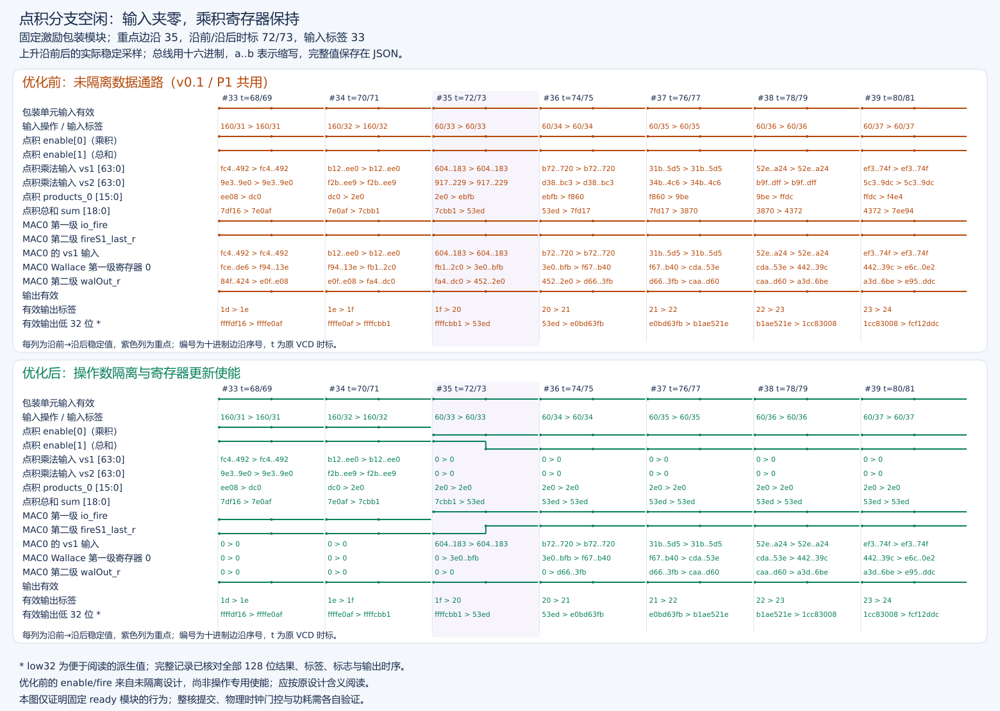
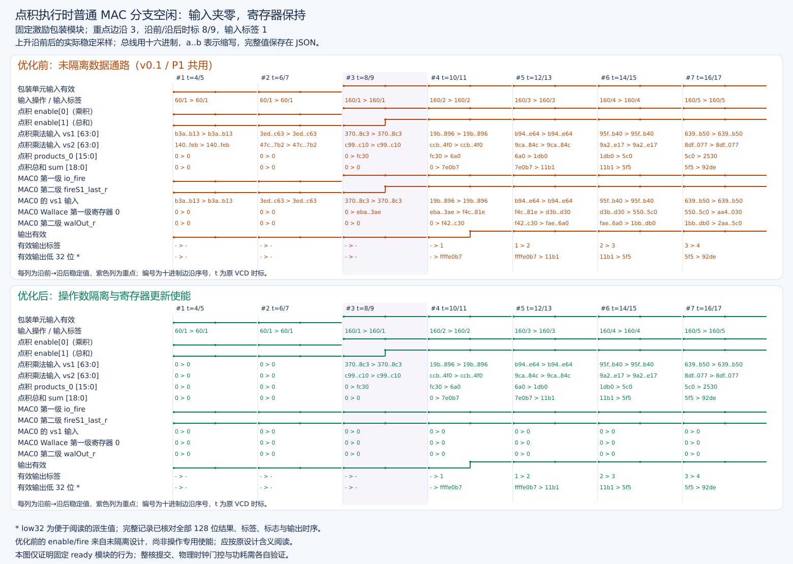
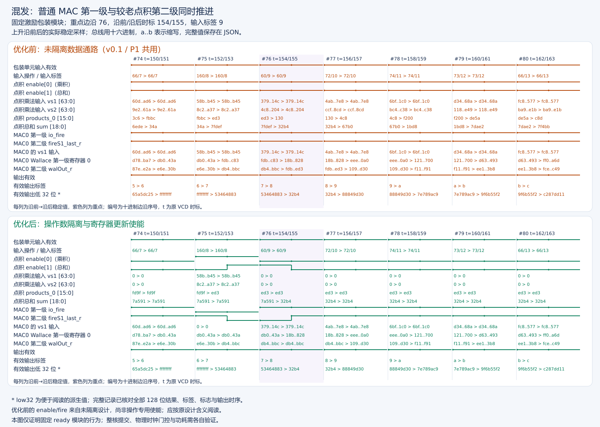

# P1 → 隔离核：优化对比报告

本报告集中说明操作数隔离、分支寄存器更新使能及前后波形证据；保留[原优化报告](../../stage2/reports/操作数隔离与寄存器更新门控报告.md)、[整核控制报告](../../stage2/reports/隔离版本整核构建与控制验证报告.md)和[固定性能报告](隔离核正式性能分析报告v3.md)，不覆盖历史材料。

## 1. 结论与版本边界

清理边界：本报告三组前后对比图、实际信号摘录、模块原始 `before.vcd/after.vcd`、隔离核可执行程序、编译缓存、正式控制波形及 e2e 诊断文件全部保留。本轮只清理 v0.1/P1 的五份旧核大 VCD，执行情况见[台账](../../manifest/存储清理台账.md)，不以旧核原始文件删除冒充隔离核新验证。

隔离核在 P1 基础上保持指令语义、译码、两级执行延迟与提交/取消接口不变，只减少当前指令未使用的数据分支活动：

- 点积未使用时，两个低 64 位乘法输入归零，乘积与求和寄存器按各自流水级使能保持。
- 普通 MAC 未使用时，在拆分/重组之前隔离数据和控制；其两级按自身 fire/fireS1 更新，不妨碍较老指令完成。
- 固定混发序列的所选四组寄存器 bit flips 为 178205→135389，减少 **24.03%**；这是 RTL 采样活动，不是功耗降低百分比。
- 隔离核独立整核构建、功能差分及四种子控制回归通过；正式四进程 P1/隔离核周期比均 **1.000000**，不声称本次进一步提速。

三张图片来自实际 **固定 ready 的 wrapper 模块前后 VCD**，不是两颗整核的 GUI 截图。优化前 wrapper 使用原未隔离数据通路：它与 P1 的相关数据通路一致，但不包含整核 P1 的译码/ROB。P1 的 oldVd 修改在译码层，不在这个夹具内。图片只能直接证明模块门控行为；整核性能与控制另用独立整核证据验证，不能互相替代。

| 比较层次 | 基线 | 优化版 | 证明范围 |
| --- | --- | --- | --- |
| 模块波形 | `stage2/waveform/isolation/before.vcd` | 同目录 `after.vcd` | 同输入序列的隔离、保持、混发、有效输出等价与采样活动 |
| 整核功能/控制 | 保留 P1 核另有测试方法验证记录 | `XiangShan/build/operand-isolation/emu` | 隔离核实际差分、完整架构状态与已覆盖推测取消 |
| 正式性能 | `XiangShan/build/p1-oldvd/emu` 的四进程 v3 | 隔离核相同镜像/ref、协议的四进程 v3 | 固定三内核和计时输入的周期对照 |

## 2. 设计、修改位置与运行流程

修改源码仅涉及这两个执行数据通路文件，不改 NEMU、译码、MGU 或共享 ROB/分支机制：

| 文件 | 修改与原因 |
| --- | --- |
| `XiangShan/src/main/scala/xiangshan/backend/fu/vector/VDot8.scala` | 在有符号乘法之前对 vs1/vs2 的低 64 位加 Mux；仅有寄存器使能不足以阻止组合乘法输入翻转。维持 8×16 位乘积、19 位求和、低 32 位符号扩展与高 96 位零。 |
| `XiangShan/src/main/scala/xiangshan/backend/fu/wrapper/VIMacU.scala` | 按操作类型分别使能 dot 两级；普通 MAC 数据在 split/reorganize 前隔离，无普通请求时控制固定为默认 vmul/e8。复用普通 MAC 内部 fire/fireS1，不关掉还在执行的旧指令。 |

关键控制关系：

```text
inIsVdot = 当前输入 fuOpType == vdot
dotEnable0 = regEnable(1) && inIsVdot
dotEnable1 = regEnable(2) && ctrlVec(1).fuOpType == vdot
macInputActive= io.in.valid && !inIsVdot
```

`regEnable(1/2)` 是既有流水级传递条件，不是新生成的物理时钟。第二级类型必须取 `ctrlVec(1)` 的较老指令；若用当前输入类型，普通乘法紧接点积时会错误关掉点积求和。

软件发出的 vdot 或普通乘法仍经原译码/重命名/IQ，进入共享 Vimac 包装单元。包装单元按当前操作选择有效输入分支，第一级计算乘积，下一流水级独立完成求和或普通 MAC 第二级；共享控制保持 tag/pdest/valid 对齐并选择结果，经原写回、ROB 提交或冲刷。隔离只发生在分支数据与更新条件上，不新增周期，不绕过配置依赖或取消。

使用 `RegEnable/when(enable)` 表达的是逻辑更新使能，**不是 ICG 物理时钟门控**；保持的数据可非零，也可能来自已取消的指令，不能将无效期内部旧值当成架构结果。

## 3. 关键信号字典

以下是本次模块图的真实层级。JSON 内同时保存宽度与 VCD 标识符，避免把夹具信号名套用到整核：

```text
T = TOP.
H = TOP.VDotIntegrationHarness.
F = TOP.VDotIntegrationHarness.fu.
D = TOP.VDotIntegrationHarness.fu.vdot.
M0= TOP.VDotIntegrationHarness.fu.vimacs_0.
M1= TOP.VDotIntegrationHarness.fu.vimacs_1.
```

| 层级 + 信号 | 含义、读图重点 |
| --- | --- |
| T `clock/reset` | 选取非复位的时钟上升沿前/后稳定快照；原始 VCD 时标不是物理芯片时间。 |
| T `io_op/io_tag` | 夹具输入操作类型与标签，vdot=`0x160`；用同序列/时刻/标签配对，不能把 tag 当成整核 ROB 标签。 |
| H `fu_io_in_valid` | 包装单元当前输入有效；与操作类型共同确定哪个分支接收请求。 |
| H `validPipe_1/ctrlPipe_1_fuOpType`、F `validVecThisFu_1` | 延迟后的有效性及类型，用于审核第二级对应较老指令。 |
| D `io_enable_0` | 点积第一级使能；高时更新八个乘积，低时保持。**优化前同名端口并非操作专用使能**，不能用优化后公式解释旧值。 |
| D `io_enable_1` | 点积第二级使能；高时更新 sum。普通输入与旧点积第二级可同时有效。 |
| D `isolatedVs1/isolatedVs2` | 优化后乘法前的实际低 64 位输入；enable0=0 时为零。优化前没有这些信号，图中对应行取原输入低 64 位作为未隔离乘法输入。 |
| D `products_0`～`products_7` | 八个有符号 16 位乘积寄存器；图片选代表性的 products_0，审计检查全部八个。图中显示原始位模式十六进制，不将其当无符号数学乘积。 |
| D `sum` | 19 位有符号归约寄存器；不应被当前年轻输入类型错误关停。 |
| M0/M1 `io_fire` | 普通 MAC 第一级更新条件；优化后只有普通请求驱动，不再被点积激活。 |
| M0/M1 `fireS1_last_r` | 普通 MAC 延迟到第二级的使能；即使当前输入是 dot，旧普通运算仍可完成。 |
| M0/M1 `io_vs1/io_vs2/io_oldVd` | 普通 MAC 三个数据输入；没有普通请求时均为零。图片只展示 M0 的 vs1，完整审计检查两个 lane 的全部数据及控制。 |
| M0/M1 `wallaceOut_mid_reg_0`～`_5` | 普通乘法 Wallace 第一级数据寄存器。图片显示 M0 的一个寄存器，全部 12 个纳入保持/活动检查。 |
| M0/M1 `walOut_r` | 普通 MAC 第二级结果寄存器；按照各 lane 的第二级使能更新。 |
| T `io_outValid/io_outTag/io_result` | 夹具有效输出及标签/完整 128 位结果；仅 valid=1 时解释结果。图上仅显示低 32 位以便阅读，审核仍比较完整 128 位及标志。 |
| T `io_cancel/io_illegal/io_saturated/io_vecWen/io_v0Wen` | 夹具取消、非法、饱和和目的写使能；纳入完整序列输入/输出审核，未全部画出。 |

## 4. 前后波形：按这三个窗口审核

上半橙色是原数据通路，下半绿色是隔离版。每列对应一个上升沿，列头 `#` 为十进制边沿序号，`t=前/后` 为原始 VCD 时标；数字总线写成 `pre > post`。总线默认十六进制，输入 op/tag 行为“十六进制 op / 十进制输入 tag”，输出 tag 为十六进制。`abc..def` 仅省略图片中的长总线中间位，精确值保留在 JSON。紫色列为固定选取的关注边沿。

折线只是稳定采样的表示，不声称恢复了沿间瞬态；无效输出显示 `-`，不解释为零。三个窗口按固定判据选择，不用最小翻转/最快输出挑选。

### 4.1 普通乘法期间：不使用的 dot 分支停止更新



[可放大 SVG](figures/isolation/isolation-dot-hold.svg)。关注边沿 **#35，t=72/73**：当前输入 op=`0x60`、tag=33，为普通乘法；较老 dot 仍在第二级。

- 原数据通路 dot enable0 仍高，普通输入变化传入点积乘法。products_0 从 `0x02e0` 变为 `0xebfb`，这是无语义用途的活动。
- 隔离版 dot enable0=0，两乘法输入都归零；products_0 保持 `0x02e0`。后续连续普通乘法时，它继续保持，而不是每拍清零寄存器。
- 此拍 dot enable1 在沿前仍为 1，sum 正确完成旧 dot，沿前 `0x7cbb1`→沿后 `0x053ed`；下一拍才关闭求和。**“第一阶段禁用”不等于“整个 dot 一律停止”。**
- 两侧沿后输出都是 tag=32、完整结果 21485（`0x53ed`），证明这次有用结果未被隔离掉。

### 4.2 dot 期间：不使用的普通 MAC 分支隔离与保持



[可放大 SVG](figures/isolation/isolation-mac-hold.svg)。关注 **#3，t=8/9**：输入为 dot，tag=1。

- 原普通 MAC 的 io_fire=1，vs1 跟随当前 dot 输入；M0 Wallace 第一级 reg0 从零更新到非零数据。
- 隔离版 io_fire=0，普通 MAC 数据输入为零，该寄存器保持零；图中后续连续 dot 时仍保持。与此同时点积 products_0 正常更新，不能把普通 MAC 静止误读成全单元停机。
- 关注拍输出 valid=0，不比较该拍无效数据；从后续有效输出可见双方 tag/结果一致。完整审计检查全部 301 次有效输出，而非拿此拍无效总线做功能证明。

### 4.3 混发：当前普通乘法与较老 dot 第二级同时推进



[可放大 SVG](figures/isolation/isolation-overlap.svg)。关注 **#76，t=154/155**，当前普通乘法 op=`0x60`、输入 tag=9；上一拍 #75 输入 dot、tag=8。

- 隔离版沿前 `MAC0 io_fire=1` 与 `dot enable1=1` 同时成立，但 dot enable0=0：普通第一级推进、旧 dot 第二级完成、当前没有新点积乘积。
- products_0 保持 `0x0ed3`，sum 从 `0x7a591` 更新为 `0x032b4`；沿后输出 tag=8、完整结果 12980，两侧相同。
- 若错误使用当前普通指令类型门控 dot 第二级，这拍 sum 会不更新；本图展示实际使能按旧 dot 对齐。全序列共有 **37 个**普通输入与 dot 第二级重叠边沿。
- 原通路无用内部数据和隔离版内部保持值可以不同；验收要求有效输出一致，不要求无效分支寄存器始终逐位相等。

## 5. 全序列活动与等价性统计

生成图片时重新执行原审核器，全部统计与[历史 PASS JSON](../../stage2/logs/isolation-wave-audit-20261005.json)逐项一致：351 个非复位边沿、301 个有效输出、73 次 dot 第一级、73 次 dot 第二级、234 次普通请求、37 个混合重叠边沿、4140 项禁用寄存器保持检查。每拍输入相同，有效输出时比较完整结果、tag、非法/饱和/写使能；不是只比较图片中低 32 位。

| 观测组 | 原通路 sampled bit flips | 隔离版 sampled bit flips |
| --- | ---: | ---: |
| dot 八个乘积寄存器 | 19052 | 4580 |
| dot 19 位 sum | 2859 | 669 |
| 两个 MAC Wallace 第一级寄存器 | 117326 | 100444 |
| 两个 MAC 第二级结果寄存器 | 38968 | 29696 |
| **以上四组寄存器合计** | **178205** | **135389** |
| dot 两乘法输入，逐周期采样（不计入寄存器合计） | 22352 | 7344 |
| 普通 MAC 三输入，逐周期采样（不计入寄存器合计） | 67112 | 56294 |

寄存器计数是每上升沿稳定前/后值 XOR 的置位数；输入计数是相邻周期输入采样值 XOR 的置位数。不同统计不能直接相加成能耗。24.03% 只覆盖上述寄存器、这个固定序列；不含组合毛刺、时钟、电容、MGU、共享流水及物理映射优化。

## 6. 整核验收与正式性能：不借模块图越界证明

隔离核相同 DefaultConfig/一核/DRAMsim3/COSIM/断言配置独立构建完成，保留 P1 二进制。原功能烟雾 52 合法/10 非法、完整 1052 合法/10 非法均通过。四个独立 seed 为 `56444f54/00000001/9e3779b9/deadbeef`，各 256 随机，并覆盖连续 VL/vtype、最终非法配置、普通乘法与 dot 混发、v0 读写和长反馈链；合计 1024 多种子随机，不冒充 1024 个完全不同控制结构。

隔离核成功闭合的[实际整核控制波形审计](../../stage2/waveform/20261006T033620-isolation-control-resumed.vcd.control.json)联合分派身份、FU 结果、接受冲刷与 ROB 提交，覆盖：

| 实际覆盖 | 已产生物理结果但被取消的 dot | 提交审核 |
| --- | --- | --- |
| 2 次真实 taken 误预测 | 4 条，结果均为 36 | 对应 ROB 分配均无提交；分支正常提交 |
| 4 次精确非法异常 | 12 条，结果含 36、36、低 32 位 −728 | 对应年轻指令均无提交；异常信息及恢复正常 |
| 正向合法训练 | 128 条 dot | 正常提交 |

控制审计中的整核 `fuOpType/robIdx` 用于身份关联，FU `io_out_valid/res_data` 表示物理执行结果；接受的 redirect/flush 表示实际取消，ROB `commit valid` 联合分配身份才表示退休。完整层级、时标和标签见控制报告与解析器，不将上述 wrapper 的 `io_outValid/io_tag` 当成 ROB 提交。

取消可发生在计算之后，因此“内部寄存器/物理结果非零”不等于“架构被修改”。软件完整 128 位目的/v0 毒值、CSR 和精确异常检查及 NEMU 差分独立通过；这些是实际已覆盖路径的证据，不是所有推测执行情况的形式化证明。初次中断的不完整 VCD 已按授权清理，报告只引用成功恢复的闭合证据。

两颗整核均以同一 v3 镜像/ref、first=0/1/0/1、两个烟雾和四个正式独立进程测量，每计时样本 1024 次点积。对照 JSON 检查所有对应样本及双方 RVV 对照：

| 内核 | P1 vdot 跨进程中位周期 | 隔离核对应周期 | P1/隔离核周期比中位数 |
| --- | ---: | ---: | ---: |
| batch4 | 1247 | 1247 | 1.000000 |
| e2e | 5178 | 5178 | 1.000000 |
| chain | 7199.5 | 7199.5 | 1.000000 |

RVV/vdot 的 5.171010、2.100908、4.129071 是隔离核内部实现对照，**不是**P1→隔离优化收益。

周期不变支持“未增加该序列的架构周期成本”，不证明物理频率、面积或功耗不变。操作数 Mux 和使能扇出可能增加面积/时序负担；综合也可能重写逻辑。后续仍需同约束综合/布局、确认映射门控结构，用同输入分布的网表活动与功耗评估真正 PPA。

## 7. 材料来源

三组图件的完整信号与采样值见[逐拍摘录](figures/isolation/isolation-wave-excerpts.json)，实验及文件对应关系见[图件清单](figures/isolation/isolation-wave-figure-manifest.json)。实现变更见[隔离增量补丁](../../stage2/patches/xiangshan-vdot-operand-isolation.patch)。

功能与取消结果见[整核控制验收](../../stage2/reports/隔离版本整核构建与控制验证报告.md)；性能数据见[四进程正式报告](隔离核正式性能分析报告v3.md)和[同协议全部样本对照](../logs/20261006T060358-16-isolation-perf-comparison.json)。
