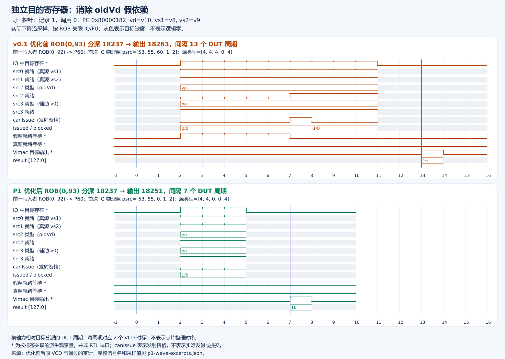
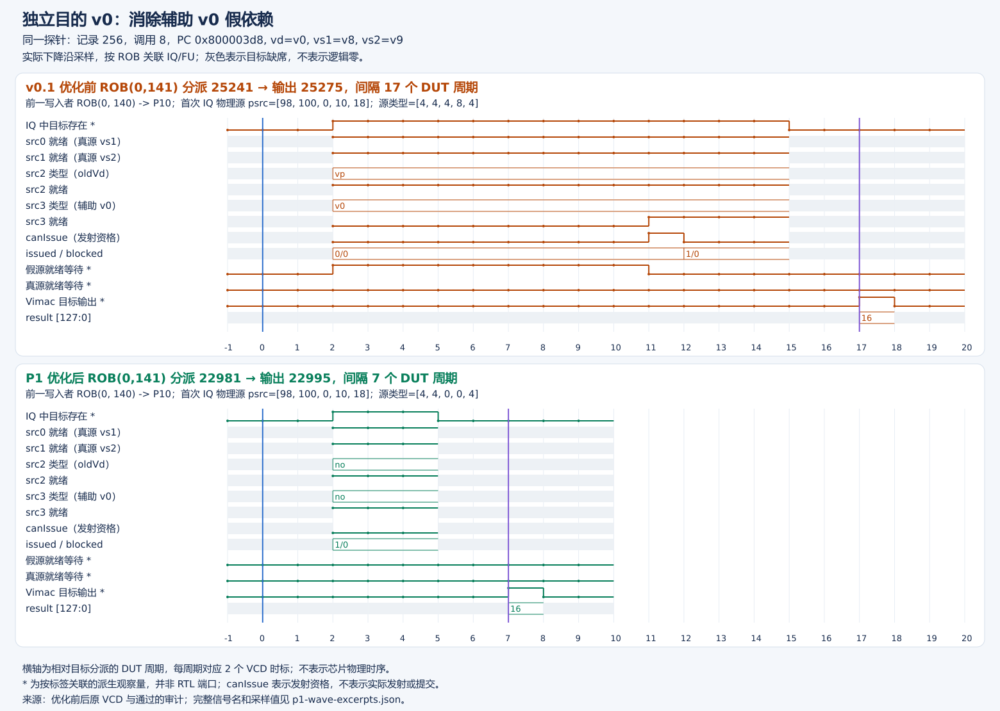
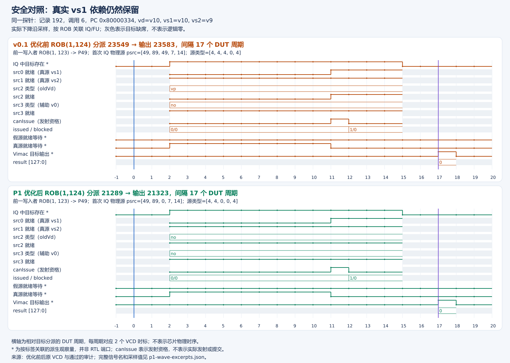

# v0.1 → P1：优化对比报告

本报告补充关键信号说明、真实波形摘录与审核入口；不覆盖[原始 P1 固定报告](旧目的假依赖定向验证与修改记录.md)，不改变历史实测结论。本篇只说明 **oldVd 去依赖优化**，不是后续操作数隔离/寄存器使能门控的证明。

## 1. 优化内容与结果

P1 消除了 v0.1 中没有语义用途的旧目的寄存器读取：完整审计窗口中，误等待记录从 632 降至 0；新核仍观察到 512 条真实源重叠等待。下面三张图分别展示普通目的寄存器、目的为 v0、目的与真实 vs1 重叠的情况。三例是按固定规则选取的实例，不是全部统计，也不是挑选最快样本。

同配置四进程正式测量中，batch4 的 old/new 周期比中位数为 1.465317；e2e 有退化，chain 基本不变。五项 RTL 单测、整核烟雾 52 合法/10 非法、完整回归 1052 合法/10 非法均通过；完整测量记录见对应版本的正式性能报告。

## 2. 修改原理及信号字典

v0.1 的 vdot 是完整覆盖写回：低 32 位为点积结果，高 96 位清零；不读取旧目的做累加，也不做尾部/掩码合并。因此译码保留第三源 oldVd 会产生无用 RAW 等待。[最小补丁](../patches/vdot-oldvd-p1.patch)在 `DecodeUnitComp` 的专用 VEC_VDOT 路径设置：

```scala
csBundle(0).srcType(2) := SrcType.no
```

该设置发生在后续辅助 v0 源生成之前，既消除 oldVd 读取，也避免独立目的 v0 引入辅助误依赖。不改变 vs1/vs2 真源、配置依赖、目的写回或 NEMU 语义。真实输入若为 v0，仍需读取；并非全局禁止 v0 依赖。

波形层级前缀如下。摘录 JSON 保存完整层级名、VCD 标识符、宽度及逐采样值，方便复查：

```text
B = TOP.SimTop.l_soc.core_with_l2.core.backend.
D = B + inner_ctrlBlock.dispatch.
Q = B + inner_vfScheduler.IssueQueueVfmaVialuFixVimacVppuVfaluVfcvtVipuVsetrvfwvf.entries.
E = Q + othersEntriesComp_<编号>.
F = B + inner_vfExuBlock.exus.Vimac.
```

| 信号（上述前缀 + 后缀） | 含义及审核用途 |
| --- | --- |
| `TOP.clock` | DUT 时钟；本图只取下降沿稳定快照，每周期相隔 2 个 VCD 时标单位。 |
| D `io_enqRob_canAccept`、`io_enqRob_req_i_valid` | 联合定位实际接受的分派请求，不能仅凭一个 valid 认定已接受。 |
| D `io_enqRob_req_i_bits_pc/instr` | PC 与指令编码；确认前后为同一探针位置的 vdot。 |
| D `io_enqRob_req_i_bits_robIdx_flag/value` | 分派 ROB 标签；连接 IQ 与 FU 的目标指令，不靠波形中同时出现的其他指令推断。 |
| E `io_commonOut_valid` | 此 IQ 项有效；条目编号可能迁移，脚本逐拍按标签重新寻找目标。 |
| E `entryReg_payload_fuOpType` | 当前流水线中 vdot 操作类型为 `0x160`，与 ROB 标签共同筛选。 |
| E `entryReg_status_robIdx_flag/value` | IQ 目标的 ROB 标签。 |
| E `entryReg_status_srcStatus_j_srcType` | 源类型：本版本 `no=0`、普通向量源 `vp=4`、辅助 `v0=8`。类型为 no 时不读寄存器，psrc 数值残留不代表仍有依赖。 |
| E `entryReg_status_srcStatus_j_srcState` | 源就绪状态：busy=0、ready=1；图中 src0/src1/src2/src3 各自对应真实 vs1/vs2、oldVd、辅助 v0。 |
| E `entryReg_status_srcStatus_j_psrc` | 重命名后的物理源号；与前一生产者目的物理号对应才能确认依赖对象。 |
| 源槽 j=4 的上述字段 | 此向量通路的配置源依赖，审核真实就绪条件时也检查它；上述槽位映射不能泛化到所有指令。 |
| E `entryReg_status_issued/blocked` | 已发射标记及阻塞/重试状态；审核等待时要求 issued=0 且 blocked=0，避免把已发射或其他阻塞当作源误依赖。 |
| E `io_commonOut_canIssue` | 条目的发射资格，不是最终仲裁授权，也不是提交信号。已标记 issued 的项即使仍可见，canIssue=0 也不表示再次被卡住。 |
| F `io_out_valid`、`io_in_bits_ctrlPipe_2_fuOpType` | FU 输出有效及对应操作类型，联合输出 ROB 标签识别目标 vdot。 |
| F `io_out_bits_ctrl_robIdx_flag/value` | FU 输出 ROB 标签。 |
| F `io_out_bits_res_data` | 完整 128 位结果。本图仅在目标 FU 输出时显示，不能用它单独证明 ROB 已提交。 |

图中带 `*` 的 `IQ target present`、`Vimac target out`、`false readiness wait`、`real readiness wait` 是脚本由原始信号推导的观察量，不是新增 RTL 端口。误等待判据包括：独立目的、真源 0/1/4 就绪、仅无用旧源未就绪且物理号与生产者匹配、未 issued/blocked、canIssue=0；它证明源就绪资格受阻，不证明其他所有执行资源都空闲。

## 3. 三组真实波形与读图说明

上半橙色为 v0.1，下半绿色为 P1；蓝色竖线为目标分派，紫色标记为目标 FU 输出。横轴对齐到各自目标分派的 DUT 周期。灰色/空白表示目标不在所观察的 IQ 项中，**不是信号为 0**。折线连接的是下降沿采样值，不展示沿间瞬态，也不能用于判断毛刺。

### 3.1 独立目的：oldVd 误依赖消除



[可放大 SVG](figures/review-edition-20261101/p1/p1-oldvd.svg)。固定记录 index=1、call=0，PC=`0x80000182`，vd=10、vs1=8、vs2=9，目标 ROB=(0,93)。前一生产者 ROB=(0,92) 写 P60。

- v0.1 首个 IQ 快照：源状态 `[1,1,0,1,1]`、类型 `[4,4,4,0,4]`，真实两输入已就绪，但无语义用途的 src2=P60 未就绪。18241～18249 的五个下降沿快照满足误等待判据。
- P1 的 src2 类型变为 no，首个状态为全部就绪；首个可见快照已经 `issued=1`，因此其 `canIssue=0` 不能解释为仍被阻塞。图中的误等待为零。
- 分派→FU 输出：18237→18263，13 周期；优化后 18237→18251，7 周期。双方完整 128 位结果均为 16，高 96 位为零。

### 3.2 独立目的 v0：辅助源误依赖消除



[可放大 SVG](figures/review-edition-20261101/p1/p1-v0.svg)。index=256、call=8，PC=`0x800003d8`，vd=0、vs1=8、vs2=9，目标 ROB=(0,141)，前一生产者 ROB=(0,140) 写 P10。

- v0.1 首个状态 `[1,1,1,0,1]`、类型 `[4,4,4,8,4]`；辅助 src3=P10 未就绪，25245～25261 有九个误等待快照。实际两个输入并不是 v0。
- P1 类型变为 `[4,4,0,0,4]`。src3 的 psrc 字段仍可能显示 10，但类型 no 使它不再成为读源；不要仅凭物理号非零判定依赖仍在。首个可见项也已经 issued。
- 分派→FU 输出：25241→25275，17 周期；优化后 22981→22995，7 周期，结果均为 16。

两侧绝对时标不同，是此前探针运行进度已改变。本图按同一记录/调用/PC配对并对齐到各自分派，不能直接相减两个文件的绝对时标来计算收益。

### 3.3 真源重叠：不能跳过正确依赖



[可放大 SVG](figures/review-edition-20261101/p1/p1-true.svg)。index=192、call=6，PC=`0x80000334`，vd=vs1=10、vs2=9，目标 ROB=(1,124)，前一生产者 ROB=(1,123) 写 P49。

- v0.1 src0=src2=P49 均未就绪，首个状态 `[0,1,0,1,1]`；P1 去掉 src2 后状态为 `[0,1,1,1,1]`，**真正的 src0=P49 仍未就绪**。
- 两侧均有九个真实源等待快照；P1 不能提前读错 vs1。分派→输出分别为 23549→23583 与 21289→21323，均 17 周期，完整结果均为 0。
- 此安全对照支持“仅删除假源，不删除真源”的设计解释，但不是所有输入/执行路径的形式化等价证明。

| 同一探针记录 | v0.1 分派→FU输出 | P1 分派→FU输出 | 完整结果 |
| --- | ---: | ---: | ---: |
| 独立 oldVd | 13 DUT 周期 | 7 DUT 周期 | 16 / 16 |
| 独立目的 v0 | 17 DUT 周期 | 7 DUT 周期 | 16 / 16 |
| 真实 vs1 重叠 | 17 DUT 周期 | 17 DUT 周期 | 0 / 0 |

这是分派、排队、执行到 FU 输出的区间，**不是孤立乘加单元延迟，更不是退休周期**。VCD 时标单位是仿真刻度，不能据此换算芯片实际 GHz 或物理时序。

## 4. 完整统计及性能边界

原始旧核窗口包含 1493 条完整执行，新核同窗口包含 1536 条；对应误等待记录为 632→0，新核真实源重叠等待为 512。窗口覆盖数不同，不能以 1536/1493 称为性能倍率，也不能把三图的采样点数相加替代完整审计统计。

四个独立正式进程采用相同镜像/ref及运行时均衡顺序，每段 1024 次点积。下表摘自[同配置前后对照](../logs/20261004T232857-17-p1-formal-core-comparison.json)，保留所有样本及不利结果：

| 内核 | first=0 的 vdot 中位周期：旧→新 | first=1：旧→新 | 四进程 old/new 比值中位数 |
| --- | ---: | ---: | ---: |
| batch4 | 1827→1247 | 1827.5→1247 | 1.465317 |
| e2e | 5178→5178 | 5051→5178 | 0.987737 |
| chain | 7199→7200 | 7199.5→7199 | 0.999965 |

batch4 的 RVV 对照周期比为 1.000000，支持局部优化收益。e2e 的 first=1 中位周期增加约 2.514%，first=0 不变；chain 基本不变。P1 核内 RVV/vdot 的 batch4=5.171010 **不是**本次 oldVd 优化倍率。

本证据不包含映射网表面积、实际频率、功耗或普遍应用加速证明。后续隔离版本的性能/控制结论见[其独立报告](隔离核正式性能分析报告v3.md)，不混用版本证据。

## 5. 图件来源

三组图件来自原始整核 VCD 的下降沿稳定采样，按目标 PC、ROB 标签和调用位置配对；输入、就绪状态、等待区间及完整结果逐项对应。原波形的采样时刻和数值保存在[逐拍摘录](figures/p1/p1-wave-excerpts.json)，文件对应关系见[图件清单](figures/p1/p1-wave-figure-manifest.json)。

同配置性能对照见[P1 正式报告](P1核正式性能实测报告.md)和[前后对照数据](../logs/20261004T232857-17-p1-formal-core-comparison.json)。原始核、P1 与后续隔离核分别记录，不跨版本合并结果。
