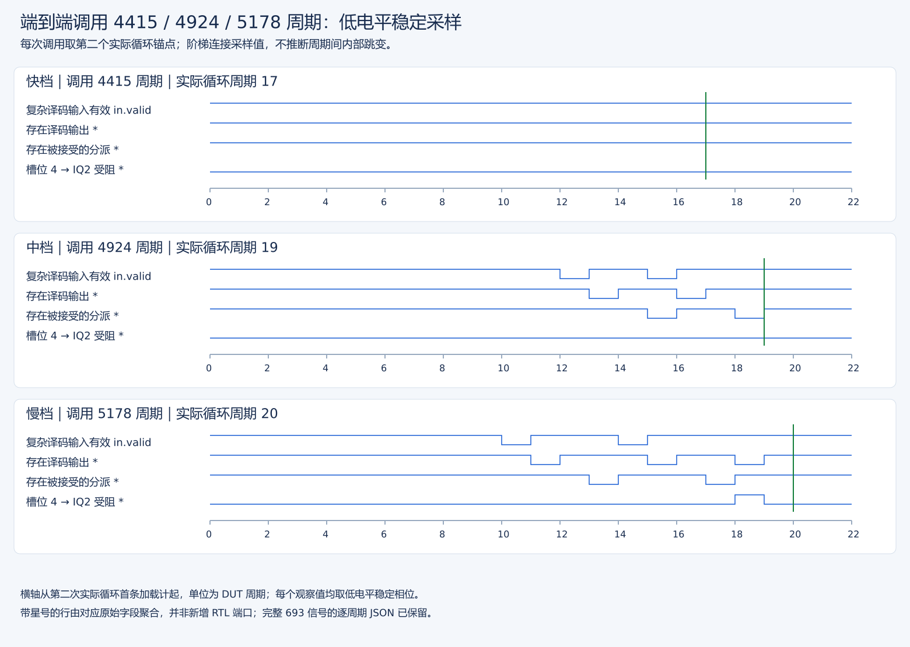
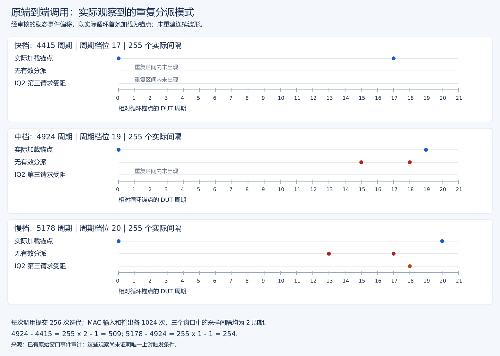

# 原正式镜像 E2E 快慢窗口内部事件诊断

原镜像整核窄窗重放、GOOD TRAP、实际退出 0、全样本一致性审核及内部事件分析全部 PASS。已定位 4415 / 5178 快慢窗口净差 763 周期的直接机制

## 目标与保护范围

保留原 v3 full 镜像、ELF、隔离版本整核 emu、NEMU、运行顺序 first=0、模拟随机种子 0 及 DRAM 配置。
不修改 RTL、参考模型、原测量程序和固定的历史报告；新的轨迹与波形独立归档。
正式历史记录中，E2E 最后一次 vdot 预热为 4415 周期，紧接着正式 rep=0 为 5178 周期，相差 763 周期。
前者在 RVV 后，后者在 RVV 前。本实验首先捕获这两次相邻调用；不把二者差异直接解释为某个单一事件。

## 文件与复现

已有轨迹使用原正式镜像、相同输入与运行参数重新核对，完整日志和全部样本一致。事件分析按稳定低相位关联分派、提交、加载、MAC 与重定向；仅正常关闭并通过审核的波形计入结果。

- 采集编排为 `scripts/capture-original-e2e-events.py`，事件分析为 `stage3/tests/analyze-original-e2e-events.py`。
- 波形、周期选取、统计和输入清单分别保存，结果无需再次仿真即可复查。
- 原始执行、恢复和解析过程保存在运行日志，以下仅列已完成证据。

### 最终证据索引

- [整核运行原始日志](../logs/20261008T114325-original-e2e-events-resumed-wave.full.log)：GOOD TRAP、执行总量、实际退出记录。
- [全样本审核](../logs/20261008T114325-original-e2e-events-resumed-wave.audit.json)：保留各组全部样本。
- [闭合波形清单](../logs/20261008T114325-original-e2e-events-resumed.capture.json)：最终 VCD 文件、大小及定位来源。
- [内部事件与逐段归因](../logs/20261008T114325-original-e2e-events-resumed.events.json)：正式 PASS、CSR 边界、分派/提交/加载/MAC/redirect 事件及互斥区间差值。
- [逐周期选中信号](../logs/20261008T114325-original-e2e-events-resumed.cycles.json)：693 个信号的流式选取结果，便于复查具体拍。
- [恢复协调日志](../logs/20261008T114324-original-e2e-recovery.coordinator.log)：固定复核、原镜像重放 PASS、事件分析 PASS、恢复 COMPLETE。

完整运行、关闭后的波形版本和逐周期分析已联合核对。

## 解释约束

分派不等于提交，需留意错误路径。裸 miss/ready 信号只能算采样电平，必须与相应 valid/fire 一起解释。
分派中部分名为 `stall_*` 的内部量不等同于真实阻塞，本实验优先使用握手、具体事件、逐批次时间轴与 TopDown 分类。
不同阻塞和事件计数可能重叠，不得相加冒充 763 个互斥额外周期。没有物理 PPA/频率/功耗结论。

## 窗口内的直接原因（完整重放审核通过）

不是 VDOT 单元在慢调用中多算了，也不是本窗口出现了更多数据缓存 miss。差异集中在**译码输入分组相位与整数 IQ 入队端口分配**。

| 直接观测 | 快调用 | 慢调用 |
| --- | --- | --- |
| 原计时区间 | 4415 | 5178 |
| 提交的真实循环 / 每个 DOT PC | 256 / 256 | 256 / 256 |
| MAC 输入 / 输出握手 | 1024 / 1024 | 1024 / 1024 |
| MAC 低相输入到输出周期差 | 全部为 2 | 全部为 2 |
| 相邻真实批次首个加载分派间隔 | 17 × 255 | 20 × 255 |
| 每个间隔内分派全空的位置 | 无 | +13、+17 |
| 每个间隔内 IQ2 阻塞位置 | 无 | +18 |
| 单独留在译码输入中的 `beq a4` / `addi t2` 次数 | 0 / 0 | 256 / 256 |
| IQ2 第三个入队请求阻塞次数 | 0 | 256 |
| 三个 LoadUnit 的有效 L1 miss / 加载 replay 握手 | 0 / 0 | 0 / 0 |
| 512 个加载的 S2 fire | 512 | 512 |
| 循环退出分支错误预测 | 1 | 1 |

这里的 MAC“2”是两个实际内部端口在低相采样中的周期差，不是整条指令/整核架构延迟的定义，也不替换既有流水接口设计说明。当前 VDot8 是两级使能流水，包装层复用两周期 Vimac 接口，具体边界见[当前设计补充](../../stage2/docs/vdot指令设计说明.md)。
两边还各有第 257 次循环首加载的**推测分派**，随后被退出分支取消；提交轨迹严格只有 256 次，未把这次错误路径计入工作量。

### 1. 每批次两次复杂译码空拍

慢路径两次出现：译码缓存只剩一个简单指令，而后续向量复杂指令已经在 IBuffer 中。

- PC `0x80000414`：`beq a4,zero,...`；慢路径只有这一条在译码输入中，下一条 `vs1r.v`（`0x80000418`）尚未进入同一个输入组。
- PC `0x8000042c`：`addi t2,a0,48`；慢路径同样单独成尾，下一条 `vs1r.v`（`0x80000430`）要等下一拍。

`CtrlBlock` 的 decode buffer 在有残余输入时优先使用缓存，而不是把残余与新的 IBuffer 指令合并补满。
`DecodeUnitComp` 本拍没有下一条 complex input 时由 active 退到 idle；下一拍重新接收复杂指令，再下一拍输出其 uop。
于是慢路径译码输出分别空一拍，经过 rename/dispatch 流水后，在每批次首加载分派 +13、+17 处形成两次全空。
快路径同位置的简单指令与后续复杂指令可以同时出现在译码输入组内，complex decoder 连续 active，没有这两拍。

波形证明 IBuffer 中已有后续指令，不能把这些空拍简单归因为 I-cache / I-TLB miss。TopDown 标签不是实际 miss 事件的替代品。
原循环有 24 条架构指令，是六路输入宽度的整数倍，这为输入分组相位持续重复提供了条件；本轮没有做修改相位的受控干预，不据此宣称所有上下文初态的唯一成因已闭环。

### 2. 每批次一次 IQ2 入队端口冲突，不是 IQ 满

循环尾部的同一分派组包含最后一个向量 store 的辅助 uop、`addi t0,-1` 和下一轮 `beq a4,zero` 等指令。
IQ2 是整数 ALU2 / BJU2（含 VSET 辅助功能）对应的发射队列，`numEnq=2`。

| 分派槽 | 内容 | 快路径选择 | 慢路径选择 |
| --- | --- | --- | --- |
| 0 | PC `0x80000430` 的整数辅助 uop | IQ2 | IQ2 |
| 1 | 同一 store 的访存 uop | IQ16 | IQ16 |
| 2 | PC `0x80000434`：`addi t0,-1` | IQ3 | IQ2 |
| 3 | PC `0x80000438`：`bnez t0` | IQ0 | IQ0 |
| 4 | PC `0x800003dc`：下一轮条件分支 | IQ2 | IQ2，阻塞一拍 |

快路径 IQ2 本拍只有两个入队请求；慢路径由于 `addi` 也选到 IQ2，槽 4 成为第三个请求。
`NewDispatch` 在前缀累计请求数超过该 IQ 的 `numEnq` 时置 `uopBlockByIQ`。实际波形中所有相关 IQ ready 均为 1，ROB 也可接受，不能称“队列满”或“ROB 满”。
槽 4 留到下一拍，`PipeGroupConnect` 的整组握手反馈把后续输入暂时挡住。这个现象在慢路径每批次重复，快路径没有。
源码的 IQ 分配使用队列计数排序；本轮直接证明了实际选择和端口超订，没有通过干预初始队列计数证明更上游的上下文成因。

源码定位：`XiangShan/src/main/scala/xiangshan/backend/CtrlBlock.scala` 的 decode buffer 选择与 `PipeGroupConnect`，`backend/decode/DecodeStage.scala` 的复杂指令输入选择，`backend/decode/DecodeUnitComp.scala` 的 active/idle 转移，`backend/dispatch/NewDispatch.scala` 的 IQ 排序、选择及 `uopBlockMatrixForAssign`，`xiangshan/Parameters.scala` 的整数 IQ `numEnq=2` 配置。它们解释波形中的行为；本轮没有修改这些文件。

### 3. 763 周期的互斥区间核算

不相加重叠 stall 计数，而按 256 次真实迭代首加载分派划分连续、互斥的时间区间：

| 区间 | 快 | 慢 | 慢减快 |
| --- | --- | --- | --- |
| 起始时间戳 → 第一次真实首加载分派 | 15 | 15 | 0 |
| 第一次 → 最后一次真实首加载分派 | 4335（255×17） | 5100（255×20） | +765 |
| 最后一次真实首加载 → 结束时间戳 | 65 | 63 | −2 |
| 总计 | 4415 | 5178 | **+763** |

收尾 65 / 63 周期还可按实际分派事件拆分：

| 收尾区间 | 快 | 慢 | 差 |
| --- | --- | --- | --- |
| 最后首加载 → 退出 `bnez` 分派 | 16 | 18 | +2 |
| `bnez` → 错误预测恢复后的 `j` 分派 | 17 | 17 | 0 |
| `j` → 空 ROB 上的结束 `csrwi vstart,0` 分派 | 19 | 15 | −4 |
| 该 marker → 结束 `mcycle` 值 | 13 | 13 | 0 |
| 收尾总计 | 65 | 63 | −2 |

最后一个 marker 在两边都确认 ROB 为空。收尾的 −2 是实际退流水/等待边界差，不是从统计拟合出来的修正；未进一步把其全部等待分解成某一条 store 的具体内部完成阶段。
退出分支实际 PC 为 `0x80000438`，通过 ROB 标签关联分派得到；redirect 的 `cfiUpdate.pc=0x8000041c` 是 FTQ 基址，不应误报成该地址的 `addi` 发生预测错误。

## 关键图：原窗口事件与后续中间档对照

[可放大 SVG](figures/publication-20261107/e2e-signals.svg)。图来自原始 693 信号逐周期缓存，固定选取各调用第二个真实首加载分派后的窗口。横轴为相对 DUT 周期，折线连接稳定低相位样本，不声称恢复沿间毛刺。加星行分别由六个真实 decode valid、可接受的六个 ROB 分派请求，以及 `uopSelIQ_4_2 && uopBlockByIQ_4` 聚合，不是新增 RTL 端口。绿色竖线标出下一次首加载，三档间隔为 17/19/20 拍；慢档 +18 的目标 IQ2 阻塞可直接看到。

此图与下面的事件模式图互补，不替代整个 256 次迭代的审计。完整逐周期 JSON、事件 JSON、原日志和全部测量值保留。图和其[信号摘录](figures/isolation-retained/signal-excerpts.json)不含未选中的全部内部信号，不能在清理后任意重新选信号。

### 已保留的复现方法

从作品目录运行 `python3 scripts/replay-isolation-evidence.py`，只核对原核、旧参考库、原镜像、ELF、启动覆盖字节、内存配置和运行库，并从保存的周期数据复算三档观测及区间差；不启动 CPU，也不依赖被精简的 VCD。

真正重采原快慢两窗口或中间档时，分别执行下列命令；输出目录必须不存在：

固定入口使用保存的旧隔离核和原 v3 full 镜像，保持 first=0、初始化 seed=0、1305 字节启动覆盖及原窗口；中间档重采继续复用已保存的快慢周期数据。运行后核对完整 benchmark、原周期数组、实际窗口和区间归因，并保存新日志/VCD/审计，不覆盖原证据。

旧编排器依赖已升级源码或原始采集文件时，不能再直接用于清理后的恢复；上述入口不重建源码，也不绕过旧核/镜像检查。本轮只核验复现条件，不启动重采。保证保留了复现实验所需的本地输入、配置与检查程序，不承诺 VCD 字节相同或跨工具/运行环境变更后周期仍相同。

本报告原始观测是 4415/5178 两窗口。图中的 4924 来自后续唯一补采调用，详细来源见[三档报告](端到端单调用与上下文受控验证报告.md)。图只把已有审计中的实际间隔和偏移画出，不补画未观察信号，也不增加采集次数。所选窗口中 MAC 计算间隔一致；周期差主要在译码/整数分派侧重复出现。其他 ±1 档位和唯一上游触发条件仍未闭合。

## 后续改进边界

诊断已解释此快慢窗口的净周期差
受控干预结果见[单调用与上下文验证](端到端单调用与上下文受控验证报告.md)。
测量报告应保留全部样本、调用位置和区间，不能挑选最快的分组相位当作通用性能。修改 benchmark 或硬件属于后续实施，本轮未做。
