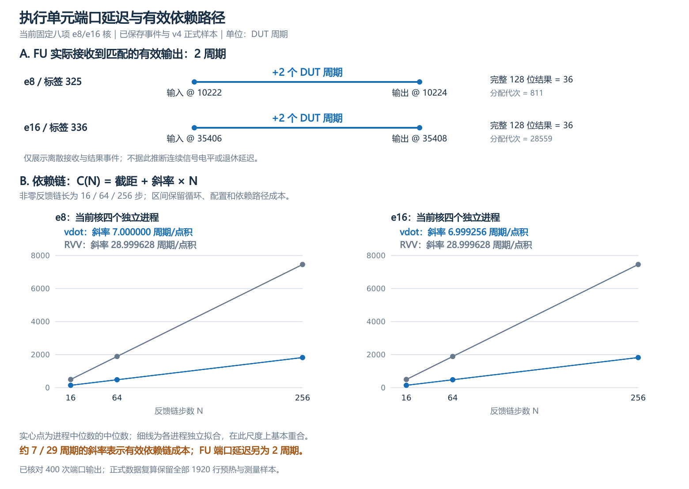
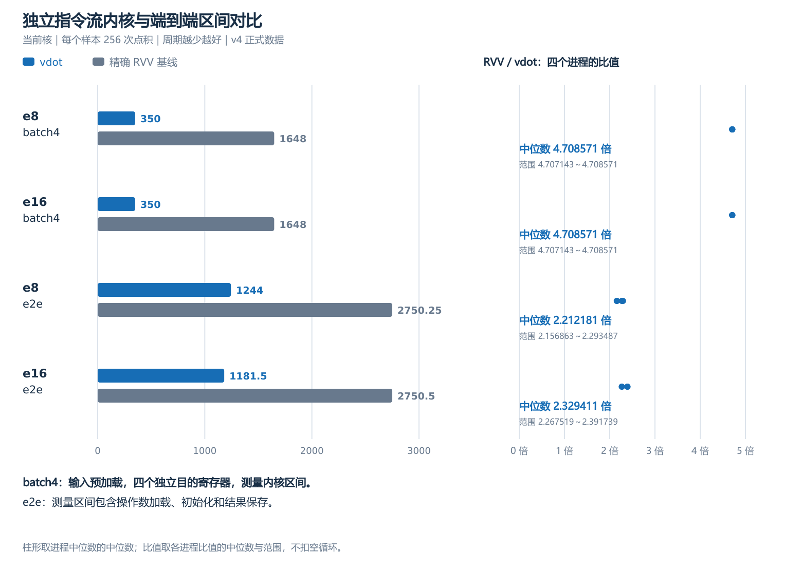
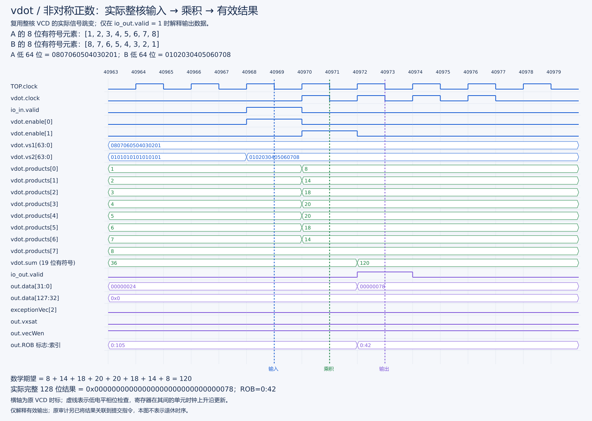
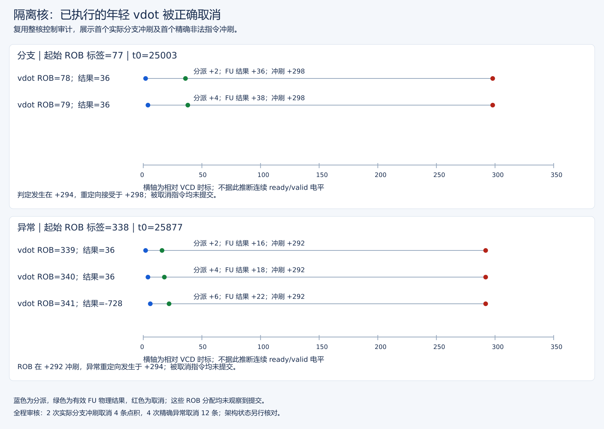
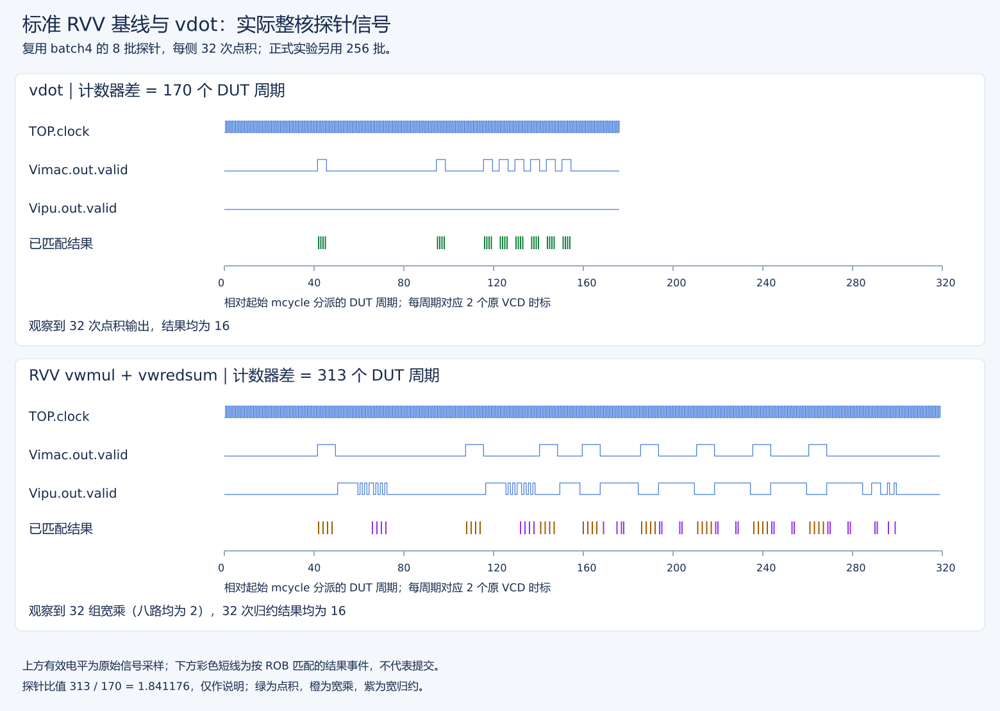
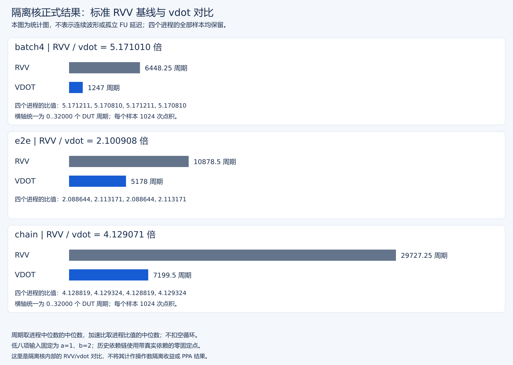
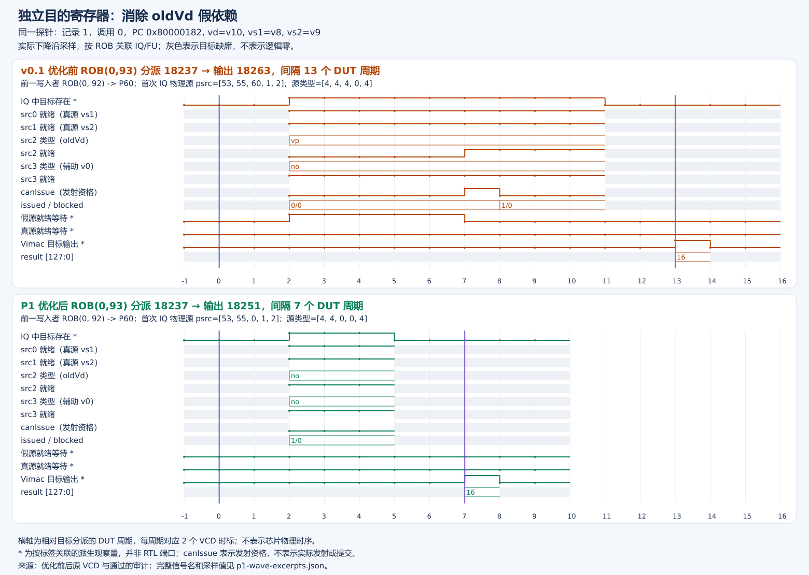
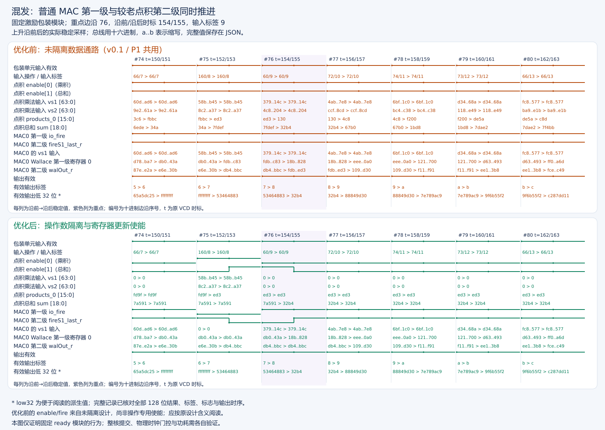
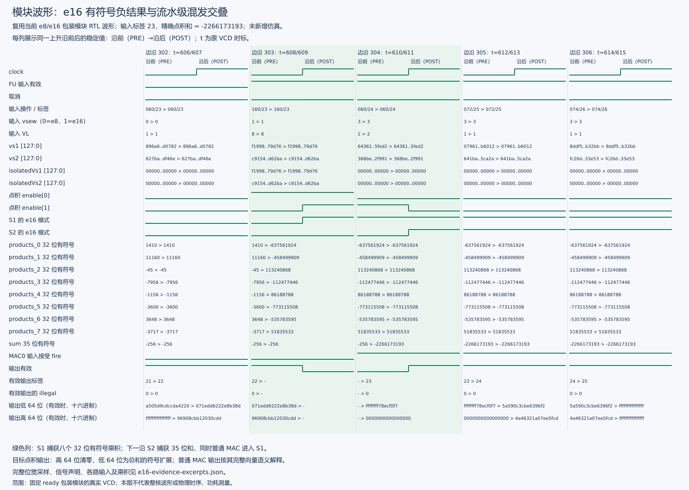

# vdot 延迟分析与创新贡献：实测、波形及修改依据

本文对应 NEMU 扩展、协同仿真、标准 RVV 基线及延迟加速分析。第 1 节区分四种周期指标，给出当前 e8/e16 的实测图；第 2 节保留有版本标识的历史证据；第 3 节按“问题—修改—收益—安全验证”说明三项设计贡献。全部图件复用已有信号记录和正式采样，没有新增处理器仿真或 VCD。

## 1. 当前 e8/e16 验收与性能

当前组合为 `XiangShan/build/sew16-fixed8/emu`、`NEMU/build/sew16/riscv64-nemu-interpreter-so`，固定八项、VLEN=128、m1、VL=8、vm=1、vstart=0。e8 结果放低 32 位、高 96 位零；e16 结果放低 64 位、高 64 位零。指令及通路见[当前主设计](../../stage2/docs/vdot指令设计说明.md)，运行组合见[版本选择](../../docs/核与参考库版本选择.md)。

| 第三阶段内容 | 当前实现与验证 | 主要材料 |
| --- | --- | --- |
| NEMU 指令扩展 | 以 int64 精确求八项和，按 e8/e16 打包，写回前检查合法性；参考库 API 2304 合法/96 非法通过 | [扩展验收](../../stage2/reports/固定八项e8e16实施与验收报告.md) |
| RTL/NEMU 协同 | 完整整核 e8 检查 1564、e16 检查 836，差分、CSR、GOOD TRAP 和退出 0 | [当前整核图文总结](../../stage2/reports/e16整核仿真与关键信号图解.md) |
| 实际执行后取消 | 四初始化进程合计 8 次分支取消 16 条 e16、32 次异常取消 96 条年轻 e16，同代次均未提交 | [内部事件报告](../../stage2/reports/e16整核取消与独立初始化实验报告.md) |
| 精确 RVV 基线 | e8 宽乘至 i16、宽归约至 i32；e16 宽乘至 i32、宽归约至 i64，核对完整输出及 CSR | [当前汇编](../sew16-perf/bench.S)、[测量协议](../sew16-perf/性能测量与复核手册v4.md) |

### 1.1 四种指标各回答什么问题

| 指标 | 起止及计算方式 | 当前结果 | 报告含义与适用范围 |
| --- | --- | --- | --- |
| FU 输入到输出 | 同一分配代次的 FU 实际接收→匹配的有效结果 | e8/e16 均为 2 DUT 周期；probe 内 400 次输出核对通过 | 执行单元端口延迟；不含译码、IQ 等待和 ROB 提交等待 |
| 非零依赖链斜率 | 16/64/256 步逐次反馈，逐进程拟合 `C(N)=C0+L×N` | vdot 约 7、RVV 约 29 周期/点积 | 包含循环、配置、反馈及依赖路径的有效周期；斜率不是单个 FU 延迟 |
| batch4 | 预加载输入，四个独立目的；每样本 256 次点积 | e8/e16 均为 350 对 1648 周期，RVV/vdot=4.708571 | 独立指令流的内核周期收益；四路共用一对源向量，不表示四组不同应用数据 |
| e2e | 每样本 256 次点积，区间包含加载、初始化及结果保存 | e8 约 2.212181 倍，e16 约 2.329411 倍 | 含访存与初始化的区间收益 |

四项使用相同的 DUT 周期单位，但测量边界不同。**不能用 29÷2 得出整体加速比，也不能把 batch4 的周期收益归因于隔离门控。** 所有内核周期保留必要循环、配置和计时标记成本，不扣空循环。

### 1.2 端口两周期与依赖链斜率

[可放大 SVG](figures/latency-levels/port-and-chain.svg)。图 A 是实际接收/结果的稀疏事件示意；两个端点分别来自同一指令，不补画中间连续电平。首个计时调用中的 e8 接收/输出为 10222→10224，e16 为 35406→35408，完整 128 位结果均为 36；按 ROB 标签与分配代次关联，不能只按重复使用的 tag 匹配。

图 B 横轴为链长 N，纵轴为整段 DUT 周期 C(N)。实心点是四个当前核进程的各自中位数再取中位数，细线为各进程独立拟合，多条线在此尺度上基本重合。每一步把前一次结果作为下一次真源；软件 oracle 检查非零、非固定点反馈，避免把“反复算零”当成一般依赖链。

| SEW | vdot 斜率，周期/点积 | RVV 斜率，周期/点积 | vdot / RVV 最大相对拟合残差 |
| --- | ---: | ---: | --- |
| 8 | 7.000000 | 28.999628 | 0.165% / 0.096% |
| 16 | 6.999256 | 28.999628 | 0.331% / 0.086% |

斜率列是四进程拟合斜率的中位数，残差列是相应四次拟合中的最大值。约 7 周期说明该反馈程序每多一步的有效成本，约 29 周期说明标准宽乘、配置切换和宽归约组合的有效成本。二者比值约 4.14，仅用于描述该依赖链的边际周期对比；有限链长还含截距成本，chain256 的整段比值因此约为 4.09。

两周期的原始证据见[动态边界与输出对齐审计](../logs/20261027T174613-sew16-perf4-preflight.timer-audit.json)和[已保存事件](../logs/20261027T174613-sew16-perf4-preflight-probe.jsonl)；三链长逐进程点、斜率、截距和残差见[正式分析数据](../logs/20261027T190338-sew16-perf4-full.analysis.json)。图的两个端口实例不能替代 400 次完整核对；本页生成器也会从原事件重新检查这 400 次匹配、配置及完整结果。

### 1.3 独立流内核与含加载、保存区间

当前性能使用独立 v4 程序，四个扩展核进程与四个旧隔离核进程配对，保留全部 1920 行预热和正式样本。当前核图表只使用四个扩展核进程；旧核用于 e8 兼容对照。下表摘自[当前正式报告](e8e16正式性能分析报告v4.md)，不是第 2 节历史图片的统计结果。

| SEW | 场景 | vdot 周期 | RVV 周期 | RVV/vdot |
| --- | --- | ---: | ---: | ---: |
| 8 | batch4 | 350 | 1648 | 4.708571 |
| 8 | e2e | 1244 | 2750.25 | 2.212181 |
| 8 | chain256 | 1824 | 7456.5 | 4.087856 |
| 16 | batch4 | 350 | 1648 | 4.708571 |
| 16 | e2e | 1181.5 | 2750.5 | 2.329411 |
| 16 | chain256 | 1824 | 7456.5 | 4.087993 |

[可放大 SVG](figures/publication-20261107/kernel-intervals.svg)。左侧蓝色为 vdot、灰色为精确 RVV 基线，横轴从零开始，四组使用同一周期尺度；右侧标出四个进程的比值、范围和中位数，重合点不代表遗漏进程。右侧范围是进程间观测范围，不是置信区间。

周期是各进程中位数的中位数；加速比先在每进程内计算，再取中位数，不直接用汇总周期相除。batch4/e2e 每样本 256 个点积，chain256 为 256 条非零反馈。batch4 的内核收益更大，说明扩大计时范围后，访存、初始化及其他开销会影响区间收益；两场景的代码与边界有差别，不能直接将两根柱的差值解释为某一个访存阶段的耗时。

当前核功能与控制图见上表材料；第一阶段 Hello 截图只证明环境，不用于计算这里的加速比。

### 1.4 标准基线为什么等价

e8 使用 signed8 宽乘到 signed16，再宽归约到 signed32；e16 使用 signed16 宽乘到 signed32，再宽归约到 signed64。双方核对完整 128 位结果、高位清零及配置 CSR。e8 `vmul` 会截断乘积，不能作为等价基线。计时边界通过当前 probe 的每内核 42 次调用审核，证明起点标记约束内核分派、终点标记位于内核提交之后；这是本实验边界的动态证明，不外推为通用内存持久性屏障。

代码见[当前汇编](../sew16-perf/bench.S)，方法见[v4 协议](../sew16-perf/性能测量与复核手册v4.md)。当前图的数值来自原始日志复算；生成与复核方法见第 4 节。

## 2. 历史 e8 图件与测量说明

以下图片和统计属于 v0.1 或旧 e8 隔离核。相关原始大 VCD 已精简，图片、真实信号摘录和原审计保留，详见[清理台账](../../manifest/存储清理台账.md)。它们用于解释通路及测量方法，不替代当前核验收。

### 2.1 NEMU 参考语义与 RTL 计算的对应

NEMU 是指令级软件参考模型，没有 RTL 时钟、流水级或可与硬件逐拍对齐的执行波形。因此这里用实际 RTL 计算波形解释 NEMU 应实现的语义，不称为“NEMU 实测波形”。

参考模型入口为 `NEMU/src/isa/riscv64/instr/rvv/vcompute.h` 的 `vdot` helper，译码由 `instr/decode.c` 和 `instr/rvv/decode.h` 接入。该历史 v0.1 版本检查 e8/m1/VL=8/vm=1/vstart=0，按 signed int8 读取低八项，以 int32 求和，再写低 32 位并清零高 96 位；先算完再写目的，以支持别名。当前 helper 已升级为上一节的 e8/e16 int64 实现。

本例 A 为 1…8，B 为 8…1，八项乘积是 8、14、18、20、20、18、14、8，合计 120。图中的输入、product 寄存器、sum 和有效输出均取自原 v0.1 整核 VCD。NEMU 用软件循环得到同一数学结果，不复制硬件加法树；`out.valid=1` 时完整输出应为 `0x00000000000000000000000000000078`。图不单独证明 NEMU 已运行，通过证据为 [NEMU API 日志](../../stage2/logs/20261002T112457-nemu-vdot-tval-api.full.log)中的 1035 合法/10 非法检查。

负数与上下界的逐项波形见[基础功能测试报告](../../stage2/reports/vdot基础功能测试与验收报告v0.1.md)。参考模型配置、异常与构建入口见[集成手册第 8 节](../../stage2/docs/vdot历史集成操作手册v0.1.md)。

### 2.2 协同仿真：计算结果不等于架构提交

运行链为：同一程序进入 XS RTL；执行单元产生物理结果；ROB 按程序顺序提交；Difftest 驱动 NEMU 执行对应指令并比较架构状态。两侧速度和内部步骤不同，不做“同一时钟拍执行相同阶段”的比较。普通用例核对完整 128 位、CSR 和异常；错误路径则要求年轻指令不提交，不能仅凭内部结果出现判失败。

这张是已有隔离核联合审计的**事件图**，不是连续 valid 波形。蓝点为分派，绿点为物理输出，红点为取消。同一 ROB 分配在完整跟踪中没有提交，架构毒值/CSR 也保持；上图是首个真实分支误预测，下图是首个精确非法异常。全部覆盖为 2 次误预测取消 4 条 vdot、4 次精确异常取消 12 条年轻 vdot，不将图中的少量事件当作全部覆盖。

v0.1 的 29 次有效结果与 29 次提交关联见[原整核波形报告](../../stage2/reports/vdot原始核执行与提交波形.md)；隔离核的四随机种子、配置切换、混发/v0/非零长链及差分结果见[统一功能验收](../../stage2/reports/vdot功能与整核控制验收报告.md)和[控制验收](../../stage2/reports/隔离版本整核构建与控制验证报告.md)。图片不能替代这些日志，也不能跨版本冒充新核证明。

### 2.3 历史基线：宽乘、宽归约与专用点积

共享实现为 [bench.S](../vdot-bench/bench.S)。RVV 基线使用 `vwmul.vv` 将八项 signed int8 乘为 int16，再切换 e16/m2，由 `vwredsum.vs` 以零种子归约至 int32，最后恢复 e8/m1。目标高 96 位提前清零并检查保持。不能使用会截断乘积的 e8 `vmul` 代替。

vdot 一条指令完成同一八项点积并清零高 96 位。batch4 每批有四个独立目标；图中探针是 8 批，共 32 个程序规定的点积。输入低八项均为 A=1、B=2，每项宽乘结果应为 2，最终点积为 16。

两幅采用相同横轴比例，从各自起点 mcycle 分派开始，2 个原 VCD 时标对应 1 个 DUT 周期。`TOP.clock`、`Vimac.out.valid`、`Vipu.out.valid` 为原始信号电平；下方彩色短线为按分派 PC/ROB 关联到的结果事件：绿=vdot，棕=宽乘，紫=宽归约。普通宽乘和 vdot 经过 Vimac，宽归约经过 Vipu。valid 轨迹未过滤其他操作，只有下方匹配事件用于本例结果核查。

该核的宽乘拆成两个输出微操作，第二个对应尾部；宽归约有四个输出微操作，中间部分和不是最终点积。提取器按同一 ROB 分组，检查宽乘首个输出的八个有效 int16 均为 2、归约最后输出和 vdot 的完整 128 位均为 16。图中彩线只标出这些经核查的结果，不把中间和误当答案。

实际捕获 vdot 32 个输出微操作、RVV 192 个输出微操作（32×2 宽乘加 32×4 归约），核查了双方各 32 个最终点积。分派却有 37 条 vdot 或 36 条宽乘，说明循环退出存在额外推测指令，不能将分派数或物理事件数当提交数；该窗口额外分派没有形成更多匹配结果。这个探针不替代完整 oracle 和 Difftest。

### 2.4 历史加速分析：探针和正式结果分开

上图探针的 mcycle 差分别为 vdot 170、RVV 313 DUT 周期，比值 1.841176。它来自旧 v0.1 核的 8 批边界验证，只解释计时方法和执行路径；**不用于当前正式加速比，不与下图数值比较 RTL 提升**。起止标记的排空/阻塞证明见[计时边界验收](P0完善与验收记录.md)。

这是**统计图，不是波形图**。数据来自[四进程完整 JSON](../logs/20261006T060358-16-isolation-perf-report.json)：每进程双方 8 次预热、8 次采样，每样本 256 批×4=1024 点积，起始顺序均衡、对内交替，不扣空循环。图中周期为各进程中位数的中位数，加速比为各进程比值的中位数，不直接用两根汇总柱相除。

| 内核 | RVV 周期 | vdot 周期 | RVV/vdot |
| --- | ---: | ---: | ---: |
| batch4，预加载四路独立目标 | 6448.25 | 1247 | 5.171010× |
| e2e，包含加载/初始化/保存 | 10878.5 | 5178 | 2.100908× |
| chain，真实反馈的零固定点 | 29727.25 | 7199.5 | 4.129071× |

随机数据用于等价性测试；计时 batch4/e2e 低八项固定为 1 和 2，chain 为零固定点。全部样本和版本条件见[历史 v3 报告](隔离核正式性能分析报告v3.md)，不与当前 v4 数据混合。

### 2.5 Baseline 与专用单元的指标边界

功能波形能展示 vdot 的两级计算：使能第一级锁存八个乘积，下一使能级归约为 19 位精确和，包装后输出低 32 位及清零的高 96 位。基线波形则直观显示宽乘与归约分属不同执行单元，另有 vtype 切换、调度、循环和串行边界成本。

因此上表是 **Baseline/vdot 内核周期加速比**，不是“RVV 单个 FU 延迟 / vdot 两拍”的纯执行单元延迟比，也不是隔离优化带来的收益。同协议 P1/隔离对照的三个内核周期比均为 1.000000，说明该次隔离优化未缩短总周期。当前 v4 另已完成非零反馈和 16/64/256 三链长分析，比较的是完整有效依赖路径；端口延迟、吞吐及含访存区间仍需分别报告。

### 2.6 历史图件来源

新探针图只读 原版本波形文件，计数器及边界来自[原六组审计](../logs/timer-probe-20261003-window2-audit.json)。小体积采样及完整信号映射保存在 [probe-samples.json](figures/comparison/probe-samples.json)；正式图由原 JSON 的全部采样重新计算，不修改原报告或测量数据。图中采用英文短信号名便于直接查找 RTL，本页提供中文判读。

绘图输出为 PNG 和可缩放 SVG；已有功能及控制图直接复用，没有重新生成。

## 3. 三项设计贡献：问题、修改、收益与安全验证

这三项分别解决调度依赖、无效活动和精确多位宽支持，收益不能相乘。oldVd 与隔离的前后对照属于各自历史 e8 版本；当前 e8/e16 核继承这些机制，并有自己的模块、整核及控制回归。版本、图的信号层次和测试范围在下文分别注明。

### 3.1 去除 oldVd 假依赖：让调度条件符合指令语义

| 环节 | 设计与证据 |
| --- | --- |
| 问题 | 复用普通向量乘加通路时，译码保留 oldVd 第三读源。前一条指令若尚未写完同一逻辑目的，重命名后的 oldVd 物理源处于 busy，IQ 即使已拿到真实 vs1/vs2 和配置，仍不能取得源就绪资格。独立目的 v0 还可能引入辅助 v0 误依赖。 |
| 修改 | 仅在 `DecodeUnitComp.scala` 的 `VEC_VDOT` 专用拆分路径设置 `csBundle(0).srcType(2) := SrcType.no`，在辅助 v0 源生成前生效。vdot 完整覆盖目的，不读旧目的累加，不做尾部/掩码合并，因此删去该读源符合语义。 |
| 收益 | 完整窗口的误等待记录 632→0。配对实例中，独立 oldVd 的分派→FU 输出为 13→7 周期，独立目的 v0 为 17→7；这是减少等待，不改变两周期 FU。四进程同协议 batch4 的旧核/新核周期比中位数为 1.465317。 |
| 安全验证 | `src0/src1` 真源和配置源继续等待；真实 `vd=vs1` 配对实例仍为 17→17 周期，前后完整结果一致。真实读取 v0 时保留依赖；普通 `vmacc` 等仍需 oldVd，不能从整个 Vimac 配置中删除第三源。模块及完整整核差分另行通过。 |

读图顺序：先看真实源 0/1 与配置源就绪，再看优化前 oldVd 的类型和 busy，最后对齐目标 FU 输出。优化后源类型为 no，即使 psrc 字段残留，也不表示还要读它。图中 13→7 是**分派到 FU 输出**，不是本文第 1 节依赖链拟合出的约 7 周期。

安全对照应同时查看[真实 vs1 依赖保留图](figures/review-edition-20261101/p1/p1-true.png)和[独立目的 v0 图](figures/review-edition-20261101/p1/p1-v0.png)。完整信号、配对方式和实测见[P1 对比报告](原始核至P1优化对比报告.md)；改动可直接审查[最小补丁](../patches/vdot-oldvd-p1.patch)。正式同配置对照还记录 e2e=0.987737、chain=0.999965 的旧/新周期比，因此只能宣称该独立流场景获益，不能宣称所有程序加速。

### 3.2 操作数隔离与更新使能：停下闲置分支，保留在途工作

| 环节 | 设计与证据 |
| --- | --- |
| 问题 | 点积与普通 MAC 共用包装接口。只在输出处选择结果，未被选择的分支仍可能随输入翻转；仅让寄存器保持，也不能阻止前级组合乘法器活动。若用“当前输入是不是 vdot”同时控制全部级，还会关闭较老指令的第二级。 |
| 修改 | `VDot8.scala` 在乘法前夹零输入，products 与 sum 按各级 enable 更新；`wrapper/VIMacU.scala` 在普通分支 split/reorganize 前夹零数据和无效控制。点积 S1 用当前 `inIsVdot`，S2 用已延迟的 `ctrlVec(1).fuOpType`；普通分支沿自身 `fire/fireS1` 推进。 |
| 收益 | 同一固定混发模块序列，所选四组寄存器 bit flips 合计 178205→135389，减少 24.03%；禁用时输入隔离、寄存器保持得到逐沿检查。P1/隔离核同协议三内核周期比均为 1.000000，未增加该测试的周期成本。 |
| 安全验证 | 351 个非复位边沿检查、301 次有效输出核对、4140 次禁用保持，以及 37 次普通/点积级交叠检查通过；整核差分、配置切换、v0、长链、多种子及实际错误路径取消另行通过。 |

关键是按**各级正在处理的指令**决定使能。例如普通乘法 B 紧跟点积 A：当前输入可令 A 所在分支的 S1 关闭，但 S2 仍必须完成 A；反过来，当前为点积也不能关掉较老普通乘法的 `fireS1`。空闲输入夹零与较老结果继续推进可以同时成立。

该图来自模块 wrapper，不是整核波形。目标边沿当前普通 MAC tag=9、较老点积 tag=8：点积 `enable0=0`，乘积寄存器保持；`enable1=1`，sum 正常更新，tag=8 的有效结果为 12980。它直观说明“停止无用一级”与“完成较老一级”如何并存。普通分支的对称保持见[MAC 禁用图](figures/isolation/isolation-mac-hold.png)，点积禁用及 S2 推进见[点积保持图](figures/isolation/isolation-dot-hold.png)。

| 固定序列中采样的寄存器组 | 优化前 bit flips | 优化后 bit flips |
| --- | ---: | ---: |
| 点积 products | 19052 | 4580 |
| 点积 sum | 2859 | 669 |
| 普通 MAC Wallace 级 | 117326 | 100444 |
| 普通 MAC S2 | 38968 | 29696 |
| 合计 | 178205 | 135389 |

原始逐沿检查与计数见[隔离波形摘录及完整审计](figures/isolation/isolation-wave-excerpts.json)，实现与整核对照见[隔离优化报告](P1至隔离核优化对比报告.md)及[增量补丁](../../stage2/patches/xiangshan-vdot-operand-isolation.patch)。这些是 RTL 采样活动，范围限于所选寄存器和序列；没有包含全部组合毛刺、电容或时钟树，**24.03% 不能写成功耗降低比例**。逻辑更新使能尚不是 ICG，Mux 与使能扇出也可能有面积及物理时序代价。

当前 e8/e16 版本还独立完成 1158 个边沿、13221 次禁用保持和 142 次交叠检查，见[当前模块与整核验收](../../stage2/reports/固定八项e8e16实施与验收报告.md)。该结果支持扩宽后使能行为兼容；旧 e8 固定序列的 24.03% 活动比例不直接移作新核的活动比例。

### 3.3 e8/e16 共享精确算术：拓展位宽，同时对齐数据与模式

| 环节 | 设计与证据 |
| --- | --- |
| 问题 | 原 e8 的八个 signed8×8 乘积与 signed19 总和无法容纳 e16 的极值；只扩大输入选择而沿用 32 位求和会丢失精度。两种模式交替或停顿时，若用当前输入模式打包旧结果，还会混淆低 32/64 位格式。 |
| 修改 | 点积分支内由 e8/e16 共享八个 signed16×16 乘法器：e8 取低八字节并符号扩展，e16 取全部八个半字；products 为 signed32，平衡加法树逐层扩宽至 signed33→34→35。`sew16S1/S2` 与对应数据使用相同级使能，输出由 `sew16S2` 选择格式。 |
| 收益 | 新增八项精确 e16 能力，保持同一指令编码、两周期端口和共享后端接口；e16 正负超 32 位结果、高位清零均有真实证据。当前 v4 的 e8 兼容对照五场景、两实现的四组中位周期比均为 1.000000，功能回归也通过。 |
| 安全验证 | 模块 4 suites/8 项测试，含 e8/e16 交替、使能停顿及普通乘法混发；NEMU API 2304 合法/96 非法；当前完整整核 e8=1564、e16=836 检查通过。四个独立初始化进程另验证 112 条已执行 e16 取消后，同分配代次不提交。 |

算术位宽可独立复核：e16 每项最大正积为 `(−32768)²=2^30`，八项和可达 `2^33=8589934592`，signed34 的正上界为 `2^33−1`，故至少需要 **signed35**。最小和为 `8×(−32768)×32767=−8589672448`。e8 的范围为 −130048…131072，signed19 已足够；它复用更宽通路后输出到低 32 位仍精确。

本例 tag=23，乘积在 `t=609 POST` 捕获，`t=611 POST` 的总和为 −2266173193，完整输出为 `0x0000000000000000ffffffff78ecf0f7`：低 64 位内符号扩展，高 64 位为零。模式寄存器与该条数据一同推进，不能用此时新输入的 SEW 解读输出。另有[正数宽位结果图](../../stage2/reports/figures/review-edition-20261101/e16-summary/module-e16-positive.png)；这两个实例不是数学最小/最大输入。极值、零及非法配置的证据范围见[边界验收](../../stage2/reports/固定八项e8e16实施与验收报告.md)。

共享仅指 e8/e16 两种点积模式复用同组乘法器，普通 MAC 仍有自己的通路。改动集中在 `VDot8.scala`、`wrapper/VIMacU.scala` 的算术/模式及合法性接线，配套更新 `VecExceptionGen.scala`、NEMU helper 与测试；逐文件说明见[当前操作手册](../../stage2/sew16/固定八项e8e16扩展操作手册.md)，可审查[硬件增量补丁](../../stage2/patches/xiangshan-vdot-sew16-fixed8.patch)与[NEMU 增量补丁](../../stage2/patches/nemu-vdot-sew16-fixed8.patch)。SEW 取本条 uop 的 VPU 控制，VL 取既有配置依赖；输出合法性使用输出级配置，保留连续 vset 后的正确依赖。

兼容周期相同不等于面积、频率或功耗不变；e16 相比原 e8 增加算术位宽和模式选择，尚无物理 PPA 结果。当前核与旧核同镜像的 e8 地址、输入、长度及选序一致，但启动参数分别开启/跳过 e16 路径，整体运行上下文有差异；这组对照用于说明已覆盖场景兼容性，不把它称为隔绝所有软件上下文的硬件因果实验。
