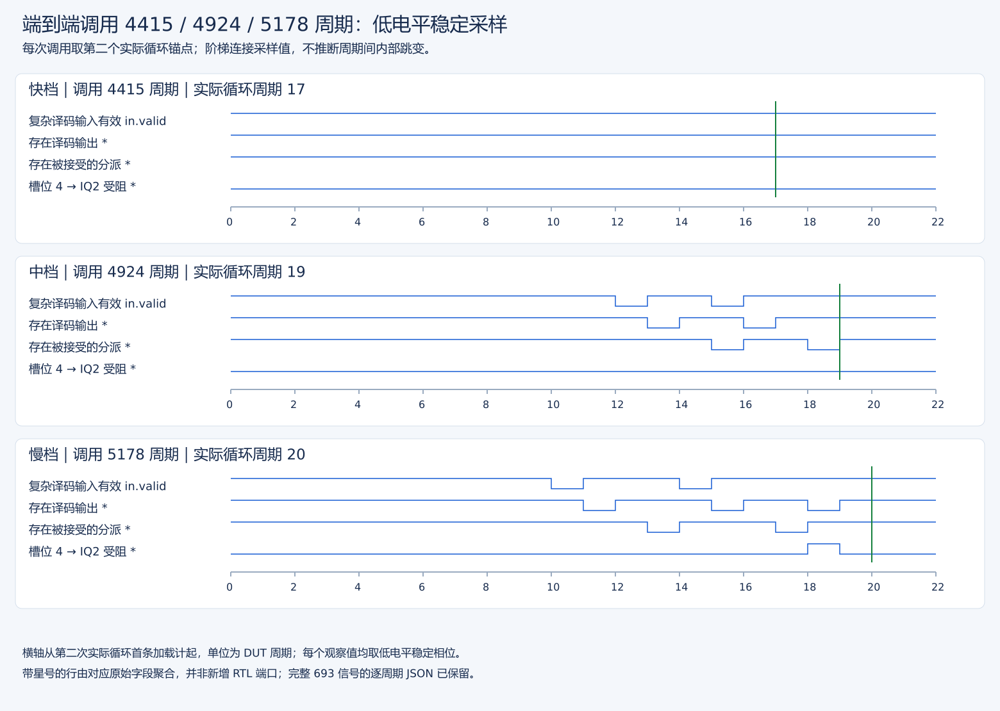
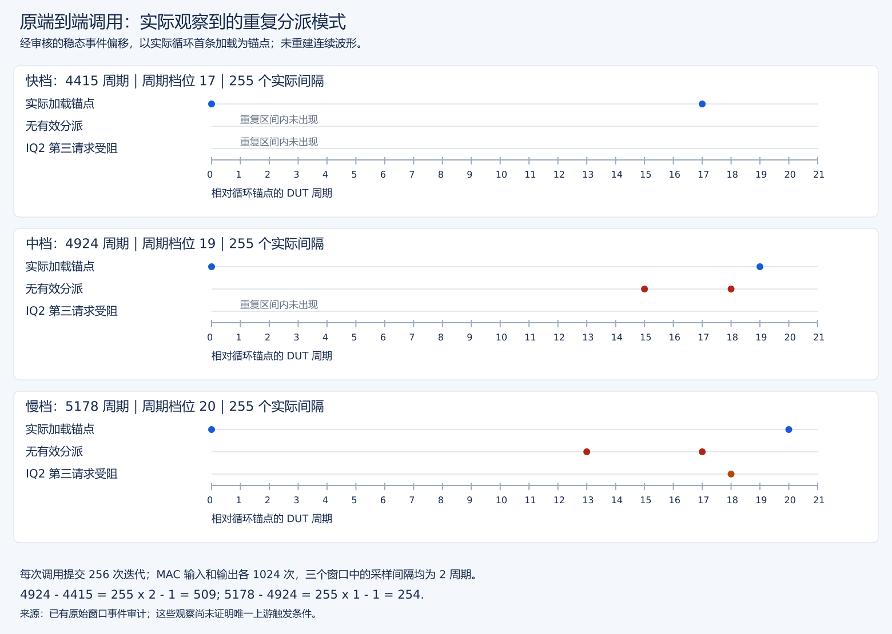

# E2E 单调用补采与调用上下文受控验证

状态： 全部完成。单调用补采、完整整核重放/差分/GOOD TRAP/退出及全样本审核 PASS；固定 12 组无波形上下文矩阵、144 次调用及 16 项配对比较审核 PASS。4415 / 4924 / 5178 三档的直接内部机制已分解，但受控干预未复现大档位切换，预测器/IQ 初态的唯一因果闭环仍未完成。

## 授权与范围收缩

原方案连续补采多个档位，预计约 40 GB；后台授权请求被用户中断，没有形成 other-bins 协调日志或新波形。随后决定只补采一个调用并复用旧波形。现已将采集工具收缩为一个固定 4924 调用，取消多档位新波形，直接压缩输出；其他档位只在历史数据中保留，不能冒充已采到内部证据。

已有 [4415 / 5178 原窗口诊断](原镜像端到端快慢窗口事件诊断.md)及其最终 PASS 事件/逐周期数据复用，原始未压缩波形不再生成第二份。

## 预先固定的假设与判定

- 4924 窗口若稳定迭代间隔为 19，检查比 17 档多的两周期来自哪种译码气泡/IQ 阻塞组合；不能先断言一定只是去掉 IQ2 冲突。若间隔混合则完整保留直方图及边界，不强行拟合一个档位。
- 使用 256 次真实提交迭代计数核验工作量；错误路径额外分派不计为迭代。与旧 4415 / 5178 窗口按起始、255 个真实迭代间隔及收尾做互斥差值核算。
- phase 单因素比较同 pressure、同调用先后位置和同 round；pressure 单因素比较同 phase、同位置和同 round。全部 12 组 / 144 调用保留，初始轮也不丢弃。首先看原始序列和档位，不用混合中位数冒充一种稳定状态。
- 因为矩阵没有内部波形，只能判断干预是否改变周期；新周期恰等于原某档位不证明内部机制相同。不能把 ALU/mul 干预等同直接钳制 IQ2，不能把 phase 数字等同已经观察到的译码缓存相位。
- 本轮没有改 RTL，也不以改变诊断程序替代硬件性能优化

## 已完成的旧波形上游复查（不重跑）

新增只读工具 `stage3/tests/analyze-e2e-entry-context.py` 从已有正式 `.cycles.json` 提取计时前 128 周期的实际 redirect 与译码输入组，使用 ROB 标签关联真实分支 PC，不把 FTQ 基址误报为指令地址。结果见[复用窗口入口证据](../logs/20261008-reused-e2e-entry-context.json)。四项合成测试通过。

| 观测 | 原 4415 快窗口 | 原 5178 慢窗口 |
| --- | --- | --- |
| 计时前选择分支 `0x80000344` 的误预测 | 0 | 1，发生于起始 CSR 分派前 19 周期 |
| 最后一个含起始 marker 的 decode 输入组 | `344,d0,d4,d8,dc,e0` | `d0,d4,d8,dc,e0,e4` |
| `csrwi vstart,0`（`3d0`）所在槽位 | 1 | 0 |
| 该组出现时间（相对起始 CSR 分派） | −29 | −11 |

上述组内地址简写均以 `0x800003` 为前缀。慢窗口在之前还观测到 caller 的 `0x800009d6`（内层 slot 循环退出）、`0x800009de`（预热 rep 循环退出）两次错误预测，随后切换到正式调用点 `0x80000a22`；快窗口使用预热调用点 `0x800009a0`。慢窗口的选择分支先走向 RVV 路径，实际 redirect 对应 `0x80000344`，恢复后的 marker 组从 `0x800003d0` 开始；快窗口 marker 前仍包含选择分支。

这是原窗口中“调用上下文 → 分支恢复 → 起始输入组不同”的直接时间线证据，推进了上游定位，但还没有通过单独控制预测器状态排除全部上下文因素。误预测本身发生在计时前，不能把一次性恢复罚时直接加进 763 周期；计时内差异是持续的分组气泡及 IQ 入队冲突。队列排序初态为何不同仍需单独验证。

## 单一 4924 窗口的实测结果

交叉入口检查见[三档入口证据](../logs/20261008-three-bin-entry-context.json)，循环信号与 IQ 选择见[三档分组证据](../logs/20261008-three-bin-loop-groups.json)，新窗口完整区间归因见[单调用事件](../logs/20261008T200238-original-other-bins.events.json)，全样本复核见[审核](../logs/20261008T200238-original-other-bins.audit.json)。

| 直接观测 | 4415（复用） | 4924（唯一新采集） | 5178（复用） |
| --- | --- | --- | --- |
| 最后起始 marker 输入组中的槽位 | 1 | 2 | 0 |
| 计时前 selector 分支误预测 | 0 | 0 | 1 |
| 255 个真实迭代间隔 | 全部 17 | 全部 19 | 全部 20 |
| 间隔内分派全空偏移 | 无 | +15、+18 | +13、+17 |
| 重复的纯标量译码尾组 | 无 | `[424]`、`[434,438,3dc]` | `[414]`、`[42c]` |
| 循环尾 IQ 选择：store 辅助 / addi / bnez / 下一轮 beq | 2 / 3 / 0 / 2 | 2 / 2 / 1 / 0 | 2 / 2 / 0 / 2 |
| 对应 IQ2 第三请求阻塞 | 0 | 0 | 256 |
| 已提交真实迭代 / DOT 数 | 256 / 1024 | 256 / 1024 | 256 / 1024 |

译码尾组每一种均出现 256 次。上表组内地址是实际 PC 后三位（`424` 对应 `0x80000424`），不是槽号。4924 的气泡位置不同于 5178，不能因都多两拍就照抄慢档的两个孤立标量 PC。

4924 的 `addi t2,a0,32`（PC `424`）独自留在 decode buffer；随后是复杂 store（`428`）。另一处尾组为 `addi t0,-1`、退出 `bnez`、下一轮条件 `beq`（`434,438,3dc`），后续复杂 load（`3e0`）已在 IBuffer。两处均观察到 complex decoder active、下一复杂输入无效、之后 idle 重新接收，形成两拍气泡。该档 `addi` 虽也选 IQ2，下一轮 `beq` 选到 IQ0，IQ2 不出现第三请求；四个相关整数 IQ ready 均为 1。

入口 marker 组为 `[340,344,3d0,3d4,3d8,3dc]`，没有 selector 误预测，但相对快档多一个组内前驱指令。这说明**不是“有误预测才有译码气泡”**：正确预测下也可能形成另一分组相位。三个实际观测窗口的 marker 槽位与档位相互对应，但它们不是所有执行初态的普适分类器。

### 关键图：三个原窗口的分派事件模式

图保留原周期数据中的真实低相位样本；绿色线为下一次真实首加载，间隔分别为 17/19/20 拍。加星行是明确字段的聚合，不是直接 RTL 端口，也不是补造沿间电平。信号定义、原始大波形精简影响，以及使用原核/原镜像重新采集的命令见[原窗口报告](原镜像端到端快慢窗口事件诊断.md)。

[查看清晰 SVG](figures/evidence/e2e-periods.svg)。蓝点为相邻真实迭代的首加载分派；红点为间隔内分派全空，棕点为 IQ2 第三请求阻塞。每种模式在 255 个真实间隔中重复；4924 档的空拍是 +15/+18，而不是照抄 5178 档的 +13/+17。灰线只是事件轨道，不表示完整 valid 电平。

图由本节已有事件 JSON 绘制，未再次读取大 VCD、生成波形或运行 emu。它不表示下面 12 组矩阵有内部波形，也不把“相似周期”当作相同机制证明。

互斥区间精确核算：

| 区间 | 4415 | 4924 | 5178 |
| --- | ---: | ---: | ---: |
| 起始 → 第一次真实首加载 | 15 | 15 | 15 |
| 第一 → 最后一次真实首加载 | 4335 | 4845 | 5100 |
| 最后一次首加载 → 结束 | 65 | 64 | 63 |
| 总计 | 4415 | 4924 | 5178 |

`4924−4415 = 255×2−1 = 509`；`5178−4924 = 255×1−1 = 254`；与已有 `5178−4415 = 763` 完全闭合。
三个窗口的 MAC 输入/输出各 1024，低相内部端口延迟全为 2；512 次加载的有效 L1 miss / bank conflict / replay 均为 0，各有一次实际循环退出误预测。收尾三段后 marker→时间戳同为 13 周期；其他收尾差异保留实测值，不冒充已定位到具体 store 完成级。

其他 4414 / 4923 / 5179 及初始预热特殊档位没有新增内部波形，本轮不能仅凭相差 1 周期断言是同一机制或计时边界抖动。全部原始样本继续保留。

## 无波形受控矩阵的最终结果

完整结果见[12 组原始审核](../logs/20261008T214323-e2e-controlled.results.json)及[独立配对分析](../logs/20261008T2341-e2e-controlled-analysis.json)。每组六轮、每轮两个实现；impl=0 为 vdot，impl=1 为 RVV。全部 144 次调用均保留，初始轮未剔除。

下表每个序列按 round=0..5 排列。同一个 phase 的 pressure=0 与 pressure=1 **全部 12 次调用周期逐项相等**，因此表格共用序列，但两个独立仿真及各自审核均保留。

| phase | pressure | vdot 原始周期序列 | RVV 原始周期序列 |
| --- | --- | --- | --- |
| 0 | 0、1 | 4718,4704,5178,5178,5178,5178 | 10863,10846,10814,10814,10814,10815 |
| 1 | 0、1 | 4718,4705,5178,5179,5179,5179 | 10863,10846,10815,10815,10815,10815 |
| 2 | 0、1 | 4718,4705,5178,5179,5179,5179 | 10863,10847,10815,10815,10815,10815 |
| 3 | 0、1 | 4718,4704,5178,5178,5178,5178 | 10863,10847,10814,10814,10814,10814 |
| 4 | 0、1 | 4718,4704,5178,5178,5178,5179 | 10863,10846,10814,10814,10814,10815 |
| 5 | 0、1 | 4718,4704,5178,5178,5178,5178 | 10863,10846,10814,10814,10814,10814 |

配对比较固定相同 round/impl/slot，不跨初始轮或实现比较：

- phase 相对同 pressure 的 phase=0：vdot 60 对，差值范围 0..+1 周期，18 对非零；RVV 60 对，−1..+1 周期，20 对非零。
- pressure=1 相对同 phase 的 pressure=0：vdot 36 对、RVV 36 对，全部差值 0。
- 各组最初两次 vdot 调用为 4718、4704/4705，后续四次为 5178/5179；这是跨调用历史效应的观测，不得称全部样本已经稳定，也不能用混合中位数抹掉初始轮。

结论：本设计中这两种固定 wrapper 干预未产生 4415/4924/5178 的大档位切换。ALU/mul 压力干预对耗时无效；改变指令数量/宽度的 phase 干预只有至多一拍变化。它们不能作为“已经控制了实际译码相位/IQ2”的证据；也不能反向证明所有调用上下文均无影响。内核准备和 CSR 排空可能消除了部分干预效果，但没有矩阵内部波形，不能把这一解释写成实测定论。

## 交付与遗留边界

本轮只新增一个 `.vcd.gz`（224101577 字节），复用旧快慢波形和逐周期证据，不存未压缩副本；12 个矩阵镜像没有波形。

后续有价值的方向是更直接地控制 selector 分支的训练/恢复历史，同时保持调用地址和代码布局，再观察实际入口分组；IQ 排序初态需独立对齐验证。先利用现有窗口和 RTL 只读分析设计有效干预，不把追加大波形当默认步骤。未追加实验，也不宣称硬件性能修复或其他 ±1 周期档位的内部归因完成。
