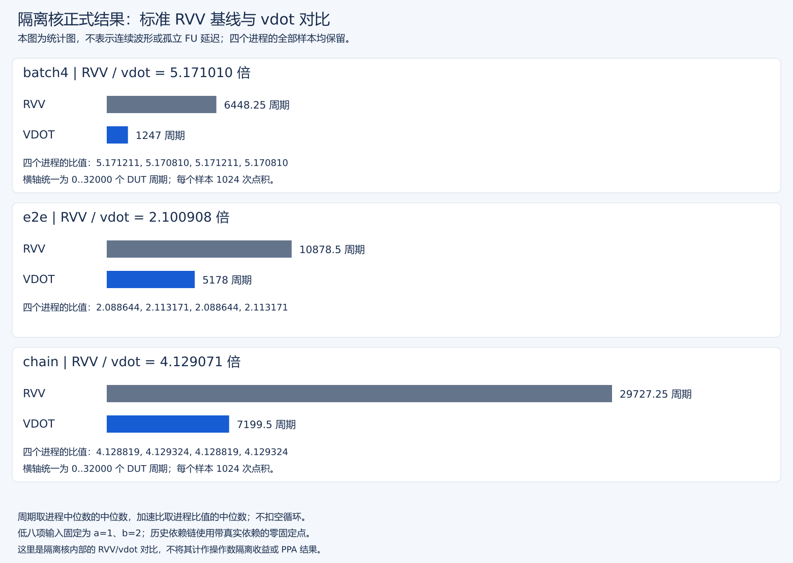
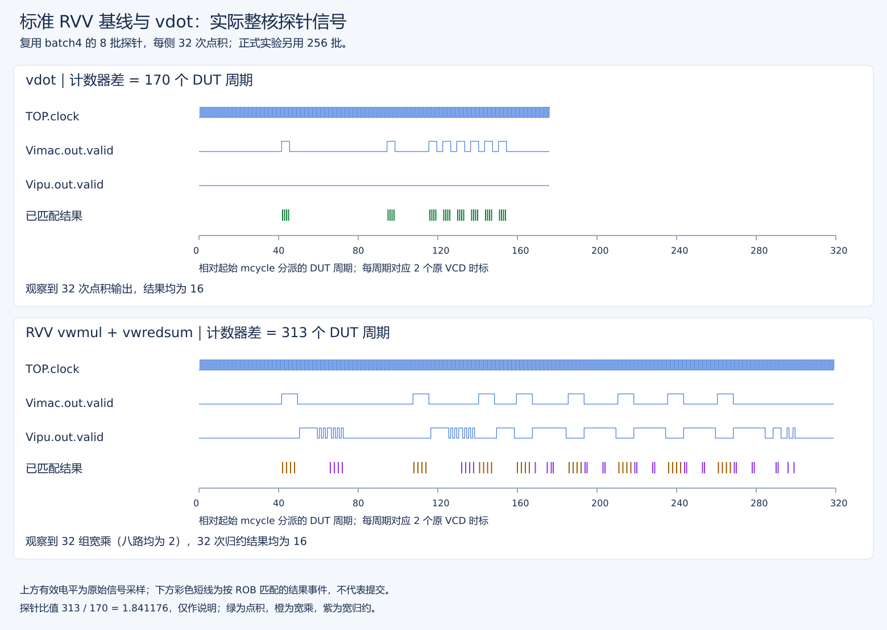
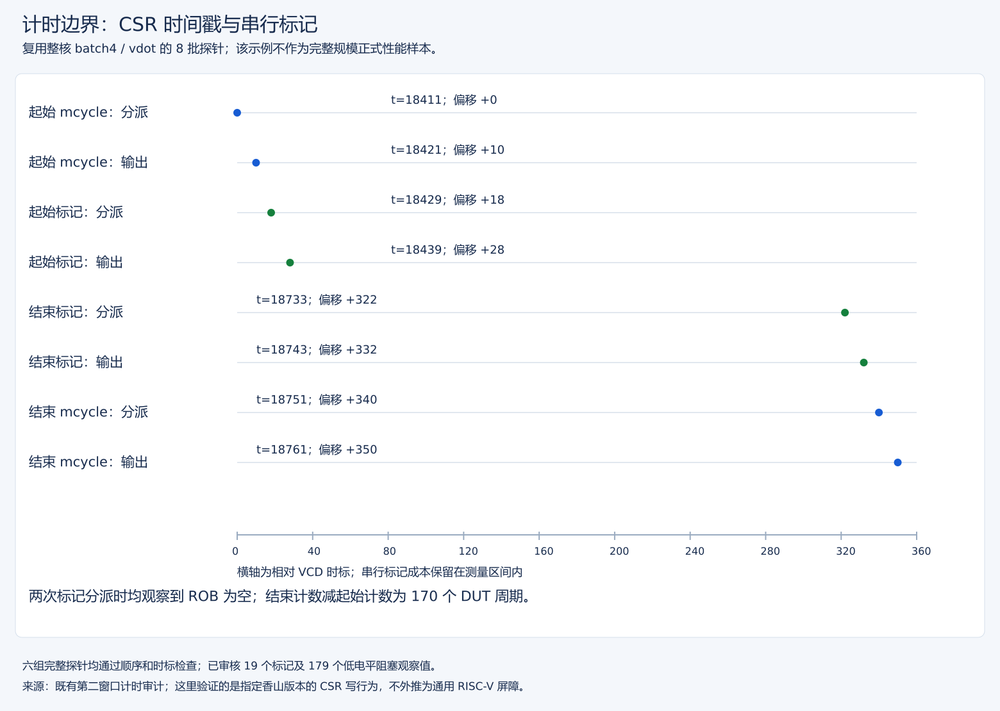
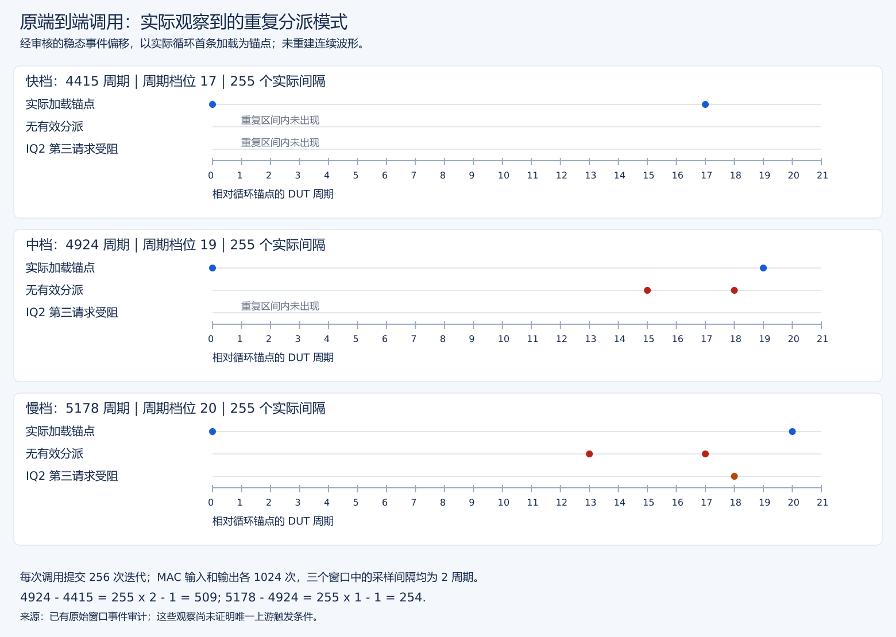

# 隔离核 vdot 正式性能实测报告 v3

实验数据来源：从全部 4 个进程完整日志复算生成，不选最快样本。

数据合同、等价性、差分检查、GOOD TRAP 与零进程退出码均通过。
数据有效不等于稳定。

## 方法

每进程双方各 1032 次 oracle 检查，含 1000 组随机、8 组定向的四种 ta/ma 策略。每实现/内核预热 8 次、采样 8 次，每样本 256 批 × 4 = 1024 次点积。对内交替顺序，进程起始顺序均衡；计时/自检结束后统一打印。
固定 XS 的 vstart CSR-write 串行标记包围内核，含标记、循环及必要配置；不减空循环。RVV 精确宽乘+宽归约与 vdot 的八项 signed int8 点积、32 位结果及 upper96 清零等价。
随机输入只用于等价性检查，不是计时输入分布。正式计时的低八项固定为 a=1、b=2（结果 16），其余字节是干扰值；chain 则采用零固定点。不能据此推断不同矩阵/数据分布的应用收益。
batch4：预加载四个独立目标；e2e：含加载、初始化、存储；chain：零固定点但存在真实 vd=vs1 依赖。跨进程以各进程中位数/比值为单位，不池化重复，不宣称置信区间。确定性仿真不代表现实芯片的随机独立样本。
详见 [P0 方法与验收](P0完善与验收记录.md)及 [v2 测量合同](性能测量可信度改进记录v2.md)。[v1 历史数据](vdot原始版本等价基线与性能实测.md) 协议不同，不直接比较提升幅度。

## 跨进程统计

周期列为各进程中位数的中位数，比值列为各进程 RVV/vdot 比值的中位数。

| 内核 | RVV 周期 | vdot 周期 | 比值中位数 | 比值范围 | 比值 CV | 初始顺序影响 |
| --- | ---: | ---: | ---: | ---: | ---: | ---: |
| batch4 | 6448.25 | 1247 | 5.171010 | 5.170810–5.171211 | 0.004% | +0.008% |
| e2e | 10878.5 | 5178 | 2.100908 | 2.088644–2.113171 | 0.584% | -1.161% |
| chain | 29727.25 | 7199.5 | 4.129071 | 4.128819–4.129324 | 0.006% | -0.012% |

单组采样最大 CV 为 2.424%。即使通过门槛，也不等于毫无波动；需结合每组范围、全部样本和位置/漂移指标阅读，尤其是含访存的 e2e。

初始顺序影响 = first=0 比值中位数 / first=1 比值中位数 − 1。全部进程加载同一个镜像；启动覆盖接口只注入一个顺序参数字节，代码、输入与输出地址布局一致。

## 每进程与全部原始样本

按 rep=0 起列出；同一对的先后由 first XOR (rep & 1) 决定。

| 进程/first | 内核 | RVV 中位数 | vdot 中位数 | RVV/vdot | RVV 周期序列 | vdot 周期序列 |
| --- | --- | ---: | ---: | ---: | --- | --- |
| 0/0 | batch4 | 6448.5 | 1247 | 5.171211 | 6448, 6448, 6449, 6449, 6449, 6449, 6448, 6448 | 1247, 1247, 1247, 1247, 1247, 1247, 1247, 1246 |
| 0/0 | e2e | 10815 | 5178 | 2.088644 | 10814, 10814, 10815, 10815, 11069, 10814, 11070, 10815 | 5178, 5178, 5178, 4924, 5179, 4923, 5178, 4924 |
| 0/0 | chain | 29727.5 | 7200 | 4.128819 | 29727, 29727, 29728, 29728, 29727, 29727, 29728, 29728 | 7200, 7200, 7200, 7199, 7199, 7200, 7200, 7199 |
| 1/1 | batch4 | 6448 | 1247 | 5.170810 | 6448, 6448, 6448, 6449, 6449, 6448, 6448, 6449 | 1247, 1247, 1247, 1247, 1246, 1247, 1246, 1247 |
| 1/1 | e2e | 10942 | 5178 | 2.113171 | 10815, 11070, 10814, 11070, 10815, 11069, 10814, 11069 | 5178, 4923, 4924, 5179, 5178, 5179, 5178, 5179 |
| 1/1 | chain | 29727 | 7199 | 4.129324 | 29727, 29727, 29727, 29728, 29727, 29728, 29728, 29727 | 7199, 7199, 7199, 7199, 7200, 7200, 7199, 7200 |
| 2/0 | batch4 | 6448.5 | 1247 | 5.171211 | 6448, 6448, 6449, 6449, 6449, 6449, 6448, 6448 | 1247, 1247, 1247, 1247, 1247, 1247, 1247, 1246 |
| 2/0 | e2e | 10815 | 5178 | 2.088644 | 10814, 10814, 10815, 10815, 11069, 10814, 11070, 10815 | 5178, 5178, 5178, 4924, 5179, 4923, 5178, 4924 |
| 2/0 | chain | 29727.5 | 7200 | 4.128819 | 29727, 29727, 29728, 29728, 29727, 29727, 29728, 29728 | 7200, 7200, 7200, 7199, 7199, 7200, 7200, 7199 |
| 3/1 | batch4 | 6448 | 1247 | 5.170810 | 6448, 6448, 6448, 6449, 6449, 6448, 6448, 6449 | 1247, 1247, 1247, 1247, 1246, 1247, 1246, 1247 |
| 3/1 | e2e | 10942 | 5178 | 2.113171 | 10815, 11070, 10814, 11070, 10815, 11069, 10814, 11069 | 5178, 4923, 4924, 5179, 5178, 5179, 5178, 5179 |
| 3/1 | chain | 29727 | 7199 | 4.129324 | 29727, 29727, 29727, 29728, 29727, 29728, 29728, 29727 | 7199, 7199, 7199, 7199, 7200, 7200, 7199, 7200 |

空循环对照（不相减）：

- 进程 0：300, 299, 299, 299, 299, 299, 299, 299。
- 进程 1：300, 299, 299, 299, 299, 299, 299, 299。
- 进程 2：300, 299, 299, 299, 299, 299, 299, 299。
- 进程 3：300, 299, 299, 299, 299, 299, 299, 299。

## 日志与版本追溯

完整运行日志（包含预热记录）：

- 进程 0：[日志](<../logs/20261006T060358-16-isolation-perf-full-run0-20261006T063347-16-bench.full.log>)。
- 进程 1：[日志](<../logs/20261006T060358-16-isolation-perf-full-run1-20261006T081637-16-bench.full.log>)。
- 进程 2：[日志](<../logs/20261006T060358-16-isolation-perf-full-run2-20261006T095922-16-bench.full.log>)。
- 进程 3：[日志](<../logs/20261006T060358-16-isolation-perf-full-run3-20261006T114338-16-bench.full.log>)。

| 进程 | first | 指令数 | DUT 周期数 | 宿主 ms（非性能指标） |
| --- | ---: | ---: | ---: | ---: |
| 0 | 0 | 1300757 | 1989710 | 6169496 |
| 1 | 1 | 1300755 | 1990433 | 6163161 |
| 2 | 0 | 1300757 | 1989710 | 6254856 |
| 3 | 1 | 1300755 | 1990433 | 6276446 |

## 结论边界与后续

周期比仅针对三个微基准及固定 XS/EMU/ref，不是孤立 FU 延迟、峰值 II、GEMM 收益或 PPA。动态边界的独立探针审计见 P0 记录，正式计时日志本身不提供逐样本波形证明；ROB 空不保证 e2e 存储已写入外部 DRAM。
已排除重新编译两个顺序造成的代码/数据布局差异；不同运行顺序仍可能改变缓存、预测器及流水状态。不剔除不利样本或放宽门槛。
本轮测量既有隔离核，包含P1 oldVd去依赖及操作数隔离/寄存器使能；测量期间没有修改RTL或NEMU。没有物理PPA结果，不据RTL活动计数宣称功耗收益。

## 启动参数审计

不是两份重新编译的程序。输入程序镜像完全相同；覆盖文件复用原镜像前缀，只允许 bench_runtime_order 一个字节不同，在 DUT RAM 加载后、首条程序指令执行前及参考/黄金内存初始化前注入。参数文件另行记录，不将其冒充相同文件。

- 进程 0：`{"changed_offsets": [], "first": 0, "offset": 1304, "overwrite_nbytes": 1305, "parameter_address": "0x80000518"}`。
- 进程 1：`{"changed_offsets": [1304], "first": 1, "offset": 1304, "overwrite_nbytes": 1305, "parameter_address": "0x80000518"}`。
- 进程 2：`{"changed_offsets": [], "first": 0, "offset": 1304, "overwrite_nbytes": 1305, "parameter_address": "0x80000518"}`。
- 进程 3：`{"changed_offsets": [1304], "first": 1, "offset": 1304, "overwrite_nbytes": 1305, "parameter_address": "0x80000518"}`。

v3 为新控制流/测量协议，不能与 v2 数值差异解释成 RTL 提升。动态边界与 e2e 波动证据见 P0 报告；本报告单独不证明动态边界或根因。

## P1 → 隔离核同协议对比

| 内核 | vdot P1/隔离核周期比中位数 | RVV对照P1/隔离核 | first=0 | first=1 |
| --- | ---: | ---: | ---: | ---: |
| batch4 | 1.000000 | 1.000000 | 1.000000 | 1.000000 |
| e2e | 1.000000 | 1.000000 | 1.000000 | 1.000000 |
| chain | 1.000000 | 1.000000 | 1.000000 | 1.000000 |

比值>1表示隔离核该区间周期更少，<1表示更多；不与RVV/vdot内核比混淆。

这是历史P1与当前隔离核的同顺序进程中位数对比，不是同步随机化试验。不做样本筛选，不外推为FU延迟、应用或PPA收益。

## 关键时序图与结果解释

上图由本报告配套 JSON 的所有原始采样复算，周期和比值沿用前面的跨进程统计定义。它是统计图，不是 FU 波形

该波形取自旧 v0.1 核的边界探针，而不是本报告隔离核的正式样本。上半为 vdot、下半为 RVV 宽乘和宽归约，共同轴比例便于查看不同执行路径。图中的 170/313 周期不用于本报告的加速比，物理输出也不当作提交数。NEMU、协同验证、基线及延迟口径的逐图说明见[集中图文对照](基线与vdot延迟加速图文分析.md)。

图用于解释本报告计时方法，取自已有 8 批边界探针，不是上述正式四进程 256 批样本的逐条波形。起点读完成后才允许起始标记入队，末尾标记完成后才接收终点读；两次标记入队时 ROB 为空。图上的 170 周期不用于计算本报告的加速比，正式结果仍由前面的全部采样得到。具体判据见[计时边界分析](P0完善与验收记录.md)。

所选原调用的迭代间隔为 17/19/20 拍，译码气泡与 IQ 入队冲突导致不同档位；这不是 vdot 算术单元本身变慢。完整分析见[三档及受控验证](端到端单调用与上下文受控验证报告.md)。
