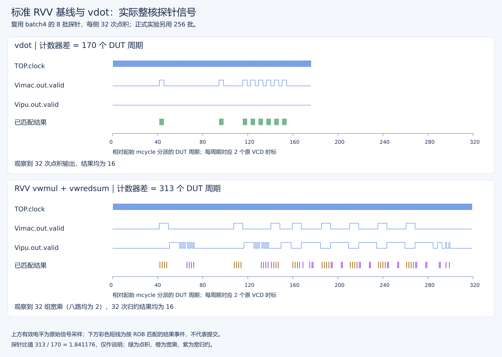

# 共享基准源码与历史 v2 入口

## Baseline 与 vdot 实际执行图



图中 RVV 通过 Vimac 宽乘和 Vipu 宽归约，vdot 直接产生点积；真实 valid 电平下的彩线是 PC/ROB 匹配的结果，不是提交。宽乘两个、宽归约四个输出微操作按同一 ROB 分组检查，中间部分和不能当最终答案。双方各 32 个点积均为 16。此处 170/313 周期属于旧 v0.1 核的 8 批探针，不能作为当前正式加速比。完整中文说明及正式统计图见[Baseline/vdot 图文对照](../reports/基线与vdot延迟加速图文分析.md)。

## 当前入口与历史使用说明

当前测量方法与选核统一见[v3测量手册](../docs/历史隔离核性能测量与复核手册v3.md)，最新隔离核全样本见[正式报告](../reports/隔离核正式性能分析报告v3.md)。本目录仍被v3包装复用源码，但下方构建/两镜像命令属于历史v2，不作为当前默认操作路线。

历史P0/v3完成了旧核同镜像运行时选序、动态计时边界及四进程正式数据审计，见 [P0方法与验收](../reports/P0完善与验收记录.md) 和 [旧核v3实测报告](../reports/原始核正式性能实测报告v3.md)。本目录仍保留v2构建入口；v3独立包装目录为 `../vdot-bench-p0/`，下文v2状态和两镜像协议为历史说明。

[正式实测报告](../reports/vdot正式性能实测报告v2.md) 的周期比 batch4=3.528318、e2e=2.141012、chain=4.128928；最大单组 CV=4.942%，通过门槛不代表没有波动。详见 [v2 方法与操作](../reports/性能测量可信度改进记录v2.md)。[v1 历史数据](../reports/vdot原始版本等价基线与性能实测.md) 保留，不与新版协议直接比较。

`bench_compute` 对 8 个定向输入的四种 ta/ma、1,000 个固定种子随机输入（策略轮换）执行独立 C oracle 检查，每个实现共 1,032 次。完整比较低 32 位与高 96 位，检查最终 e8/m1/VL=8、ta/ma、vstart=0、vxrm/vxsat 不变。高源字节也有随机毒化。

RVV 基线不是截断的 `vmul(e8)+vredsum`：使用 e8/m1 的 signed `vwmul.vv` 产生 e16/m2 产品组，切到 e16/m2 后用 `vwredsum.vs` 加 e32 零 seed。目标以 e32/m1 预清全 128 位，归约采用 tu，保留高 96 位零；最终恢复原 e8/m1/VL=8 与 ta/ma。临时组和输入/seed/输出互不重叠。

v2 正式配置：双方每内核预热 8 次、测量 8 次，每次 256 批 × 4 点积；每对样本交替先后，另一个镜像反转初始顺序。正式队列启动四个全新 emu，初始顺序各两次。全部测量和检查结束才统一打印；每次预热/测量均检查四个完整输出及最终 VL/vtype/vstart/vcsr。

采用固定 XS 实现的 `csrwi vstart,0` 建立 mcycle 前后串行边界。计时包含两条串行标记及循环控制等开销，初始化后的首次排空在计时外。不是通用 RISC-V 屏障或孤立 FU 延迟，动态边界波形仍需另外验证；原始周期不扣空循环。

| 测量 | 内容与口径 |
| --- | --- |
| batch4 | 输入预加载、目标/seed 初始化在计时外；4 个独立目标，正式配置重复使用 256 次。RVV 每批 4 宽乘 + 4 宽归约 + 2 配置；vdot 每批 4 条；含循环/串行计时开销，不是峰值 II |
| e2e | 在计时内每批执行相同的输入整寄存器加载、输出/seed 清零、计算、4 次整寄存器保存；双方都保留同样的初始化工作。内核末尾额外保存用于自检发生在计时外 |
| chain | 正式配置 1,024 次显式 `vd=vs1` 回馈到 v14。零固定点但有真实寄存器依赖；含循环和基线配置，不等于单元两拍 |
| empty | 正式配置 256 次 addi/bnez，采用相同计时标记；完整工作与内核不同，故不相减 |

所有计时结束后检查 4 个完整输出。batch4/e2e 输入低字节是 1 和 2，期望 16；chain 期望全零。结果检查发生在计时外。

```bash
source env.sh
bash cie2026-skito-SKIProject/scripts/build-vdot-bench.sh
bash cie2026-skito-SKIProject/scripts/run-vdot-bench-series.sh
```

短流程验证（双方各 32 定向、2 次预热/4 对测量，每次 32 点积、两个新进程；不是正式性能）：

```bash
bash cie2026-skito-SKIProject/scripts/build-vdot-bench.sh --smoke
bash cie2026-skito-SKIProject/scripts/run-vdot-bench-series.sh --smoke
```

`run-vdot-bench.sh` 只跑一次，默认 v2 full/order0，通过 `VDOT_IMAGE` 指定镜像；build 的 `--first=0|1` 仅构建一侧。新对象/镜像与 v1 分离；旧镜像未覆盖。正式 series 可用 `--runs=偶数` 增加独立重复，至少四次；串行运行、flock 防重复、失败即停。

`build-vdot-bench.sh --baseline-only` 使用独立镜像/对象目录，仅执行标准 RVV 正确性检查，不执行 custom 指令，也不进行 vdot 性能测量。该镜像只能用来预检参考兼容性。

分析器兼容 v1；严格检查 v2 元数据、双方等价性、完整重复、配对顺序、预热摘要和错误。JSON 包含原始值、中位数、范围、CV、前后半程漂移和位置影响；跨进程以各进程中位数/比值为单位，不池化虚增独立样本。默认 CV>5% 或漂移/顺序影响>10% 提示不稳定
